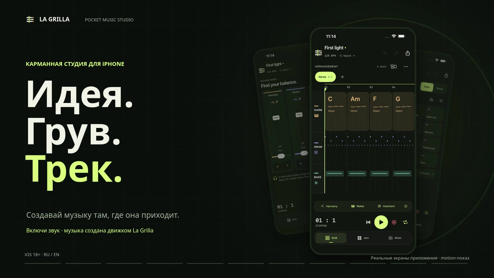

# La Grilla · Идея → грув → трек

**[▶ Полное промо со звуком · 1:36 · Full HD](https://github.com/alexgazin/la-grilla/raw/refs/heads/main/Media/Promo/la-grilla-promo.mp4)**

Анимированная витрина реальных экранов текущего приложения: крупная типографика,
плавное движение композиции, увеличенные фрагменты интерфейса и оригинальная
музыка. Это motion-дизайн на native-скриншотах, а не запись непрерывной сессии
на телефоне. Все исходные PNG в `Screenshots/OriginalVision` сохранены без изменений.

| Время | Глава |
| --- | --- |
| 0:00 | Идея. Грув. Трек. |
| 0:04 | Grid · аккорды, такты и секции |
| 0:12 | Arrange · клипы и форма трека |
| 0:20 | Jam · пэды, квантование, overdub |
| 0:28 | Notes · мелодия, бас, piano roll |
| 0:36 | Harmony · аккорды и стилизация |
| 0:44 | Assistant · локальные RU/EN Commands |
| 0:52 | Voice-to-MIDI · монофоническая beta |
| 1:00 | Perform · секции, фильтр, delay, live take |
| 1:08 | Mixer · фейдеры, pan, mute / solo |
| 1:16 | MIDI · input/output и CC Learn |
| 1:24 | Export · MIDI, WAV, stems и проект |
| 1:32 | La Grilla · твоя музыка |

## Музыка из самого приложения

96 секунд, 120 BPM, 4/4, 48 тактов. Оригинальная инструментальная композиция
с гармонией C–Am–F–G, собственной мелодией, басом и встроенными барабанами.
Звук отрендерен неизменёнными `MusicDomain.OfflineRenderer` и C++ `AudioDSP`.
Фильтр и delay в главе Perform — настоящая автоматизация этого движка.
Саундтрек не является записью показанного на скриншоте live take.
Внешняя музыка, семплы и вокал не использованы.

[Редактируемый музыкальный проект, MIDI и аудио-проверки](Audio/README.md) ·
[Воспроизвести саундтрек](../../Tools/PromoSoundtrack/README.md) ·
[Воспроизвести видео](../../Tools/Promo/README.md).

## Что именно показано

Все экраны — нативная сборка **1.0.0 (14)**, source `77fb72a`,
[принятый run 43771988471](https://github.com/alexgazin/la-grilla/actions/runs/43771988471).
Источники, хеши и параметры готового видео перечислены в [provenance.json](provenance.json).
Полный экран справа сохраняет пропорции; увеличенные фрагменты помечены отдельно.
Движение телефона и типографики относится к видеокомпозиции.

Assistant показан в работающем локальном режиме Commands; реальная
FoundationModels-генерация здесь не демонстрируется. Voice — подготовка записи
одной мелодии, beta с наушниками и ручной проверкой; распознанный живой напев
в ролике не показан. MIDI-кадр честно сохраняет видимые виртуальные QA-порты
и диагностику, включая два поздних входных события; это не подключение физического
USB/BLE-контроллера. Приложение ещё не опубликовано в App Store.

Брендовая иконка ранее создана через OpenArt —
[источник](../../Design/2026/openart-icon-generation.json).
Для этого ролика новые генерации OpenArt не запускались и кредиты не расходовались.
