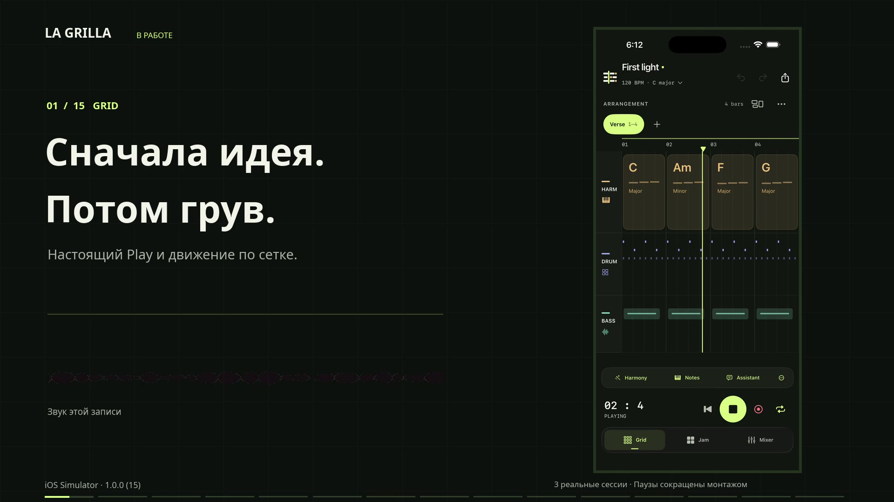

# La Grilla в работе

**[▶ Рабочая демонстрация · 2:12 · Full HD · со звуком](https://github.com/alexgazin/la-grilla/raw/refs/heads/main/Media/WorkingDemo/la-grilla-working-demo.mp4)**

[Полная запись сессии без монтажных сокращений](https://github.com/alexgazin/la-grilla/raw/refs/heads/main/Media/WorkingDemo/la-grilla-session-original.mp4) ·
[Монтажные интервалы](accepted-edl.json) · [Происхождение и проверки](provenance.json) ·
[Воспроизвести монтаж](../../Tools/NativeDemo/README.md).

Это запись работающего SwiftUI-приложения в **iOS 26.2 Simulator, iPhone 16 Pro Max**,
сборка **1.0.0 (15)**. Все нажатия, ввод и жесты выполнены XCTest через настоящие
элементы интерфейса. Начальное состояние — встроенная демопесня в отдельном
тестовом хранилище; последующие музыкальные действия сделаны через UI.
Изображение приложения не воссоздаётся и не анимируется из PNG.

В короткой версии 15 разделов и 36 исходных интервалов. Сокращены ожидания
автоматизации и разделены три сессии; действия идут с исходной скоростью.
Полный экран сохраняет пропорции. Титры, рамка, прогресс и осциллограмма
относятся к оформлению видео и находятся вне интерфейса приложения.

| Раздел | Что видно в настоящем приложении |
| --- | --- |
| Grid / Chord / Zoom | Play и движущийся счётчик, ввод Cmaj7, Set / Apply, два pinch-жеста. |
| Pads / Jam | Удары по пэдам, count-in, запись overdub, изменение шага. |
| Mixer / Notes | Pan, mute, добавление нот, Copy / Paste и Undo. |
| Harmony / Commands | A/B и применение локальной гармонии; текстовая команда tempo 108, review, Apply / Undo. |
| Voice | Подготовка монофонической записи, BETA · MONO. Живой напев и его распознавание не показаны. |
| Perform / Repeat / Take | Настоящий круговой фильтр, reset, delay, repeat и сохранённый take — 53,1 с / 10 событий. |
| Export / Share | WAV 48 kHz / 24-bit из проекта, настоящий рендер и файл в системном меню iOS. Это отдельный экспорт проекта, а не заявление об экспорте показанного live take. |

## Звук этой же сессии

Стерео записано отдельным macOS-приложением из **BlackHole 2ch**, куда направлен
выход Simulator. Разрешение получено обычным системным запросом. Базы TCC и
идентичность других приложений не менялись. Тестовый тон использовался только
для отдельной проверки канала записи; в демонстрационное видео он не включён.
Офлайн-саундтрек, чужая музыка и синтез вместо отсутствующего захвата не используются.

Исходный CAF: **600 с, 48 kHz, stereo Float32, 28 800 000 кадров**. Независимый
полный decode подтвердил конечные отсчёты, отсутствие клиппинга и ноль разрывов
sampleTime. Музыка присутствует во всех трёх сессиях; измерения отдельно
подтверждают начало Play, изменение стереобаланса, mute и high-pass фильтр.

Для слышимости применён один постоянный gain **+17 dB** с проверкой запаса
до клиппинга. В коротком монтаже на стыках есть fade по 15 мс; скорость звука,
его музыкальная структура и тембры не меняются. Лимитер и автоподмена звука не применяются.
Осциллограмма построена по выбранному реальному PCM.

## Синхронизация и честная граница исходного run

Источник — commit **`b4a584fc1cc60d73a97386986c2330ca7e45980c`**,
[run 43813957218](https://github.com/alexgazin/la-grilla/actions/runs/43813957218).
В нём **все три настоящих UI-метода прошли**: 267,834 / 69,662 / 110,545 с,
финальный `xcodebuild` завершился с кодом 0.

**Сам capture-workflow завершился FAILURE.** Его исходная проверка сравнила
записанный звук с моментом SIGINT после оформления `xcresult`: этот wall-clock
хвост продолжался примерно на 9,34 с дольше 600-секундного PCM. Статус не переписан
в SUCCESS. Это не неуспешное действие приложения: последний UI-маркер экспорта
имеет host time 1323,431, а PCM покрывает до 1379,783 — с запасом более 50 с.

Видео VFR содержит 537,737 с фактических PTS; неподвижный технический хвост
не продлил медиапоток до wall-clock остановки. **Весь фактический MP4 и все
выбранные интервалы покрыты настоящим звуком.** Это отдельно проверено по
полным потокам и всем 29 маркерам. Непокрытые кадры не публикуются и не заполняются
синтетической тишиной. Инструмент будущего захвата исправлен: останавливает медиа
после третьего PASS, затем всё равно требует финального успешного выхода Xcode.

Один постоянный сдвиг CAF относительно video PTS — **12,871520875 с**. Он
откалиброван по первому видимому Play/Stop и точному началу PCM; независимая
остановка спустя примерно 233 с дала остаток 159,6 мс внутри исходного VFR-интервала.
Растяжения времени нет. Это практическая синхронизация записи Simulator,
а не измерение задержки физического iPhone. Все исходные временные receipts
и их оговорки сохранены в provenance.

Перед монтажом VFR целиком переводится в CFR 30 с удержанием предыдущего
реального кадра до следующего PTS. Это сохраняет неподвижные Voice и Share;
прямой seek к будущему кадру мог бы ошибочно показать уже следующий экран.
Оптическая интерполяция и генерация кадров не используются.

Исходные MP4/CAF и `xcresult` сохранены в
[артефакте 14202272642](https://github.com/alexgazin/la-grilla/actions/runs/43813957218/artifacts/14202272642);
API размер и SHA-256 ZIP проверены. Артефакты Actions имеют ограниченный срок
хранения; полная доступная для просмотра сессия и короткая версия входят в репозиторий.

Новая модель FoundationModels, живой голос, физические USB/BLE-контроллеры,
аппаратные аудиомаршруты и публикация в App Store этим видео не подтверждаются.
[Открытая приёмка C8](../../docs/release/DEVICE_ACCEPTANCE.md).
