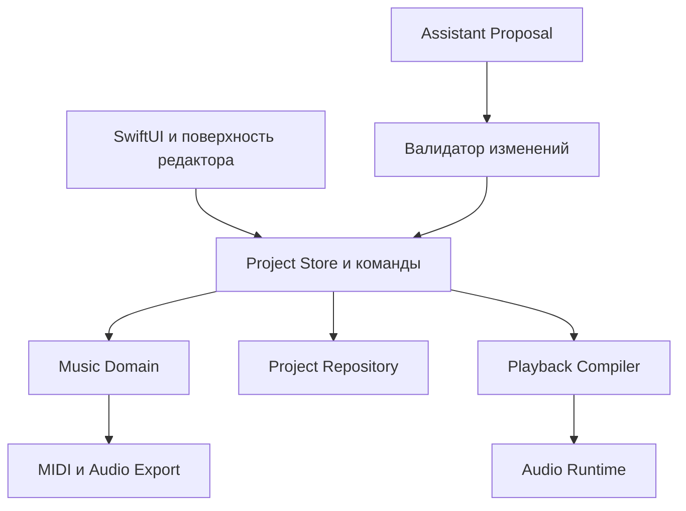
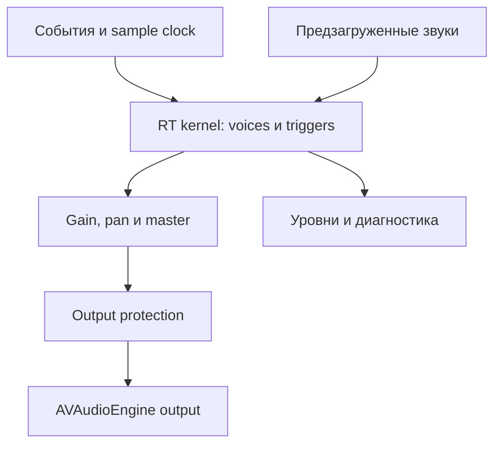
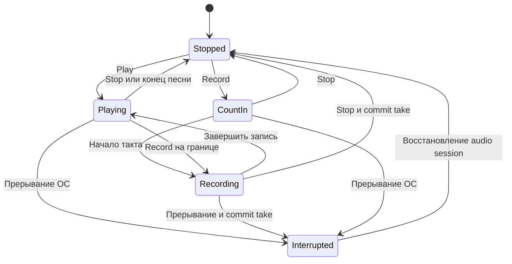
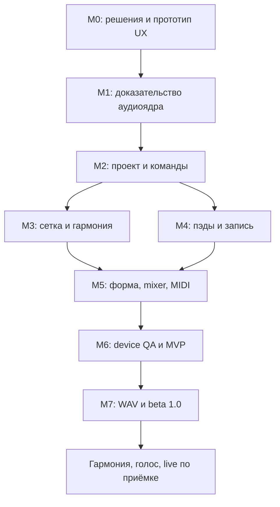

# La Grilla

[](https://github.com/alexgazin/la-grilla/actions/workflows/ios.yml?query=branch%3Amain)

**Карманная студия для iPhone: придумать гармонию, сыграть бит, собрать форму трека и продолжить работу в большой DAW.**

Рабочее название: **La Grilla** («сетка»). Платформа: **iOS, SwiftUI, нативный аудиодвижок**. Основной язык этой спецификации — русский; пользовательский интерфейс локализован на RU/EN.

> **Программная реализация исходного видения — 1.0.0 (14), schema 8:** C1–C7 реализованы и прошли [полный native run](https://github.com/alexgazin/la-grilla/actions/runs/43771988471) для source `77fb72ab82cd800eb8131136628c416ad83c9046`: 118 Swift tests / 19 suites, 15 C++ suites, 44 functional workflows и 3 capture methods. Сохранены [73 индивидуально проверенных оригинала](Screenshots/OriginalVision), [12 неизменённых Store-копий EN/RU](Screenshots/AppStore) и обновлённые [превью](Screenshots). [PR #13](https://github.com/alexgazin/la-grilla/pull/13) содержит интеграцию; badge выше ведёт к проверкам текущего `main`.

Реализованы 65 качеств аккордов и пользовательские формулы, перенос/копирование/resize клипов и секций, масштабирование с сохранением времени под пальцами и атомарные live-правки. Голос записывается поверх бита с сохранением исходника; доступны ручная коррекция, круговой DJ filter и Assistant с review/Apply/Undo целой песни. FoundationModels используется только на поддерживаемом устройстве/языке; локальные RU/EN Commands доступны отдельно.

[ROADMAP](ROADMAP.md) · [Подробный план C0–C8](docs/ORIGINAL_VISION_COMPLETION.md) · [Журнал этапов и исправлений](docs/IMPLEMENTATION_LOG.md) · [Принятая QA и ограничения](docs/release/C7_ACCEPTANCE.md) · [Запуск на своём iPhone через Xcode](docs/DEVELOPMENT.md#run-on-your-own-iphone).

Физическая приёмка C8, реальная модель/живой напев, установка и запуск на iOS 18, signing/TestFlight и App Review ещё не выполнены. Разрывы временных меток рендера и качество голосового черновика описаны в QA; физическая непрерывность звука требует измерений, расшифровку можно проверить и исправить вручную. Приложение не опубликовано в App Store.

**Дизайн:** [исходные UX/UI требования](DESIGN_PROMPT.txt). Ниже сохранены первоначальная продуктовая спецификация и backlog; их будущие формулировки не заменяют актуальные результаты в [Release QA](docs/RELEASE_QA.md).

## Содержание

1. [Продукт и его ценность](#1-продукт-и-его-ценность)
2. [Продуктовые решения](#2-продуктовые-решения)
3. [Версии и границы MVP](#3-версии-и-границы-mvp)
4. [Основные сценарии](#4-основные-сценарии)
5. [Экраны и взаимодействия](#5-экраны-и-взаимодействия)
6. [Музыкальная модель](#6-музыкальная-модель)
7. [Гармоническая лаборатория](#7-гармоническая-лаборатория)
8. [Битмейкинг и запись](#8-битмейкинг-и-запись)
9. [Архитектура iOS](#9-архитектура-ios)
10. [Аудиодвижок и транспорт](#10-аудиодвижок-и-транспорт)
11. [Хранение и восстановление](#11-хранение-и-восстановление)
12. [MIDI и аудиоэкспорт](#12-midi-и-аудиоэкспорт)
13. [Голосовые команды и ИИ](#13-голосовые-команды-и-ии)
14. [Voice-to-MIDI](#14-voice-to-midi)
15. [DJ Performance](#15-dj-performance)
16. [Внешние MIDI-контроллеры](#16-внешние-midi-контроллеры)
17. [Качество и производительность](#17-качество-и-производительность)
18. [План проверок](#18-план-проверок)
19. [План разработки](#19-план-разработки)
20. [Backlog с приёмкой](#20-backlog-с-приёмкой)
21. [Готовность к релизу](#21-готовность-к-релизу)
22. [Данные, контент и монетизация](#22-данные-контент-и-монетизация)
23. [Риски и решения](#23-риски-и-решения)
24. [Порядок работы разработчика](#24-порядок-работы-разработчика)
25. [Источники](#25-источники)

## 1. Продукт и его ценность

### 1.1. Что это за приложение

La Grilla соединяет три способа создавать музыку:

- **Композиторский:** тональность, аккорды, обращения, мелодия, такты и секции.
- **Исполнительский:** пальцевый бит, повторяющийся грув, запуск секций и управление эффектами.
- **Разговорный:** описание структуры словами и помощь в преобразовании музыкального материала.

Главная единица результата — **редактируемый музыкальный проект** с нотами, ритмом и формой. Любое предложение помощника должно превращаться в понятные музыкальные изменения, которые можно прослушать, поправить и отменить.

**Обещание первой версии:** «За несколько минут собери собственный гармонический луп с битом, преврати его в небольшую композицию и сохрани MIDI для дальнейшей работы».

### 1.2. Для кого

| Пользователь | Задача | Что должно получиться |
| --- | --- | --- |
| Начинающий музыкант | Услышать идею без знания всех нот | Выбрать тональность, аккорды и готовый ритмический старт |
| Битмейкер | Быстро записать грув и гармонию вне студии | Пэды, overdub, стабильный луп, перенос в DAW |
| Автор песен | Набросать куплет и припев | Именованные секции с независимыми аккордами |
| Продюсер | Сохранить музыкальную заготовку | MIDI с темпом, дорожками и предсказуемыми нотами |
| Исполнитель, поздние версии | Поиграть своей композицией как инструментом | Квантованный запуск секций, фильтр, FX, запись исполнения |

Первый приоритет — автор идеи и битмейкер, которому нужен быстрый переход от аккордов к звучащему лупу. Интерфейс не должен требовать подготовки полноценного студийного проекта до первого звука.

### 1.3. Почему одного набора функций недостаточно

Live Loops уже есть в GarageBand, а мобильное создание музыкальных набросков и перенос в Live — в Ableton Note. Это подтверждают руководства производителей [S1–S2]. Поэтому наличие пэдов, сетки или «ИИ» само по себе не доказывает востребованность и уникальность приложения.

**Проверяемая гипотеза отличия:** связка «понятная гармония → объяснимые преобразования → непрерывный джем → переносимый результат» окажется удобнее для конкретной задачи, чем переключение между несколькими инструментами.

До расширения продукта провести 5–8 наблюдаемых сессий с музыкантами: дать одну задачу — собственный восьмитактовый луп и две секции — и посмотреть, где они останавливаются. Вопросы: понятно ли, что звучит; удаётся ли исправить результат; хотят ли вернуться со своей следующей идеей. Размер этой выборки подходит для поиска проблем UX, но не для доказательства рыночного спроса.

### 1.4. Что не обещаем

Автоматический коммерческий хит, профессиональное сведение одной кнопкой, распознавание любой полифонической записи, полную совместимость с проектами Ableton и прямую публикацию в Spotify не закладывать в обещания продукта. Поддерживаемые сценарии описаны по версиям ниже.

## 2. Продуктовые решения

| Вопрос | Решение | Причина |
| --- | --- | --- |
| Формат | Нативное приложение iPhone; iPad после проверки основной эргономики | Аудиозадержка и жесты требуют реального устройства |
| Минимальная ОС | Проектный baseline — iOS 18; проверить совместимость в техническом этапе | Не привязывать основной сценарий к новейшим ИИ-возможностям ОС |
| Инструменты | Swift 6, SwiftUI; при необходимости UIKit для сетки и multitouch | Простые экраны нативные, сложные жесты изолированы |
| Звук | AVAudioEngine / Audio Toolbox; AudioKit только после измеримой необходимости | Нужен контролируемый timing и воспроизводимый экспорт |
| Первый результат | Harmony + Drums, до трёх дорожек с опциональным Bass | Достаточно для законченного музыкального наброска |
| Режим работы | Локально, без аккаунта и без интернета в MVP | Сохранение идеи не зависит от сети |
| Источник истины | Собственная событийная модель проекта | Одинаковая музыка в UI, воспроизведении и экспорте |
| ИИ | Предлагает типизированные изменения; музыкальные ограничения проверяет приложение | Текст модели не исполняется как код и не меняет проект бесконтрольно |
| Запись | Сначала MIDI-события и one-shot инструменты | Time-stretch и аудиоклипы резко увеличивают объём работы |
| Выпуск | Внутренний MVP → TestFlight → публичная 1.0 | Польза и надёжность проверяются до расширения функций |

Это стартовые решения, а не требования к уже существующему коду. Изменение решения оформлять прямо в этом README: что меняется, почему и какой критерий приёмки затронут.

## 3. Версии и границы MVP

### 3.1. v0.1 — минимальный работающий музыкальный инструмент

| Входит | Конкретный объём |
| --- | --- |
| Проекты | Создать, переименовать, дублировать, сохранить, открыть, удалить с подтверждением; демопроект |
| Транспорт | Play/Stop, запись барабанов, метроном, count-in, BPM 40–240, размер 4/4 |
| Сетка | Горизонтальный мультитрековый таймлайн, такты, секции, pinch-to-zoom, drag с привязкой |
| Форма | До 64 тактов и 8 последовательных секций; названия Intro/Verse/Chorus/Outro или свои |
| Дорожки | Harmony и Drums; третья Bass добавляется по желанию |
| Гармония | 12 корней, major/minor, dim, aug, sus2/sus4, 7, maj7, m7, m7b5; выбор обращения |
| Ввод аккордов | Picker и строгий локальный парсер обозначений; без свободных текстовых команд |
| Барабаны | 4×4 пэда, один комплект из 16 разрешённых к распространению one-shot звуков, step editor |
| Запись | Overdub/Replace, квантование 1/8 или 1/16 и Off, Undo последнего прохода |
| Луп | 1/2/4/8 тактов, перемещение по вкладкам не прерывает звук |
| Бас | Простой паттерн корней аккордов с регистром и громкостью; без генератора сложных партий |
| Звуки | Один гармонический тембр, один басовый, один drum kit; прослушивание аккорда до добавления |
| Микшер | Вертикальные фейдеры, pan, mute/solo, master, индикатор перегруза |
| Экспорт | MIDI Type 1 с темпом, размером, именами дорожек, нотами и маркерами секций |
| Надёжность | Автосохранение, восстановление, обработка аудиопрерываний, работа офлайн |

**Не входят в v0.1:** запись вокала, Voice-to-MIDI, диктовка, свободные ИИ-команды, DJ FX, WAV/stems, внешние MIDI-устройства, AUv3-плагины, синхронизация между устройствами, импорт чужих аудиопетель, смены темпа/размера внутри трека.

Сценарий MVP заканчивается экспортированным MIDI и сохранённым проектом. Для публичного релиза 1.0 дополнительно нужен аудиоэкспорт, чтобы результатом можно было поделиться без сторонней DAW.

### 3.2. Последующие этапы

| Версия | Добавление | Условие начала |
| --- | --- | --- |
| v0.2 | WAV mixdown, выровненные stems, переносимый проект; ручное редактирование мелодии, до 8 дорожек | v0.1 проходит техническую приёмку и пользовательские сессии |
| v0.3 | Расширенные аккорды, voicing, локальная стилизация, текстовые команды, preview изменений | Стабильная модель команд и undo |
| v0.4 | Диктовка команд и монофонический Voice-to-MIDI | Подтверждённый pipeline записи и тестовый набор голосов |
| v0.5 | DJ Performance, запись лайва, USB/BLE MIDI | Общий транспорт выдерживает live-edit и восстановление |
| v1.0 | Полировка выбранного набора, доступность, TestFlight, выпуск | Пройдены релизные ворота из раздела 21 |

Нумерация обозначает зависимость работ. Если голос или live не проходят измеримую приёмку, их можно оставить на следующую публичную версию, выпустив 1.0 с завершённым ядром и честным описанием возможностей.

## 4. Основные сценарии

### 4.1. От пустого проекта до собственного лупа

1. Нажать «Новый проект». Сразу доступны пэды и кнопка Play.
2. Установить 120 BPM, C major, 4/4 и длину лупа 4 такта.
3. В Harmony поставить `C | Am | F | G`, по одному аккорду на такт.
4. Запустить луп. Открыть Drums, включить count-in и записать kick/snare/hat.
5. Перейти обратно в Harmony: ритм и позиция транспорта продолжаются.
6. Исправить один аккорд, отменить неудачный проход ударных.
7. Добавить простой бас по корням, сохранить проект и экспортировать MIDI.

Для новичка предусмотреть «Послушать пример» и шаблон гармонии. Шаблон не должен выдаваться за авторскую композицию пользователя.

### 4.2. Из лупа в трек

1. Назвать первые 8 тактов Verse.
2. Дублировать секцию как Chorus. Операция создаёт независимую копию клипов.
3. Изменить гармонию и плотность барабанов в Chorus.
4. Добавить Intro и Outro; переставить секции.
5. Выключить режим Loop и прослушать Arrangement от начала до конца.
6. Экспортировать всю аранжировку либо выделенный диапазон.

### 4.3. «Поджазовать», после MVP

Выделить 4 такта → «Изменить гармонию» → выбрать степень изменения → услышать A/B → увидеть, какие аккорды и ноты изменятся → применить или отклонить. Пример: `C | Am | Dm | G` → `Cmaj7 | Am7 | Dm9 | G13`. Выход за тональность доступен отдельным уровнем, а не скрытым побочным эффектом.

### 4.4. Напеть мелодию, после MVP

Выбрать такты, надеть наушники, записать одну мелодическую линию под метроном. После записи увидеть исходный контур высоты и MIDI-ноты с сомнительными фрагментами. Исправить октаву/ритм, прослушать голос и инструмент по очереди, затем добавить результат в проект.

### 4.5. Сыграть live, после MVP

Запустить секцию, поставить следующую в очередь, временно изменить фильтр и beat-repeat. При включённой записи исполнения сохранить фактически сыгранную последовательность и автоматизацию. Обычная аранжировка меняется только отдельной командой «Создать аранжировку из исполнения».

## 5. Экраны и взаимодействия

### 5.1. Информационная архитектура

| Экран | Основное действие | Что всегда видно |
| --- | --- | --- |
| Projects | Открыть или создать проект | Название, дата, длительность, состояние сохранения |
| Grid | Редактировать форму и аккордовые события | Такты, секции, дорожки, выделение, playhead |
| Jam | Играть пэды и записывать паттерн | Пэды, длина лупа, Record, Overdub/Replace |
| Mixer | Настроить баланс | Фейдеры, dB, mute/solo, уровни |
| Export, sheet | Сохранить результат | Формат, диапазон, состав экспорта |
| Assistant, после MVP | Подготовить изменение | Исходная команда, предложение, A/B, Apply/Cancel |
| Perform, после MVP | Играть секциями и FX | Активная/следующая секция, фильтр, запись live |

Внутри проекта транспорт закреплён над нижней навигацией: Play/Stop, Record по контексту, позиция, BPM, Loop. Переключение редакторов сохраняет позицию, выделение и звучание. Переключение на другой проект останавливает текущий после сохранения.

### 5.2. Grid на iPhone

- Portrait — основной режим. Landscape даёт больше тактов и увеличенные пэды; поворот не пересоздаёт аудиодвижок.
- Слева закреплены заголовки дорожек; сверху линейка тактов и ряд секций. Горизонтальная прокрутка синхронна для всех дорожек.
- На общем масштабе показывать форму, цвет дорожек и краткие символы аккордов; на крупном — доли, длительности и ручки изменения.
- Нажатие на аккорд открывает bottom sheet: корень, качество, расширения, бас, обращение, Preview.
- Аккорд — событие внутри гармонического клипа. Клип — контейнер; их ручки редактирования должны выглядеть различно.
- Новичку доступны названия аккордов и подсказки, опытному — степени и интервалы. Режимы меняют отображение, а не содержимое музыки.

### 5.3. Контракт жестов

| Жест | Результат | Защита от ошибки |
| --- | --- | --- |
| Tap по пустой гармонической ячейке | Создать/выбрать аккордовое событие | Предварительное прослушивание отдельно от подтверждения |
| Tap по элементу | Выделить | Не запускает случайное перемещение |
| Long press + drag | Переместить клип/аккорд | Видны исходная позиция, целевой такт и snap |
| Drag за край | Изменить длину | Минимальная длина и граница секции проверяются |
| Pinch | Изменить горизонтальный масштаб | Точка под центром жеста остаётся на том же музыкальном времени |
| Drag по фону | Прокрутить | Не создаёт ноты и не запускает пэды |
| Double tap по фейдеру/ручке | Вернуть значение по умолчанию | Значение подписано; доступна отмена |
| Контекстное меню | Duplicate/Delete/Copy | Удаление больших объектов подтверждается; undo доступен |

Арбитраж жестов определить до реализации: pinch отменяет незавершённый drag без коммита; фон обрабатывает прокрутку; захваченный элемент перемещается только после long press. Не хранить по одной интерактивной SwiftUI View на каждую линию большой сетки: использовать Canvas/рисование и отдельный hit-testing видимых элементов. Если конфликт жестов не удаётся стабилизировать, заменить поверхность редактора на `UIViewRepresentable`, сохранив доменную модель.

### 5.4. Доступность и визуальный язык

Минимальные цели касания — 44 pt; мелкие музыкальные события получают увеличенную область выбора. Цвет дополняется названием, формой и состоянием. Для VoiceOver предусмотреть список событий с командами «сдвинуть на долю», «увеличить длительность», «прослушать», «удалить». Dynamic Type обязателен для меню, форм и справки; для сетки — масштаб и альтернативный список. Проверить Reduce Motion, светлую/тёмную тему, контраст и левую/правую руку.

Стиль — спокойная тёмная рабочая поверхность, ясные границы тактов, один акцент транспорта и постоянные цвета дорожек. Музыкальные инструменты не перекрывать декором. Оформление и терминология должны быть собственными; Ableton/MPC используются как ориентиры взаимодействия, а не как название или обещание совместимости.

## 6. Музыкальная модель

### 6.1. Время

**Единица проекта — целочисленный tick. PPQ = 960 ticks на четверть.** Секунды и координаты экрана вычисляются из ticks; их нельзя сохранять как единственный источник музыкальной позиции.

Для постоянного темпа и размера:

```text
ticksPerBar = PPQ × numerator × 4 / denominator
seconds(tick) = tick × 60 / (BPM × PPQ)
sampleFrame(tick) = round(seconds(tick) × actualSampleRate)
```

В 4/4 один такт = 3840 ticks, восьмая = 480, шестнадцатая = 240. При 120 BPM четверть = 0,5 s, такт = 2 s. Внутри проекта первый tick и индекс первого такта равны 0; в UI первый такт отображается как 1. Для 64 тактов длительность проекта при 120 BPM — 128 s.

`sampleFrame` считать от стабильной опорной позиции, а не прибавлять округлённую длительность каждой доли: так не накапливается ошибка. После смены аудиомаршрута sample rate брать заново и создавать новую привязку времени.

### 6.2. Основные сущности

| Сущность | Поля и смысл |
| --- | --- |
| Project | `id`, `schemaVersion`, `revision`, название, BPM, размер, тональность, tracks, patterns, sections, arrangement |
| Track | Стабильный UUID, имя, роль `harmony/drums/bass/melody`, инструмент, gain, pan, mute, solo |
| Pattern | UUID, длина в ticks, тип содержимого, локальные события; музыкальный материал без позиции в песне |
| ClipInstance | UUID, `patternID`, `startTick`, `lengthTicks`, `patternOffsetTick`; размещение паттерна на дорожке |
| Section | UUID, название, `startTick`, `lengthTicks`; диапазон музыкальной формы |
| ChordEvent | Локальный tick, duration, буквенный корень, качество, extensions/alterations, slash bass, voicing |
| NoteEvent | UUID, локальный tick, duration, MIDI pitch 0–127, velocity 1–127, канал при необходимости |
| DrumEvent | UUID, локальный tick, padID, velocity; drum-map связывает pad и MIDI note |
| InstrumentPreset | Стабильный ID и версия тембра, настройки, ссылки на разрешённые assets |
| TransportState | Состояние, tick, loop range, режим arrangement/jam/perform; runtime, не музыкальный контент |
| PerformanceTake | После MVP: секции, параметры, note/trigger events и время исполнения |
| AssetRecord | Относительный путь, hash, формат, назначение, сведения о лицензии |

В v0.1 дублирование клипа/секции создаёт новые независимые паттерны. Связанные копии — отдельная будущая функция с явным значком. Это предотвращает ситуацию «поправил припев и незаметно изменил куплет».

### 6.3. Инварианты

1. Время начала неотрицательное, длительность положительная, события помещаются в паттерн.
2. Loop — полуоткрытый интервал `[startTick, endTick)`, конец строго больше начала. Событие на `endTick` относится к следующему проходу.
3. В v0.1 одна дорожка не содержит перекрывающиеся clip instances. Harmony не содержит одновременно активные разные аккорды.
4. Секции в v0.1 покрывают песню последовательно без перекрытий и дыр; вставка/удаление/перестановка выполняется одной ripple-операцией.
5. Ноты хранить как события с длительностью; при компиляции получать NoteOn/NoteOff. При одинаковом времени NoteOff для той же ноты идёт перед новым NoteOn.
6. На Stop, seek, замену проекта, удаление звучащей дорожки и разрыв MIDI отправлять завершение активных нот и очищать sustain.
7. Операции проверяются до изменения проекта. Неудачная команда не оставляет частично изменённые секции.
8. Гармония и сгенерированный бас компилируются из одной revision проекта.
9. Прослушивание предложения ИИ использует временный snapshot. Оно не изменяет сохранённые ноты.
10. Экспорт использует зафиксированный snapshot; изменения во время экспорта не меняют начатый файл.

### 6.4. Режимы воспроизведения

**Arrangement:** последовательно исполняет clip instances и завершает песню на конце диапазона. **Jam:** повторяет выбранный диапазон; интерфейс всегда показывает его начало и длину. **Perform:** после MVP исполняет секции по действиям пользователя и записывает их порядок в отдельный take.

В MVP ноты на конце лупа обрезаются по границе с корректным NoteOff. Tie через границу и свободная фаза клипов появятся только отдельной функцией. При перемещении playhead внутрь длинного аккорда движок восстанавливает активное состояние; не нужно ждать следующего аккорда, чтобы услышать гармонию.

### 6.5. Тональность и транспонирование

Тональность — контекст подсказок. Её изменение само по себе не сдвигает написанные ноты. Отдельная команда «Транспонировать проект» предварительно показывает число полутонов, затронутые дорожки и ноты вне диапазона; Drums исключены. Pitch class хранить отдельно от буквенного написания, чтобы C♯ и D♭ могли звучать одинаково, сохраняя правильное обозначение.

### 6.6. Эталонный музыкальный пример

Контрольный четырёхтактовый проект: 120 BPM, 4/4, C major, PPQ 960. Это точные ожидаемые данные для первого вертикального сценария:

| Такт в UI | Начало, ticks | Аккорд | Ноты закрытого voicing, MIDI | Длительность, ticks |
| --- | --- | --- | --- | --- |
| 1 | 0 | C | 60, 64, 67 | 3840 |
| 2 | 3840 | Am | 57, 60, 64 | 3840 |
| 3 | 7680 | F | 53, 57, 60 | 3840 |
| 4 | 11520 | G | 55, 59, 62 | 3840 |

Общая длина — 15360 ticks / 8 s. Root bass: 36, 33, 29, 31, по одному событию на такт с gate 90%; drum-map: kick 36, snare 38, closed hat 42 на канале 10. В каждом такте kick в offsets 0/1920, snare 960/2880, hat каждые 480 ticks. Числа нот однозначны независимо от различий в обозначении октав между DAW. Это тестовый паттерн поведения, а не требование использовать только такое расположение голосов во всех проектах.

Будущий JSON document обязан хранить `schemaVersion`, `revision`, tempo/meter, UUID-ссылки, локальные ticks и presets с версиями. Конкретную полную сериализованную схему зафиксировать вместе с первым валидатором LG-005; до этого пример proposal из раздела 13 не является форматом сохранения проекта.

## 7. Гармоническая лаборатория

### 7.1. Словарь вместо бесконечного списка строк

«Полная база аккордов» реализуется как **правила построения**: корень + интервальная формула + расширения/альтерации + бас + voicing. Не перечислять вручную все сочетания корней, регистров и обращений.

| Тип | Пример от C | Интервалы в полутонах от корня |
| --- | --- | --- |
| Major | C | 0, 4, 7 |
| Minor | Cm | 0, 3, 7 |
| Diminished | Cdim | 0, 3, 6 |
| Augmented | Caug | 0, 4, 8 |
| Suspended | Csus2 / Csus4 | 0, 2, 7 / 0, 5, 7 |
| Dominant seventh | C7 | 0, 4, 7, 10 |
| Major seventh | Cmaj7 | 0, 4, 7, 11 |
| Minor seventh | Cm7 | 0, 3, 7, 10 |
| Half-diminished | Cm7b5 | 0, 3, 6, 10 |
| Ninth, после MVP | C9 / Cmaj9 | 0, 4, 7, 10, 14 / 0, 4, 7, 11, 14 |
| Altered, после MVP | C7b9 | 0, 4, 7, 10, 13 |

После MVP добавить 6, m6, add9, dim7, 9/11/13, #11, b9/#9, b5/#5, slash chords и пользовательские интервальные формулы. `Cadd9` и `C9` различаются наличием септимы. Расширение 13 не означает, что любой voicing обязан играть все промежуточные ступени. База формул и правила опускания нот версионируются и проверяются тестами.

### 7.2. Ввод и voicing

Локальный парсер должен принимать документированный набор обозначений: `C`, `Cm`, `Cmaj7`, `C7`, `Cm7b5`; slash и расширения включаются вместе с соответствующей версией. Unicode ♭/♯ нормализуются. Неизвестное обозначение даёт понятную ошибку и открывает picker; парсер не угадывает молча.

Расположение нот решается отдельно от названия аккорда: регистр, обращение, число голосов, закрытое/открытое расположение, сохранение верхнего голоса. В v0.1 доступны закрытое расположение и обращения; более сложные варианты — после MVP.

Для voice leading генерировать ограниченный набор допустимых расположений и минимизировать стоимость: суммарное движение голосов + штраф выхода из регистра + штраф нежелательного пересечения + штраф чрезмерной плотности. Ограничить число кандидатов и время вычисления; выполнять вне аудиопотока. Мелодическая совместимость — дополнительный штраф, а не запрет любой неаккордовой ноты.

### 7.3. Стилизация «поджазовать»

Три режима после MVP:

1. **Мягко:** септимы/добавочные ступени и плавные обращения, без изменения корней.
2. **Выразительнее:** функциональные расширения и разрешённые вторичные доминанты; хроматика помечается.
3. **Реharm:** замены и проходящие аккорды с ограничением количества изменений и защитой мелодии.

Для каждого кандидата показать изменённые символы, звучащие ноты, краткую причину и фрагменты вне исходной тональности. «Сделать джазовым» не равно «добавить maj7 ко всему»: например, в C major доминанта G7 имеет другую функцию, чем Gmaj7.

Первую стилизацию сделать локальным набором музыкальных правил. ИИ при наличии выбирает направление и параметры, но валидатор и движок voicing остаются детерминированными. Любой применённый вариант материализуется в сохраняемые события и отменяется одной операцией.

## 8. Битмейкинг и запись

### 8.1. Пэды

4×4 пэда, 16 фиксированных MIDI-сопоставлений и один качественный набор звуков. Названия и цветовые семейства: kick, snare/clap, closed/open hat, toms, percussion, cymbals. Точный состав зафиксировать при подготовке звуков. Closed/open hat объединить в choke group: закрытый hat завершает открытый с коротким затуханием.

Срабатывание — на touch-down, не на отпускание пальца. Пэды поддерживают несколько одновременных касаний; каждое имеет собственный идентификатор. Давление на экран iPhone не считать достоверным velocity: начальное velocity фиксированное, редактируется в step editor; позже можно добавить явные velocity-зоны.

Во время игры уже загруженные звуки не читаются с диска. Переключение вкладок и открытие sheet не выгружает инструменты. Нажатия по пэдам сразу слышны: квантование применяется к записанным событиям и их последующим проходам, а не задерживает каждый удар до ближайшей доли.

Для MVP root bass использует простой oscillator preset с envelope; Harmony — небольшой заранее загруженный собственный/лицензированный sample-instrument. Изменение pitch должно сохранять достаточное качество в заявленном регистре; диапазон и число multisamples выбираются в M1. Для записи MIDI учитывать timestamp касания, привязку host/audio time и измеренную маршрутную компенсацию; не вычитать одну и ту же константу «Bluetooth latency» для всех устройств. Политику компенсации и её единицы записать в результатах M1.

### 8.2. Режимы записи

| Режим | Поведение |
| --- | --- |
| Count-in | 1 такт; удары до начала записи слышны, но не сохраняются |
| Overdub | Новый проход добавляет события к выбранному паттерну |
| Replace | Первый полный записываемый проход заменяет содержимое выбранного паттерна; исходник сохраняется для Undo |
| Record Off | Пэды звучат, проект не меняется |
| Step | Tap добавляет/удаляет удар в выбранном шаге; velocity меняется отдельно |

Record во время воспроизведения вооружает запись на следующую границу такта; UI показывает countdown. Завершение записи сохраняет уже сыгранный материал. Выход из проекта сначала завершает take и сохраняет его; сбой сохранения показывается пользователю.

### 8.3. Квантование и цикл

Для сетки `q` ticks и позиции `t`: `quantized = q × round(t / q)`, точную половину округлять вперёд. В лупе результат на его правой границе преобразуется в начало следующего прохода и нормализуется в локальную позицию паттерна. Исходный timestamp сохраняется до фиксации take, чтобы будущая версия могла дать strength-квантование.

Не проигрывать живой удар второй раз немедленно после записи его в snapshot: «слышимый ввод» и «сохранённое событие будущего прохода» имеют разные роли. На последующих оборотах событие играет один раз. Два намеренных удара в одном шаге не удалять автоматически; step editor показывает наложение и позволяет объединить.

Один завершённый проход — одна undo-транзакция. Если запись длится несколько оборотов, хранить завершённые проходы отдельно; незавершённый проход фиксируется на Stop. Replace действует один раз в начале take, последующие обороты overdub до Stop — это состояние видно рядом с Record.

Swing, note repeat, probability, ratchets и генеративные паттерны — после MVP. Их данные, если появятся, нужно материализовать либо сохранять вместе с seed, чтобы повторный экспорт давал ту же музыку.

## 9. Архитектура iOS

### 9.1. Слои и зависимости



Стрелка означает обращение к API/передачу данных. Domain не импортирует SwiftUI, AVFoundation, сетевой SDK или файловые API. Экспорт и воспроизведение используют одинаковую компиляцию нот и музыкального времени.

### 9.2. Модули

| Модуль | Ответственность | Что в нём запрещено |
| --- | --- | --- |
| App / Features | Навигация, экраны, onboarding, доступность | Владеть render clock или пересоздавать engine при уходе со страницы |
| MusicDomain | Ticks, события, аккорды, voicing, команды, валидация | Зависеть от UI, сети или конкретного аудиомаршрута |
| ProjectStore | Единое состояние проекта, revision, undo/redo, dirty-state | Выполнять аудиорендер на MainActor |
| PlaybackCompiler | Из модели в упорядоченные ноты, triggers и runtime snapshot | Читать View state и запрашивать ИИ |
| AudioRuntime | Один engine, transport, инструменты, очередь событий, телеметрия | Дисковый/сетевой ввод, аллокации и ожидание в render callback |
| Persistence | Пакет проекта, миграции, autosave, восстановление | Сохранять недопустимую схему частично |
| Export | MIDI и отдельный offline render; progress/cancel | Экспортировать изменяющийся проект без snapshot |
| Assistant, позже | Распознавание запроса, proposal, preview | Применять произвольный код или менять проект без валидатора |
| MIDIAdapter, позже | Endpoints, timestamp conversion, mapping | Передавать callback напрямую в SwiftUI |

На старте достаточно app target + локальный Swift Package для Domain + небольшой native audio target. Не создавать десяток пакетов без реальной необходимости. Границы важнее количества Xcode targets.

### 9.3. Владение и потоки

- `AppContainer` создаётся на уровне приложения и владеет `AudioEngineService`, repository и текущей project session.
- `ProjectStore` — на `MainActor`; тяжёлое построение snapshot выполняется отдельно и возвращает результат с revision.
- `PersistenceActor` сериализует файловые операции; `ExportActor` ограничивает экспорт одним заданием.
- Сетевые/ASR/pitch-задачи работают вне UI и audio threads; отменяются при закрытии контекста.
- Render callback работает с заранее выделенными буферами, фиксированными структурами и подготовленными событиями. Actors, `await` и `Task` внутри него не используются.
- Обратная связь движка передаёт небольшой runtime snapshot; UI считывает его с частотой до 30–60 Hz. UI не наблюдает за каждым аудиосэмплом.

Swift strict concurrency проверяет передачи между обычными потоками, но не гарантирует real-time безопасность. Для render-критичной части изначально планируется маленькое C/C++ ядро, подключённое к `AVAudioSourceNode`; интерфейс к Swift передаёт POD-данные и handles. Если технический этап докажет более простой эквивалентный путь с нативными AU-инструментами, решение можно заменить до основной реализации, сохранив тесты timing. Смешивать два независимых секвенсора в продукте нельзя.

### 9.4. Команды, отмена и revision

Все изменения проходят через `ProjectCommand`: `AddChord`, `MoveClip`, `ResizeClip`, `SetTempo`, `DuplicateSection`, `CommitDrumTake`, `SetTrackMix`, `ApplyProposal`. Команда сначала валидируется, затем атомарно меняет проект, увеличивает revision и записывает undo.

Drag, длинное движение фейдера и применение ИИ — по одной undo-операции на завершённое действие. Во время drag UI показывает preview; двигателю передаются только допустимые актуальные значения. Запись ударных не запускает полное сохранение и перекомпиляцию проекта на каждом touch.

Готовый runtime snapshot имеет `projectID`, `revision`, generation и целевую границу применения. Устаревший результат компиляции отбрасывается. На смене snapshot нельзя освобождать память в аудиопотоке: использовать подтверждение прочтения и освобождение старых поколений на control thread. Для MVP достаточно подготовленного double/triple buffering с документированным протоколом владения, а не небезопасной замены указателя.

## 10. Аудиодвижок и транспорт

### 10.1. Начальный audio graph

Базовый план: один `AVAudioEngine`, один clock, заранее загруженные one-shot drum samples и простые harmonic/bass voices. `AVAudioSourceNode` вызывает небольшой render kernel, который раскладывает события внутри текущего буфера, ведёт голоса и формирует дорожечные/мастер-буферы. Разделение stems закладывается в routing ядра, но WAV включается в v0.2.



Render kernel — минимальный: oscillator/sample voices, ADSR/короткие fades, choke, voice stealing и gain/pan. Не писать собственный reverb, sampler editor или сложный синтезатор для MVP. Полноценные AU-инструменты и AudioKit допустимы позже через адаптер, если не нарушают timing, offline render и лицензии [S3, S9].

AudioKit не заменяет модель проекта, правила музыкального времени или работу с `AVAudioSession`. Решение о зависимости принимать после воспроизводимого spike, закрепить конкретную версию и проверить её транзитивные компоненты и assets отдельно.

### 10.2. Общий clock

Истинное время исполнения — аудио sample time с привязкой к host time. `Timer`, `DispatchQueue.asyncAfter`, `Task.sleep` и SwiftUI animation clock не запускают ноты. Они пригодны для UI/служебных задач, но не для музыкального scheduler.

Компилятор превращает ticks в отсортированные события. На каждом render buffer движок исполняет события с соответствующим offset внутри этого буфера. При смене BPM на границе такта фиксируется новая временная опора; уже прошедшая позиция не пересчитывается и не прыгает назад.

Для будущих AU-инструментов использовать документированные sample-time MIDI APIs только после проверки конкретного AU. `AUEventSampleTimeImmediate` имеет специальную семантику и сам по себе не означает произвольное sample-accurate планирование с UI-потока [S10].

### 10.3. Live edits

| Действие | Когда вступает в силу |
| --- | --- |
| Pad preview, mute, gain, pan | Ближайший доступный render cycle, gain/pan сглаживаются |
| Изменение нот или аккорда при Play | Следующая граница такта с индикатором Pending |
| BPM и новый диапазон лупа | Следующая граница такта; сохраняется музыкальная фаза |
| Изменение структуры секций | В v0.1 только при Stop; UI предлагает остановить и применить |
| Solo | Атомарное изменение набора звучащих дорожек |
| Stop / panic | Ближайший цикл, завершение нот и очистка очередей |

Если подготовка изменения опоздала к выбранной границе, его применять на следующей и обновлять countdown, а не запускать события задним числом. Новая команда для того же параметра заменяет ещё не применённую старую; очередь имеет ограничение размера.

В v0.1 смена BPM и диапазона лупа во время **Recording/CountIn** блокируется до завершения take; это исключает изменение временной базы незавершённой записи. При обычном Playing действует таблица выше. Undo музыкального события при Play также проходит через границу применения, а UI различает состояние проекта и ещё звучащую revision.

### 10.4. Состояния транспорта



Позиция до прерывания сохраняется; восстановление не начинает новую запись автоматически. Ошибка engine приводит в безопасное остановленное состояние с видимым «Повторить», сохранённым проектом и диагностическим кодом.

### 10.5. Audio session и маршруты

В MVP использовать категорию для воспроизведения; при добавлении микрофона — отдельную проверенную конфигурацию `playAndRecord` с подходящим mode. Запрашивать предпочтительные sample rate и buffer duration, затем читать фактические значения после активации: пожелание приложения не гарантирует параметры hardware [S5].

Обрабатывать interruptions, route change, изменение конфигурации engine, media services reset и возврат из background. При отключении наушников — пауза, а не неожиданный звук из динамика [S6]. При новом маршруте пересоздать необходимые format-dependent буферы вне render thread, очистить старую временную привязку и корректно восстановить доступность транспорта.

В рамках одного проекта навигация никогда не деактивирует session. При уходе в background играть только по действующему пользовательскому Play и корректно настроенному audio background mode; при Stop освобождать ненужные ресурсы. Нельзя удерживать приложение в фоне тишиной ради произвольных фоновых задач [S12].

Bluetooth MIDI и Bluetooth-аудио — разные каналы. MIDI-контроллер может работать через BLE, но беспроводные наушники имеют собственную задержку. Не обещать одинаковую точность живой игры по AirPods и проводному/USB-маршруту.

### 10.6. Память и защита звука

Пул голосов ограничен: стартовый бюджет — 64 суммарно, включая до 32 drum voices. Voice stealing завершает старый голос коротким fade; активные ноты учитываются по voice ID, pitch и источнику. MIDI pitch не является уникальным идентификатором голоса.

Фейдеры и параметры сглаживать короткой ramp. Samples приводить к внутреннему формату вне render thread. Никаких загрузок SoundFont, построения словарей, `print`, JSON, диска, сети, mutex или обращения к audio session из render callback [S4]. Проверять finite-значения, денормалы, headroom и пик master; output protection не должна маскировать постоянный перегруз микса.

Начальная фейдерная шкала: минимум — `−∞`, рабочий диапазон −60…+6 dB, unity `0 dB` с меткой; `linearGain = 10^(dB/20)`. Вверх значение увеличивается. Панорама — equal-power, центр не усиливает каждый канал как два независимых unity-сигнала. Mute завершает активные голоса с коротким fade; unmute восстанавливает текущее гармоническое состояние, а drum hits до момента unmute не повторяются.

Очереди live-input и control events ограничены и различаются. При перегрузке нельзя случайно отбросить NoteOff и оставить зависший голос: включить счётчик overflow, выполнить согласованный panic/reset соответствующего источника и показать сообщение вне render thread. «Перезапустить engine на каждом сбое» не является штатным обработчиком очереди.

## 11. Хранение и восстановление

### 11.1. Пакет проекта

Планируемый формат `.grilla` — document package. Внутри JSON manifest с `schemaVersion`, паттернами, секциями, mixer state и asset references; подпапка аудиоматериалов и необязательный preview. Это описание будущего формата, а не файлы текущего репозитория.

В v0.1 все инструменты bundled, поэтому пользовательский проект небольшой. В переносимом архиве после MVP включать необходимые пользовательские samples и manifest; системные assets можно ссылать по ID/версии только при гарантии их наличия на получателе. Отсутствующий asset явно помечать; не подменять тишиной без сообщения.

### 11.2. Сохранение

- In-memory проект меняется сразу; dirty revision сохраняется с debounce, цель — до 2 s после завершённого действия.
- После take, применения proposal, закрытия проекта и перехода в background запускать приоритетный checkpoint в пределах доступного времени ОС.
- Писать новый snapshot во временное соседнее место, валидировать и атомарно заменять документ; сохранять последнюю рабочую копию.
- Во время сохранения новых изменений не считать более позднюю revision уже сохранённой. UI различает «Сохраняется», «Сохранено», «Ошибка».
- Заполненный диск, отмена доступа к файлу или ошибка записи не уничтожают текущий in-memory проект; предлагать повтор и «Сохранить копию».

Цель autosave ограничивает вероятную потерю последних несохранённых действий, но не является обещанием нулевой потери при мгновенном завершении процесса. Для более строгого восстановления после MVP добавить журнал завершённых команд с checkpoint/compaction; не подменять его полным JSON на каждый удар.

### 11.3. Загрузка и миграции

Сначала прочитать schemaVersion и проверить лимиты, UUID, ссылки, длительности и assets. Для старой схемы мигрировать копию; исходник сохранять до успешного открытия. Более новую неподдерживаемую схему не перезаписывать. Повреждённый документ открывать через восстановление предыдущей версии или в безопасном режиме с экспортом доступных данных.

В проектном manifest использовать относительные пути; при импорте пакетов проверять traversal, размер, число файлов, decompression limits и фактический формат. Экспортируемый архив не включает внутренние абсолютные пути, диагностические логи или credentials.

Удаление проекта — явное действие с подтверждением; открытая project session сначала закрывается. Автоматически загружать все пользовательские проекты в сеть запрещено продуктовым контрактом.

## 12. MIDI и аудиоэкспорт

### 12.1. MIDI v0.1

**Standard MIDI File Type 1, PPQ 960.** Дорожка 0 содержит tempo, time signature, key metadata, названия/маркеры секций. Каждая музыкальная дорожка — отдельный MIDI track с именем. Для записи файла подходит Audio Toolbox `MusicSequenceFileCreate`; нативные sequencing APIs также умеют сериализовать MIDI, но параметры resolution проверяются отдельным round-trip тестом [S7].

| Данные | Правило экспорта |
| --- | --- |
| BPM | Tempo meta event в начале; стандартная микросекундная точность представления |
| Размер | Time signature в начале; в MVP только 4/4 |
| Harmony | Реальные ноты выбранного voicing с длительностями, а не только строка «Cmaj7» |
| Bass/Melody | Сохранённые ноты и velocity |
| Drums | MIDI channel 10 в пользовательской нумерации, index 9 в API; согласованный GM-style drum map |
| Другие дорожки | Разные каналы, исключая drum channel; не отправлять разные инструменты в один канал случайно |
| Названия аккордов | Дополнительные text/marker events; их отображение зависит от принимающей DAW |
| Mixer | MIDI гарантирует ноты и timing; gain/pan/FX приложения не считать переносимым сведением |
| Инструменты | Optional GM program hints; одинаковое звучание в чужой DAW не гарантируется |
| Диапазон | Начало выделенного диапазона становится tick 0; долгие ноты обрезаются на его границах |
| Конец | Корректные NoteOff и End-of-Track; исключить зависшие ноты и отрицательные delta times |

**MIDI не содержит звуковые samples и не является аудиозаписью.** Пользователь видит это в export sheet: «Для редактирования нот в музыкальной программе». При экспорте аранжировки лупы разворачиваются до её конечной длины, бесконечный Jam не экспортируется бесконечно.

### 12.2. WAV mixdown v0.2

По умолчанию — stereo PCM WAV, 48 kHz / 24 bit; опционально 44,1 kHz и 16 bit. Реальный sample rate аудиоустройства не должен незаметно менять выбранный формат файла. Дизеринг применять при соответствующем уменьшении разрядности один раз на финальном этапе. Эти форматы — решения продукта, а не универсальные требования стриминговых сервисов.

Рендерить отдельный зафиксированный проект через тот же compiler и kernel в offline/manual rendering контексте. Не переводить играющий live engine в offline mode. `AVAudioEngine` предоставляет manual rendering для такого процесса [S8]. MVP-ядро не зависит от wall clock, случайности и состояния UI.

В v0.2 запуск экспорта требует Stop — это ограничивает CPU-пики на iPhone и делает поведение понятным. Отдельный export context всё равно обязателен, чтобы отмена и сбой не ломали основной движок.

Пользователь выбирает песню/секцию/диапазон и наличие effect tail. Начальный tail — ограниченный параметр 0–10 s, по умолчанию 2 s. Показывать clipping, не нормализовать файл скрытно. Progress основан на отрендеренных frames; Cancel удаляет только временный незавершённый экспорт.

### 12.3. Stems v0.2

- Каждый файл начинается с общего tick 0 диапазона, имеет одинаковый sample rate, число frames и одинаковую добавленную длину tail.
- Экспортируются выбранные дорожки, включая нужную начальную тишину; «убрать тишину в начале» по умолчанию выключено.
- **Dry:** до track FX, с документированными gain/pan; **Wet:** после track FX и gain/pan. В первой версии stems достаточно одного явно названного режима.
- Shared send FX при появлении экспортировать отдельными return stems. Master limiter/compressor в stems не включать: нелинейный master делает сумму раздельных файлов неэквивалентной общему миксу.
- Mixdown применяет выбранную master chain; в stems-архиве режимы, BPM, размер, диапазон, имена/ID дорожек и tail записываются в manifest.
- Файлы называются безопасно: индекс + читаемое имя; коллизии и запрещённые символы нормализуются.

Stems проверять импортом всех дорожек в одну DAW с общей стартовой точкой. В режиме без master/нелинейных shared FX сумма stems должна соответствовать reference mix в пределах численной погрешности. Если выбранный FX нарушает аддитивность, не обещать null-test совпадение.

Первый режим stems фиксируем как **после gain/pan дорожки, до track/master FX**, без автоматической нормализации отдельных файлов. Выбор Wet добавляется только вместе с реальными track FX и соответствующей проверкой маршрутизации.

### 12.4. Путь до релиза музыки

La Grilla отдаёт MIDI для дальнейшего производства и WAV/stems для сведения, мастеринга и передачи. Публикация в Spotify выполняется через подходящего дистрибьютора/лейбл, как описывает Spotify for Artists [S13]. Кнопку «Опубликовать в Spotify» без отдельной реальной интеграции не добавлять.

## 13. Голосовые команды и ИИ

### 13.1. Два независимых ввода

**Диктовка** превращает речь в текст. **Музыкальный интерпретатор** превращает текст в предложение команд. Напетая мелодия обрабатывается другим pipeline из раздела 14: speech recognition не определяет MIDI-ноты.

После MVP сначала реализовать текстовые команды с локальным ограниченным синтаксисом. Примеры: «Темп 110», «Куплет 8 тактов», «В припеве Am, F, C, G по два такта». Свободный язык добавить отдельным провайдером; базовый редактор и локальная стилизация остаются работоспособны офлайн.

### 13.2. Контракт proposal

Пример **предложения**, ещё не применённого к проекту:

```json
{
  "schemaVersion": 1,
  "baseRevision": 42,
  "scope": "selected-section",
  "operations": [
    { "type": "setTempo", "bpm": 110 },
    { "type": "renameSelectedSection", "name": "Chorus" }
  ],
  "assumptions": [],
  "warnings": []
}
```

Интерфейс proposal должен использовать allowlist операций и JSON Schema. Реальные ID берутся из ограниченного контекста текущего проекта; придуманные ID не принимаются. `baseRevision` сравнивается перед применением. Если пользователь успел изменить проект, предложение повторно проверяется/строится заново; чужие изменения не перезаписываются.

### 13.3. Обработка команды

1. Определить выбранную секцию/диапазон и разрешённые действия.
2. Передать интерпретатору минимальный контекст: BPM, тональность, выбранные такты, символы аккордов; без всего аудиоархива.
3. Получить только предложение структурированных операций, ограниченное по размеру.
4. Проверить схему, ссылки, диапазоны, лимиты, музыкальные инварианты и revision.
5. Показать preview: «110 BPM, Chorus, 8 тактов, 4 аккорда» и музыкальную разницу.
6. По Apply выполнить одной транзакцией. Cancel не меняет проект. Undo восстанавливает исходное состояние.

«Припев 8 тактов: Am F C G» неоднозначен без правила длительностей. UI предлагает явно видимый вариант «по 2 такта» и подтверждение. Если в команде указаны четыре аккорда по одному такту, но запрошено восемь, не достраивать молча оставшееся: предложить повтор/растяжение/уточнение.

### 13.4. ASR и сеть

Использовать Apple Speech через адаптер с проверкой доступности языка, модели и on-device режима. Для поддерживаемых ОС оценить `SpeechAnalyzer`/`SpeechTranscriber`; для baseline — соответствующий доступный API. Новые возможности закрываются availability checks. У `SFSpeechRecognizer` требование on-device возможно только при поддержке устройства [S11]. Не обещать всем устройствам одинаковое распознавание или работу всех языков без сети.

Первоначально распознавать RU/EN; музыкальные названия нормализовать отдельным словарём. Микрофон и Speech permissions запрашивать при первом использовании соответствующей функции, а не на старте приложения. Отказ оставляет текстовый ввод и ручной редактор доступными.

Если свободные запросы идут в облачный LLM, нужен небольшой backend proxy: пользовательский запрос → authentication/anonymous scoped session → rate limit → provider → schema validation → proposal. Ключи провайдера находятся только на сервере. Railway или другой хостинг — вариант будущего размещения, не зависимость MVP и не причина создавать сервер сейчас.

Определить timeout, Cancel, budget на запрос/день, защиту от повторного применения, версии моделей/промптов и поведение при 429/5xx. Ошибка сети возвращает редактируемый текст, не сбрасывает музыку. Проекты и голос не используются для обучения или аналитики без отдельного ясно описанного согласия.

## 14. Voice-to-MIDI

### 14.1. Реалистичный первый объём

Одна напетая/насвистанная линия в относительно тихом помещении, с наушниками, записью до 30 s и заданным темпом. Первым выпускать **анализ после завершения записи**, а не live tracking. Полифонический вокал, аккорды на гитаре, готовая песня из динамика и определение всех инструментов не входят в первый релиз функции.

### 14.2. Pipeline

1. Записать исходный mono PCM и timestamps; сохранить временный asset до принятия/отмены.
2. На worker преобразовать sample rate и уровень, не уничтожая исходник.
3. Найти voiced/unvoiced участки и fundamental frequency с confidence. Выбор YIN/pYIN/нейросетевого pitch detector — по общему тестовому набору, лицензии и скорости.
4. Удалить очевидные octave jumps, сгладить вибрато без уничтожения осознанных переходов, выделить onset/offset.
5. Перевести частоту в непрерывную ноту: `m = 69 + 12 × log2(f / 440)`, затем получить MIDI pitch и отклонение в cents.
6. Сегментировать ноты. Паузы остаются паузами; низкая уверенность не превращается в случайную ноту.
7. Привязать время к transport tick с учётом count-in и измеренной записи/маршрутной задержки.
8. Предложить rhythm quantize и необязательный scale snap; исходный результат всегда доступен.
9. Показать piano roll, confidence, редактирование pitch/октавы/границ и A/B.
10. По Apply создать MIDI-клип; по Cancel удалить временные данные по установленной политике.

Алгоритм выбора pitch detector здесь намеренно не объявлен решённым без измерений. До добавления зависимости сравнить минимум два кандидата на одинаковых исходниках; не выбирать только по одному удачному демо.

### 14.3. Ограничения и приёмка

Микрофонный мониторинг по умолчанию выключен, чтобы не получить feedback. Напевание поверх динамика телефона не является поддерживаемым качественным режимом первой версии. Учитывать расстояние до микрофона, дыхание, тишину, низкий голос, фальцет, глиссандо, согласные и повтор одной ноты.

Проектные цели для тестового набора: note pitch F1 ≥ 0,90 с допуском 50 cents на чистых устойчивых фразах; onset F1 ≥ 0,85 при допуске 80 ms; отдельно считать octave-error rate и результаты разных голосов. Это ворота на контролируемом наборе, а не обещание точности для любой записи. Если цели не достигнуты, выпускать как явно обозначенную beta с удобной коррекцией либо откладывать функцию.

## 15. DJ Performance

### 15.1. Смысл режима

Исполнитель управляет **собственными секциями и инструментами проекта**. Две деки с готовыми треками, поиск чужой музыки, beatmatching чужих файлов и DJ-библиотека в этот продукт пока не входят.

Первый набор: launch секций, mute/solo, двунаправленный master filter, beat-repeat и один tempo-synced delay. Reverb, stutter, roll, цепочки FX и внешние mappings добавлять по отдельной приёмке.

### 15.2. Точная семантика элементов

| Элемент | Правило |
| --- | --- |
| Section launch | Следующая секция стартует на следующем такте; активная и queued видны раздельно |
| Повторный tap queued-секции | Отменяет очередь |
| Два разных запуска до границы | Последний заменяет предыдущий, UI сразу отражает выбор |
| Filter | Центр — bypass; влево low-pass, вправо high-pass; cutoff логарифмический, с ограничением resonance |
| Beat jump | Сдвиг музыкальной позиции на ±1/±4 доли; note cleanup и восстановление состояния |
| Beat-repeat | Временный loop 1/4, 1/2, 1, 2 доли; не путать с beat jump |
| Release repeat | Возврат к скрыто продолжающейся позиции исходного транспорта, режим явно подписан |
| FX bypass | Плавный переход, без щелчка и скачка громкости |
| Panic | Снять pending triggers, выключить активные ноты, вернуть безопасные значения FX |

Круглая ручка может управляться вертикальным drag: это точнее на небольшом экране, чем требовать рисовать идеальную окружность пальцем. У значения есть подпись и reset. Состояние звучащего фильтра сохраняется при навигации, а не сбрасывается из-за закрытия View.

### 15.3. Запись исполнения

PerformanceTake хранит порядок запусков, note/trigger events, огибающие параметров, исходную revision, seed и версии используемых инструментов. Чтобы сохранить фактически сыгранный результат, воспроизводить take как конечную последовательность, затем рендерить WAV. Экспорт обычной исходной аранжировки не должен называться «записью лайва».

Плотную автоматизацию сглаживать и упрощать с заданной погрешностью; не сохранять каждое обновление UI без ограничения. Live FX не меняют статический mixer проекта до явного Commit/Save snapshot.

## 16. Внешние MIDI-контроллеры

После MVP использовать Core MIDI для входа/выхода и CoreAudioKit для системного выбора BLE MIDI-устройства [S14]. Поддержка означает проверенный набор устройств/сообщений, а не «любой контроллер работает».

Первый объём: NoteOn/Off, velocity, sustain CC64 и несколько learnable CC для gain/filter. NoteOn с velocity 0 трактовать как NoteOff. Каналы и ноты отображать в пользовательской нумерации, внутри API нормализовать явно. Сохранение mapping привязано к проекту или пользовательскому профилю с понятным выбором.

Callback MIDI складывает ограниченные timestamped events в очередь; редактирование проекта выполняется вне callback. Host timestamps переводить в audio clock; позднее событие исполнять в ближайшем допустимом render cycle и учитывать в статистике late events. Вход и выход по умолчанию не создают MIDI feedback loop.

Проверить USB class-compliant keyboard, BLE keyboard/pad, hot-plug, disconnect при удержании нот и sustain, reconnect и несколько endpoints. При разрыве завершить голоса конкретного источника. MIDI Clock, Ableton Link, MPE, MIDI 2.0 и полноценный AUv3 host — отдельный backlog после измерения реальной потребности.

## 17. Качество и производительность

### 17.1. Измеримые цели

| Показатель | Цель / метод | Этап |
| --- | --- | --- |
| Первый звук нового проекта | До 10 s от открытия приложения без обязательной регистрации/загрузок; измерение пользовательской сессией | v0.1 |
| Открытие небольшого сохранённого проекта | p95 ≤ 2 s на зафиксированном reference iPhone, прогретое хранилище | v0.1 |
| Внутренний timing | Не более 1 sample ошибки запланированного onset в deterministic/offline тесте; без накопленного drift | M1 |
| Живой pad → звук | Цель p95 ≤ 25 ms на reference wired/USB маршруте; измерять физическим loopback/внешней записью | M1 |
| Audio buffer | Начальная цель 128/256 frames при 48 kHz; фактическое значение считывается с устройства | M1 |
| Работа render callback | p99 < 50% доступного времени буфера на контрольном проекте; отдельный сбор worst-case и overruns | v0.1 |
| Длительный джем | 30 min без пропущенных/дублированных событий и слышимых glitches на контрольном маршруте | v0.1 |
| Навигация во время Play | 100 смен Grid/Jam/Mixer без перезапуска транспорта | v0.1 |
| UI | Цель 60 fps на обычных операциях; главный критерий — отсутствие блокировки audio и потери touch | v0.1 |
| Память | Начальный бюджет ≤ 250 MiB на demo/3-track проекте; проверить peak export отдельно | v0.1 |
| Autosave | Цель ≤ 2 s после завершённой команды при доступном диске; status соответствует сохранённой revision | v0.1 |
| MIDI | Round-trip сохраняет pitches/velocity/ticks/tracks и tempo в пределах точности SMF | v0.1 |
| Стемы | Полное совпадение начала, sample rate и числа frames; воспроизводимый sum test в линейном режиме | v0.2 |
| Offline render | Предварительная цель быстрее real time на контрольном проекте; correctness важнее скорости | v0.2 |

Перед измерениями зафиксировать модель iPhone, iOS, build, sample rate, реальный buffer, маршрут и контрольный проект. Buffer 128 frames не означает суммарную задержку 2,7 ms: touch, граф, драйвер, конвертер и выход также дают задержку. Bluetooth-аудио измеряется отдельной строкой, без применения wired-цели.

Числа пересмотреть по результатам M1, сохранив причины. Нельзя облегчить контрольный проект задним числом и выдать это за улучшение движка. Для profiling использовать Instruments и инструменты аудиопроизводительности Apple [S15].

### 17.2. Контрольные проекты

**P1 Smoke:** 4 такта, `C | Am | F | G`, kick на долях 1/3, snare 2/4, hats восьмыми, простой бас. **P2 Load:** 64 такта, 8 секций, 3 дорожки, полный набор барабанов, максимальная разрешённая плотность и polyphony. **P3 Edge:** ноты на границах, длинные release, смена BPM на границе, удаление звучащих событий, многократные Undo/Redo. После расширения до 8 дорожек добавить новый нагрузочный профиль, сохранив P2 для сравнения.

В M0 установить явные лимиты событий и размера документа. Предлагаемый старт: до 50 000 событий на проект v0.1 и до 4 096 новых событий в одном take; переполнение останавливает запись с сохранением уже принятого материала и сообщением, а не приводит к аварии. Реальные лимиты уточнить по памяти и CPU, проверить граничные значения.

## 18. План проверок

### 18.1. Уровни

| Уровень | Проверки | Где запускать |
| --- | --- | --- |
| Domain unit / property tests | Время, формулы аккордов, команды, инварианты, voicing, квантование, undo | Swift Package; Apple-независимый набор может работать вне macOS |
| Persistence tests | Round-trip, миграции, atomic save, revision races, broken assets, full disk simulation | macOS runner и device smoke |
| Audio deterministic | Импульсы на известных frames, loop boundaries, voice cleanup, event ordering | macOS/iOS audio harness |
| UI automation | Onboarding, gestures, проект, запись, export sheet, accessibility | iOS simulator; ключевые действия также на устройстве |
| Device/audio | Реальная задержка, routes, фон, Siri/звонок, нагрев, multitouch | Физические iPhone и реальное audio hardware |
| DAW integration | Импорт MIDI/stems, названия, BPM, длина, точки начала | Минимум две независимые DAW |
| Пользовательские сессии | Луп → секции → экспорт без подсказок ведущего | 5–8 представителей основной аудитории |

Simulator подходит для интерфейса и части логики, но не доказывает качество реального аудио. Linux/cloud IDE может помогать с кодом и частью Domain tests, однако iOS-сборка, signing и полноценная проверка требуют macOS/Xcode и физических устройств. Облачное управление с телефона возможно через macOS CI/удалённый Mac; обычный Linux-хостинг не собирает и не исполняет iOS-приложение.

### 18.2. Обязательный регрессионный набор

| ID | Сценарий | Ожидаемый результат |
| --- | --- | --- |
| T01 | Создать проект в авиарежиме, сыграть пэд | Звук и сохранение работают без сети |
| T02 | Ввести `C`, `Cm7`, неизвестное обозначение | Корректные формулы; неизвестное не портит проект |
| T03 | Записать 4 такта и открыть все редакторы | Ритм, позиция и запись не сбрасываются |
| T04 | Одновременные kick/snare/hat | Все касания приняты; нет потерянного multitouch |
| T05 | Удары до/на/после границы лупа | По одному событию в правильном проходе |
| T06 | Включить/выключить quantize | Меняется записанный timing; live monitoring остаётся непосредственным |
| T07 | Overdub → Undo → Redo | Проход целиком исчезает и восстанавливается |
| T08 | Replace, два оборота, Stop, Undo | Исходный паттерн восстанавливается; очистка не повторяется каждый оборот |
| T09 | Choke открытого hat закрытым | Предсказуемое завершение без щелчка |
| T10 | Изменить аккорд при Play | Pending, применение на границе, без старых зависших нот |
| T11 | Быстро менять один параметр при Play | Применяется актуальная команда, очередь не растёт бесконечно |
| T12 | Изменить BPM на границе такта | Все дорожки остаются в одной фазе |
| T13 | Дублировать Verse в Chorus, изменить копию | Verse остаётся прежним |
| T14 | Переставить/удалить секцию при Stop | Секции и клипы сдвигаются одной undo-операцией |
| T15 | Seek внутрь длинного аккорда | Восстановлен правильный активный аккорд |
| T16 | Stop/seek/mute/delete при звучании | Нет зависших нот, sustain или ложного хвоста |
| T17 | Фейдер вверх/вниз, mute/solo, reset | Выше — громче; минимум — тишина; несколько solo работают совместно |
| T18 | Pinch на выделенном клипе, отмена жеста | Масштаб стабилен; незавершённый drag не меняет музыку |
| T19 | Закрыть процесс во время autosave, открыть | Загружается последняя целая revision или backup |
| T20 | Full disk/ошибка записи | Видна ошибка, рабочий проект сохранён в памяти, доступен Save Copy |
| T21 | Загрузить старую/слишком новую схему | Корректная миграция копии либо безопасный отказ без перезаписи |
| T22 | Импортировать испорченный будущий пакет | Отклонён безопасно, нет выхода за директорию |
| T23 | MIDI: песня и выделенный диапазон | Корректны tempo, tracks, события и NoteOff на границах |
| T24 | MIDI в двух DAW | Импортируется, drum mapping и начало совпадают |
| T25 | 100 переходов между экранами, повороты | Engine и транспорт сохраняются, нет роста памяти |
| T26 | Siri/звонок/блокировка/route change | Безопасное состояние, take сохранён, запись сама не возобновляется |
| T27 | Отключить наушники или USB audio | Пауза, отсутствие неожиданного звука/аварии |
| T28 | 30 min load-проект и редактирование | Нет drift, starvation, явных glitches и неограниченного роста памяти |
| T29 | WAV/stems, повторный export, Cancel | Правильный формат/длина; временные файлы удаляются безопасно |
| T30 | Proposal с неправильными IDs/длинами | Отклонён полностью, сохранённая музыка не меняется |
| T31 | Proposal по старой revision, timeout, повтор Apply | Нет перезаписи новых правок и двойного применения |
| T32 | Отказ Microphone/Speech, нет сети/модели | Ручной ввод доступен, ограничение объяснено |
| T33 | Напев, тишина, шум, octave jump | Нет выдуманных нот в тишине; сомнительные места видны и редактируются |
| T34 | DJ launch/cancel/jump/repeat + Undo | Согласованы transport и UI, отсутствуют stuck notes |
| T35 | Live take → replay → export | Порядок секций и автоматизация соответствуют исполнению |
| T36 | MIDI disconnect с sustain | Голоса источника завершены, приложение продолжает работать |
| T37 | VoiceOver, Dynamic Type, маленький экран | Основной сценарий доступен через альтернативные действия |

T01–T28 и T37 относятся к v0.1 с учётом ещё не включённых импортных функций. T29–T36 включаются по мере появления соответствующих возможностей; нельзя объявлять их пройденными заранее. Тесты должны выявлять ошибки поведения, а не проверять текст внутренних вызовов.

## 19. План разработки

### 19.1. Критический путь



Ветки здесь означают зависимости задач, а не требование одновременно запускать несколько разработчиков/агентов. Один разработчик проходит их последовательно по доступному времени.

### 19.2. Этапы и выходные артефакты

| Этап | Что делать | Готовность / что показать |
| --- | --- | --- |
| M0 — фундамент | Выбрать macOS/Xcode baseline, reference iPhone, signing-путь; набросать Grid/Jam; зафиксировать лимиты и права на sounds | Проверенный build на iPhone, кликабельная основная навигация, таблица технических решений |
| M1 — audio spike | Clock, 3 дорожки, one-shots/voices, loop, pad preview, events внутри buffer, offline impulses, interruptions | Видео реального iPhone + latency/timing/CPU данные. Без этого не строить сложный UI |
| M2 — документ | Domain, Codable schema v1, валидатор, команды, undo, autosave, backup | Project round-trip; сценарии с ошибкой записи и восстановлением |
| M3 — гармония | Grid, zoom/drag, chord picker/parser, voicing, Preview | Четыре аккорда звучат в тактах; undo и границы работают |
| M4 — ритм | 16 multitouch pads, metronome, count-in, overdub/replace, step editor | Реальный записанный луп, который продолжает звучать между экранами |
| M5 — законченный MVP flow | Секции, копирование, Bass, mixer, MIDI export, project browser | Самостоятельно созданная песня из двух секций, импорт MIDI в две DAW |
| M6 — стабилизация | Device matrix, Accessibility, performance, routes, regression, пользовательские сессии | Подписанный чек-лист v0.1 и список подтверждённых ограничений |
| M7 — аудиорезультат | Mixdown, stems, portable document, export cancel/recovery, beta packaging | ZIP/stems и WAV открываются вне приложения; TestFlight feedback закрыт |
| M8 — умная гармония | Расширения, voicing, стилизация, текстовые proposals | A/B, apply/undo и тесты invalid/stale proposals |
| M9 — голос | ASR adapter, capture, pitch comparison, note editor, correction | Метрики распознавания на наборе и успешные пользовательские записи |
| M10 — исполнение | Section launch, filter/repeat, take recording, USB/BLE MIDI | Воспроизводимый live take с экспортом и MIDI disconnect checks |
| M11 — публичный релиз | Выбранный набор функций, privacy, metadata, финальная QA и submission | Приложение доступно пользователю и проверен установленный production build |

M8–M10 могут выйти после первой публичной версии. Это сохраняет исходное видение, но не делает все исследовательские функции условием выпуска полезного ядра.

### 19.3. Оценка объёма

Для одного опытного iOS-разработчика с доступом к реальным устройствам: **ориентир 10–16 полных рабочих недель на v0.1**, ещё **4–8 недель на WAV/stems, beta и полировку ядра**. Это плановая оценка, не срок исполнения: отсутствие опыта real-time audio, подготовка контента и проблемы M1 могут её существенно увеличить. Полное видение с качественным голосом и live — отдельная работа на несколько месяцев после ядра.

Пересчитать оценку после M1 и первых пользовательских сессий. Не умножать скорость разработки автоматически из-за ИИ-помощника: аудиозадержка, поведение ОС и удобство игры требуют физических измерений.

## 20. Backlog с приёмкой

Приоритет P0 — блокирует полезный и надёжный MVP; P1 — нужен для завершённой публичной версии ядра; P2 — расширение продукта. Ниже сохранена исходная декомпозиция требований; актуальные статусы и доказательства реализации находятся в [ROADMAP](ROADMAP.md) и [QA](docs/QA.md).

| ID | Приоритет | Задача | Зависимость | Приёмка |
| --- | --- | --- | --- | --- |
| LG-001 | P0 | Создать будущие Xcode targets, Domain package, version baseline | Нет | Сборка и запуск на reference iPhone |
| LG-002 | P0 | Audio clock и минимальный kernel | 001 | Impulse timing без drift, заданная latency измерена |
| LG-003 | P0 | Предзагрузка sounds, voices, choke, output guard | 002 | Все инструменты играют без дисковых операций в render |
| LG-004 | P0 | Transport и loop | 002 | T05/T12/T15/T16 проходят |
| LG-005 | P0 | Project schema и валидатор | 001 | Недопустимый проект не применяется |
| LG-006 | P0 | Commands/revision/undo | 005 | Команда атомарна, drag/take отменяются целиком |
| LG-007 | P0 | Save/load/backup/autosave | 005–006 | T19–T21 проходят |
| LG-008 | P0 | Project browser и demo | 007 | Новый/существующий проект открывается офлайн |
| LG-009 | P0 | Playback compiler и snapshot handoff | 003–006 | Устаревшая revision не проигрывается, память безопасно освобождается |
| LG-010 | P0 | Grid drawing, hit-test и gestures | 006 | T18, T25 и доступный список событий |
| LG-011 | P0 | Chord formulas/parser/picker | 005 | Формулы таблицы проверены; ошибки обозначений видны |
| LG-012 | P0 | Harmony playback и Preview | 009–011 | Слышны точные voicing, Preview не записывается в проект |
| LG-013 | P0 | Pads, multitouch, metronome | 003–004 | T03/T04/T09 проходят |
| LG-014 | P0 | Takes, quantize, overdub/replace | 006,009,013 | T05–T08 проходят |
| LG-015 | P0 | Step editor | 010,014 | Удар и velocity редактируются с undo |
| LG-016 | P0 | Sections и ripple arrangement | 006,010 | T13/T14 проходят |
| LG-017 | P0 | Root bass | 009,011 | Бас совпадает с корнями и экспортируемыми нотами |
| LG-018 | P0 | Mixer и meters | 003,006 | Вертикальные dB-фейдеры, mute/solo и ramps проверены |
| LG-019 | P0 | MIDI Type 1 и share sheet | 009,016 | T23/T24 проходят |
| LG-020 | P0 | Interruptions, routes, фон, resets | 004,007 | T26/T27 проходят на iPhone |
| LG-021 | P0 | Performance/accessibility/user sessions | 008–020 | T28/T37 и сценарий без подсказок |
| LG-022 | P1 | Offline mixdown | 009,018,020 | WAV соответствует выбранным параметрам и диапазону |
| LG-023 | P1 | Stems, архив, manifest | 022 | Выравнивание и документированный sum test |
| LG-024 | P1 | Portable projects и safe import | 007 | Asset hashes, лимиты и T22 проверены |
| LG-025 | P1 | Piano roll / ручная melody track | 010,014 | Ноты редактируются, сохраняются и экспортируются |
| LG-026 | P2 | Extended harmony и voicing | 011–012 | Расширения и ограничения регистра проверены |
| LG-027 | P2 | Локальная стилизация и proposal preview | 006,026 | A/B, Apply/Cancel/Undo без скрытых изменений |
| LG-028 | P2 | Свободные текстовые команды / LLM proxy | 027 | T30/T31, rate limits, отсутствие ключей в клиенте |
| LG-029 | P2 | ASR adapter и диктовка | 028 | T32, RU/EN и fallback на текст |
| LG-030 | P2 | Voice capture и pitch evaluation | 020,025 | Тестовый набор, отчёт кандидатов, permissions |
| LG-031 | P2 | Voice-to-MIDI editor | 030 | T33 и заявленные quality gates |
| LG-032 | P2 | Perform launch/filter/repeat | 004,009,018 | T34 и гладкие переходы |
| LG-033 | P2 | PerformanceTake и replay/export | 022,032 | T35, конечная воспроизводимая запись |
| LG-034 | P2 | USB/BLE MIDI и learn | 003–004,020 | T36 на двух типах соединений |
| LG-035 | P1 | TestFlight / privacy / публичный выпуск | 021–025 | Все релизные ворота выбранного набора закрыты |

Большие строки делить на reviewable задачи, сохраняя ID и критерий поведения. Разработка начата по поручению владельца; исходные критерии используются вместе с актуальным роадмапом и журналом проверки.

## 21. Готовность к релизу

### 21.1. Definition of Done для v0.1

- [ ] Новый пользователь на реальном iPhone создаёт гармонию и бит без аккаунта и сети.
- [ ] Звук не останавливается при переходах Grid/Jam/Mixer, открытии sheet и повороте устройства.
- [ ] Доступны собственные аккорды, записанный/исправленный drum pattern, root bass и две секции.
- [ ] Undo/Redo, autosave, повторное открытие и восстановление работают на музыкальном содержимом.
- [ ] MIDI экспортируется и импортируется минимум в две DAW с правильными нотами и временем.
- [ ] Нет известных blocker/critical ошибок: потеря проектов, систематические glitches, зависшие ноты, crash основного сценария.
- [ ] Пройден reference load-проект на физическом устройстве; результаты сохранены в отчёте будущей разработки.
- [ ] Пользователь видит ограничения MIDI, аудиомаршрута и незавершённых функций.

### 21.2. Дополнительно для публичной 1.0 ядра

- [ ] Mixdown и выбранный режим stems работают, файлы открываются за пределами приложения.
- [ ] Проверена самая старая разрешённая ОС/модель, маленький экран и актуальный iPhone/актуальная ОС; список определяется в M0 по реальному deployment target.
- [ ] Проверены dark/light, RU/EN, VoiceOver, Dynamic Type, Reduce Motion и denied permissions.
- [ ] TestFlight пользователи прошли основной сценарий; проблемы сохранения и звука закрыты.
- [ ] Подготовлены и проверены privacy policy, App Privacy сведения, required-reason API/SDK declarations при применимости и понятные purpose strings.
- [ ] Права на bundled samples, шрифты, иконки и зависимости подтверждены; notices включены в будущий app bundle.
- [ ] Скриншоты и описание показывают только реально доступные функции.
- [ ] Signing, archive, distribution, App Store Connect metadata и review notes подготовлены; перед submission перепроверены актуальные требования Apple [S12].
- [ ] Установленная release-сборка проверена на устройстве; предусмотрены backup/export пользовательских проектов и совместимость следующей schema.
- [ ] Если включены платные функции — проверены purchase/restore/offline entitlement; если не включены — нет неработающих paywall-заглушек.

### 21.3. Полная готовность исходного видения

Помимо ядра, пройдены отдельные ворота для расширенной гармонии, структурированных голосовых команд, монофонического Voice-to-MIDI с коррекцией, DJ live take и USB/BLE MIDI. Проверка «кнопка появилась на экране» не закрывает ни один из этих пунктов. До выполнения соответствующих критериев функции остаются экспериментальными или отсутствуют в публичном описании.

## 22. Данные, контент и монетизация

### 22.1. Данные и безопасность

В MVP — локальные проекты и настройки; никакой обязательной регистрации или передачи музыкального контента. Диагностика по умолчанию локальная: коды ошибок, buffer/route параметры, счётчики late/overrun; не сырые записи голоса и не персональные данные. Для отправки диагностического пакета пользователь видит состав и сам запускает действие.

Cloud AI включается отдельным осознанным действием с объяснением, какой текст/фрагмент проекта уходит, кому, зачем и на какой срок хранится. Политика зависит от реально выбранного провайдера и должна соответствовать реализации. Не заявлять «всё всегда на устройстве», если часть запросов отправляется в облако.

Secrets не хранятся в git, README, asset bundle или клиентском binary. При появлении аккаунтов предусмотреть удаление аккаунта/данных. Актуальные требования App Review и раскрытие обработки данных проверить перед включением SDK и перед релизом [S12].

### 22.2. Звуки и лицензии

Для MVP лучше небольшой самостоятельно созданный либо явно разрешённый к встраиванию набор звуков. «Royalty-free» в названии пакета не означает, что разрешено распространять исходные samples внутри музыкального приложения. Для каждого asset нужны источник, условия встраивания, возможность коммерческого использования пользователем и требования attribution.

AudioKit имеет MIT-лицензию основного репозитория [S9], но это не задаёт автоматически лицензию всем его дополнительным пакетам, моделям и sound banks. Проверять каждый компонент отдельно. Не копировать звуки, UI-изображения, шрифты или пресеты Ableton/Akai из их приложений.

**Лицензия самого проекта пока не выбрана.** Публичность GitHub-репозитория не следует трактовать как согласие автора выпустить будущий продукт под MIT или другой open-source лицензией. Отдельный LICENSE в этой поставке не создаётся; решение о лицензировании кода и контента принимается владельцем до привлечения внешних участников и распространения кода.

### 22.3. Монетизация как гипотеза

Начать с закрытой бесплатной beta. После подтверждения пользы рассмотреть разовую покупку ядра/Pro и отдельные качественные sound packs. Облачный ИИ может иметь измеряемые лимиты и отдельную оплату; бесконечные платные API-запросы не должны финансироваться неограниченной разовой покупкой.

Не блокировать доступ к ранее созданным проектам, базовое сохранение и безопасный вывод данных после изменения тарифа. Решение о цене, IAP-схеме и cloud-бюджете принимать после тестов спроса и расчёта реальной себестоимости; конкретные цены здесь не выдумываются.

### 22.4. Что измерять после beta

Основной показатель — пользователь создаёт собственный проект, возвращается к нему и получает полезный экспорт. Дополнительно: время до первого звука, доля завершённых лупов, место отказа в основном сценарии, ошибки экспорта/сохранения, возвращение к собственному материалу через неделю.

Сначала достаточно наблюдаемых сессий и добровольной обратной связи. При включении аналитики не передавать названия проектов, ноты, исходный голос, тексты команд и файлы; состав событий и согласия проверить отдельно. Цели retention/конверсии определять после появления baseline, не выдавать произвольные проценты за доказанную норму рынка.

## 23. Риски и решения

| Риск | Как проявится | Решение / точка проверки |
| --- | --- | --- |
| Слишком широкий продукт | Пэды, DAW, DJ и AI существуют по отдельности, но не складываются в удобный инструмент | Один основной flow, жёсткие границы v0.1, пользовательские сессии до M8 |
| Audio glitches | Щелчки, пропуски, нестабильный грув | M1 до сложного UI, RT core, предзагрузка, Instruments |
| Два независимых clock | Бас постепенно расходится с битом | Единственный transport и compiler для всех источников |
| Сложный C/C++ kernel | MVP превращается в разработку синтезатора | Только простые voices; аудиорешение пересматривается по M1, без собственного большого DSP набора |
| Гонки при live edit | Играет устаревший аккорд или память освобождена раньше чтения | Revision/generation, bounded handoff, acknowledgement и тесты ownership |
| Потеря музыкальной идеи | Проект повреждён после сбоя/миграции | Atomic save, backup, тесты ошибок, экспорт копии |
| «Полная база аккордов» бесконечна | Ручной каталог не покрывает сочетания | Интервальные правила и версионируемые формулы |
| ИИ меняет не тот участок | Испорчена аранжировка | Scope, schema, diff, preview, baseRevision, undo |
| Плохое Voice-to-MIDI | Октавные ошибки и неточный ритм | Ограниченный mono-сценарий, тестовый набор и редактор коррекции |
| Задержка беспроводного аудио | Пэды кажутся медленными | Отдельный маршрутный профиль; рекомендация wired/USB для точной игры |
| Несовместимость stems | Дорожки не совпадают по началу или не суммируются | Общие frames/tail, документированная FX-схема и DAW import test |
| Проблемы sound rights | Пакет нельзя встроить или распространять | Собственные assets либо проверенные условия каждого sample |
| Рост расходов AI | Подписка убыточна | Rate limits, budget, feature usage accounting, локальный fallback |
| Облачная разработка без Mac | Нельзя проверить фактическую сборку и задержку | macOS CI/удалённый Mac + реальные iPhone; Linux для ограниченных задач |
| Изменения Apple APIs/review | Неподдерживаемая сборка или неверные permissions | Зафиксировать toolchain в M0, перепроверять официальные требования перед выпуском |

## 24. Порядок работы разработчика

### 24.1. Что делать первым

1. Прочитать разделы 2–3, 6, 9–10 и 17–21; подтвердить, что текущая задача — реализация, а не повторное расширение идеи.
2. В M0 зафиксировать версии Xcode/Swift/SDK, deployment target, reference hardware, доступ к macOS/signing и источник звуков.
3. В M1 сделать минимальный воспроизводимый звук и измерения до детального дизайна редакторов.
4. Реализовать модель и команды, затем вертикальный сценарий: один аккорд → loop → drum take → save → MIDI.
5. Расширить до секций и полного MVP; в конце каждого этапа показать работающий сценарий и подтверждённые ограничения.
6. Добавлять WAV, гармонические преобразования, голос и live только после соответствующих зависимостей и ворот.

Следующая таблица сохраняет структуру из исходной спецификации. Нативное приложение и Xcode project уже реализованы; фактическое устройство репозитория и команды сборки описаны в [DEVELOPMENT](docs/DEVELOPMENT.md).

| Будущий каталог/target | Содержимое |
| --- | --- |
| `App/` | Entry point, container, routing |
| `Features/Projects`, `Grid`, `Jam`, `Mixer`, `Export` | UI по пользовательским задачам |
| `Packages/MusicDomain/` | Типы, команды, теория, независимые тесты |
| `AudioRuntime/` | Engine adapter, transport, RT kernel, telemetry |
| `Persistence/` | Documents, migration, autosave |
| `Resources/` | Только проверенные sounds, локализации и notices |
| `Tests/`, `UITests/` | Поведенческие и интеграционные проверки |

Это историческая проектная структура; текущие исходники находятся в `App/`, `Features/`, `AudioRuntime/`, `Packages/`, `Resources/` и `UITests/`.

### 24.2. Проверка и поставка кода

Перед каждым merge: сборка затронутых targets, соответствующие unit/integration tests, проверка основного сценария, а при изменениях audio — устройство и timing regression. Перед release — весь device/DAW набор. CI на macOS автоматизирует build/test/archive; ритм на динамике физического телефона и реальную задержку ручной игры CI не подменяет.

Воспроизводимые команды для существующего `LaGrilla.xcodeproj`, схема `LaGrilla`, используемые SDK/destinations и CI описаны в [DEVELOPMENT](docs/DEVELOPMENT.md). Фактические результаты проверок — в [Release QA](docs/RELEASE_QA.md) и [журнале реализации](docs/IMPLEMENTATION_LOG.md).

Каждая завершённая задача должна иметь: конкретное изменение поведения, способ проверки, результат и известные ограничения. Не обозначать mock, неподключённую кнопку или статический screen как готовую функцию.

### 24.3. Исторический стартовый контракт для ИИ-помощника разработки

> Реализуй La Grilla по этому README по этапам M0–M11. Начинай с минимального доказанного аудиоядра и полного пользовательского сценария v0.1. Сохраняй единственный transport, событийную музыкальную модель, атомарные команды, undo, autosave и одинаковый compiler для playback/export. Не расширяй MVP голосом, облаком, DJ FX или плагинами до закрытия его критериев. Любое музыкальное преобразование валидируй и делай отменяемым. Результат проверяй сборкой, подходящими тестами и физическим iPhone; для аудиоэкспорта — также импортом в DAW. Не заявляй выполненные проверки без их запуска и не выдавай проектную цель за измеренный результат. При ограничении доступа к macOS/устройствам продолжай независимую работу, но явно отмечай непроверенную часть. На момент составления этого стартового контракта репозиторий содержал только документацию; последующая реализация и её приёмка записаны в ROADMAP и журнале.

## 25. Источники

Официальные первоисточники проверялись при подготовке 14 ноября 2026. Ссылки подтверждают доступность платформенных механизмов и существование сравниваемых сценариев. Архитектура, лимиты, версии продукта и quality gates выше — собственные проектные решения; документы Apple не гарантируют их показатели на будущем приложении. Перед implementation spike проверить availability, актуальные SDK и выбранные версии зависимостей повторно.

| ID | Источник | Для чего используется |
| --- | --- | --- |
| S1 | [Apple: GarageBand Live Loops overview](https://support.apple.com/en-mide/guide/garageband-iphone/chsca7ff9ced/ios) | Существующие синхронные loop/perform сценарии |
| S2 | [Ableton Note Manual](https://www.ableton.com/en/note/manual/) | Мобильные клипы, сцены и перенос наброска |
| S3 | [Apple: AVAudioEngine](https://developer.apple.com/documentation/avfaudio/avaudioengine) | Нативный audio graph и режимы работы |
| S4 | [Apple QA1715: Audio Session APIs and render callback](https://developer.apple.com/library/archive/qa/qa1715/_index.html) и [Audio Unit Programming Guide](https://developer.apple.com/library/archive/documentation/MusicAudio/Conceptual/AudioUnitProgrammingGuide/TheAudioUnit/TheAudioUnit.html) | Ограничения real-time потока; архивные материалы дополняются актуальными API docs |
| S5 | [Apple QA1631: Requesting Audio Session Preferences](https://developer.apple.com/library/archive/qa/qa1631/_index.html) | Предпочтительные и фактические buffer/sample-rate параметры |
| S6 | [Apple: Responding to audio route changes](https://developer.apple.com/documentation/avfaudio/responding-to-audio-route-changes) | Переключение устройств и отключение наушников |
| S7 | [Apple: MusicSequenceFileCreate](https://developer.apple.com/documentation/audiotoolbox/musicsequencefilecreate(_:_:_:_:_:)) и [AVAudioSequencer MIDI data](https://developer.apple.com/documentation/avfaudio/avaudiosequencer/data(withsmpteresolution:error:)) | Запись MIDI и разрешение времени |
| S8 | [Apple: Performing offline audio processing](https://developer.apple.com/documentation/avfaudio/performing-offline-audio-processing) | Manual/offline rendering |
| S9 | [AudioKit official repository](https://github.com/AudioKit/AudioKit) | Возможная дополнительная audio-зависимость и её основная лицензия |
| S10 | [Apple: AUScheduleMIDIEventBlock](https://developer.apple.com/documentation/audiotoolbox/auschedulemidieventblock) | Sample-time события для будущих AU-инструментов |
| S11 | [Apple: requiresOnDeviceRecognition](https://developer.apple.com/documentation/speech/sfspeechrecognitionrequest/requiresondevicerecognition), [supportsOnDeviceRecognition](https://developer.apple.com/documentation/speech/sfspeechrecognizer/supportsondevicerecognition), [SpeechAnalyzer](https://developer.apple.com/documentation/speech/speechanalyzer) и [WWDC25: SpeechAnalyzer](https://developer.apple.com/videos/play/wwdc2025/277/) | ASR capability checks и современные варианты speech pipeline |
| S12 | [Apple App Review Guidelines](https://developer.apple.com/app-store/review/guidelines/) | Background services, privacy и требования к релизу |
| S13 | [Spotify for Artists: Get started](https://artists.spotify.com/en/get-started) | Путь доставки музыки через дистрибьютора |
| S14 | [Apple: CABTMIDICentralViewController](https://developer.apple.com/documentation/coreaudiokit/cabtmidicentralviewcontroller) | Подключение BLE MIDI-устройств |
| S15 | [Apple: Analyzing audio performance with Instruments](https://developer.apple.com/documentation/audiotoolbox/analyzing-audio-performance-with-instruments) | Профилирование real-time audio |

---

**Реализация начата: нативное ядро и основной пользовательский сценарий доступны в исходниках. Подтверждённые проверки и незакрытые ворота приёмки перечислены в [docs/QA.md](docs/QA.md).**
