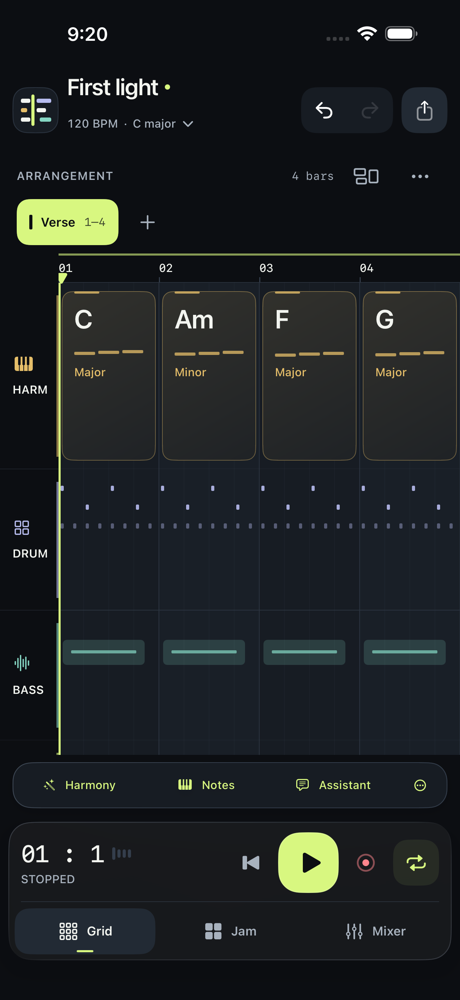
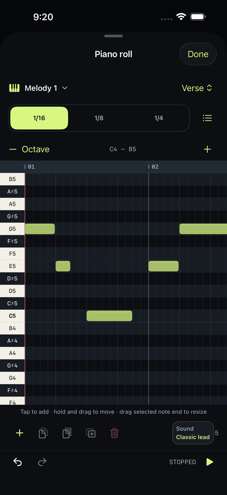
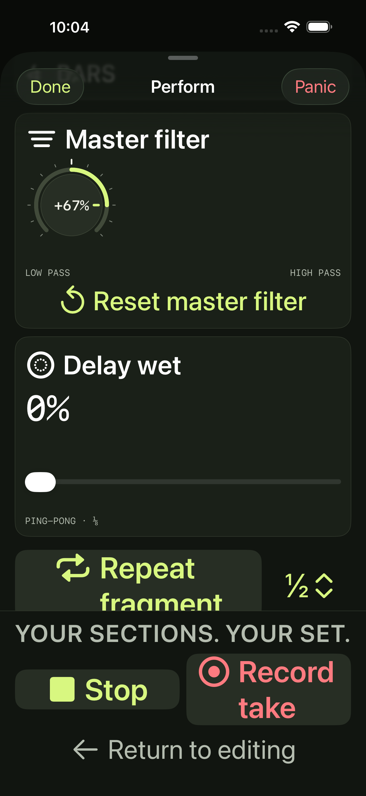
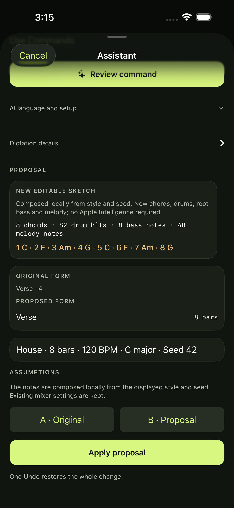

  

<h1 align="center">La Grilla</h1>

<strong>Идея → грув → трек.</strong> Карманная студия для iPhone: сочиняйте гармонию, играйте бит, собирайте аранжировку и продолжайте работу в своей DAW.

   
  iOS 18+ · SwiftUI · нативный звук · RU / EN · без аккаунта

<a href="#экраны">Экраны</a> · <a href="#возможности">Возможности</a> · <a href="#попробовать-на-iphone">На iPhone</a> · <a href="docs/release/CURRENT.md">Текущий статус</a> · <a href="ROADMAP.md">Роадмап</a>

## Экраны

### Форма песни

Откройте «Форму песни» над сеткой, чтобы увидеть пропорции куплетов, припевов и бриджей. Перемещайте карточки за ручку, добавляйте и дублируйте секции. «Помощник» показывает исходную и предложенную структуру перед применением.

<table><tr><td></td><td></td></tr></table>

[Оригиналы и нативная проверка](Screenshots/SongForm27/README.md) · [Применение и этапы звука](docs/SONG_FORM_AND_SOUND_BANKS.md)

### Песня из исполнения

Запишите лайв и перенесите сыгранный порядок секций в отдельный проект. В новой песне можно менять секции, аккорды и партии. Сохранённый дубль доступен для повторного воспроизведения и экспорта.

[Оригинальный кадр и проверка](Screenshots/Release31/README.md)

### Игровая клавиатура

В «Джеме» откройте кнопку с клавишами или выберите «Клавиши» в нотном редакторе. Касание запускает ноту, удержание задаёт длительность, несколькими пальцами можно взять аккорд. В альбомной ориентации на широком экране помещаются две октавы. На мелодической дорожке кнопка записи сохраняет сыгранную фразу в открытый паттерн. Всю фразу можно отменить одним действием.

В галерее доступны записанные пианино и нейлоновая гитара, а также синтезированные электропианино, маримба, вибрафон, электроорган и четыре саксофона: сопрано, альт, тенор и баритон. У саксофонов различаются атака трости, призвук дыхания и вибрато. Выбор инструмента сохраняется на дорожке и слышен при воспроизведении и экспорте. В меню звуков доступны собственные банки SoundFont. [Послушать четыре саксофона по очереди, 9 секунд](Media/Audio/saxophone-voices.mp3)

### Эквалайзер в микшере

Нажмите **EQ** на дорожке или на мастере. За точку на графике можно потянуть пальцем, чтобы изменить частоту и усиление. Под графиком есть точные настройки четырёх полос, включая добротность Q и тип фильтра. Для сравнения на слух можно отключить отдельную полосу или весь EQ. В меню пресетов 27 готовых кривых для саксофона, ударных, баса, клавиш и мастера. Стереоэкспорт включает обработку мастера. При экспорте stems каждая дорожка сохраняет собственный EQ.

### Звуковые банки и Pocket Kit

Акустическое пианино и нейлоновая гитара доступны сразу. В звуковых банках можно найти и назначить инструмент из SoundFont. Тот же тембр используется в WAV и stems. В Джеме можно загрузить Pocket Kit из 16 сэмплов или выбрать свой звук из общей библиотеки.

<table><tr><td></td><td></td><td></td></tr></table>

[Оригинальные экраны инструментов](Screenshots/InstrumentLibrary30/README.md) · [Pocket Kit](Screenshots/Sounds28/README.md) · [Настройки звука и исполнение](docs/SONG_FORM_AND_SOUND_BANKS.md)

### Ночная тема

<table><tr><td></td><td></td><td></td></tr><tr><td></td><td></td></tr></table>

[Оригинальные экраны и их версии](Screenshots/Design26/README.md)

История скриншотов сборки 23

## Экраны сборки 23

Ночная тема на iPhone 16 Pro Max Simulator. Perform показан с крупным системным текстом; нажмите на кадр, чтобы открыть оригинальный PNG.

<table><tr>
<td align="center"><strong>Фильтр и доступный Reset</strong>  </td>
<td align="center"><strong>Секции и транспорт</strong>  </td>
<td align="center"><strong>Review транспонирования</strong>  </td>
</tr></table>

Эти три кадра сохраняют source `8f7cd0e`: методы-владельцы прошли, весь тот targeted-запуск — 4 PASS / 1 allowance. [Неизменённые оригиналы и происхождение](Screenshots/Build23Layout/README.md).

**Ступени и бемоли после перезапуска · прежний main 0cfd12e**

Оригинальный кадр `0cfd12e` принадлежит прошедшему Flats/scale-degrees методу. Весь main-run: 70 PASS / 2 FAIL / 1 allowance; один прошедший кадр не принимает весь релиз. [PNG, source/run и SHA-256](Screenshots/Build23Main/README.md).

**Помощник после исправлений · исходный кадр candidate 7564**

Неизменённый оригинал `7564fe7`, owner AI setup PASS; весь focused4 — **4 PASS / 0 allowance**, не полный73 и не генерация реальной моделью. На кадре показаны реальные элементы управления и исходная языковая подсказка. [Source/run и provenance](Screenshots/Build23Assistant/README.md).

**Пэды после contact/hold · main `8bc7866`**

Неизменённый оригинал source `8bc7866`: Pad-owner **PASS13.483s**, предшествующий LiveEditing полностью **PASS83.255s**, включая Stop/hold/timing/counter. Весь full73 остаётся **71 PASS / 2 FAIL / общий timeout**, без полной приёмки. [PNG, owner и provenance](Screenshots/Build23Pads/README.md).

## Возможности

| Часть студии | Текущая реализация |
| --- | --- |
| **Grid и редакторы** | До 8 дорожек, 8 секций и 64 тактов. Карта всей песни, перетаскивание секций, изменение длины клипов, pinch-to-zoom, piano roll, Undo/Redo. |
| **Гармония** | 65 типов аккордов, свои интервальные формулы и voicing. A/B, стилизация, slash chords, буквенная запись, ступени и транспонирование. |
| **Локальный SketchComposer** | Скетч из аккордов, ударных, баса и мелодии по стилю и seed. Проверка, прослушивание, Apply одной операцией и дальнейшее редактирование. |
| **Jam и Perform** | Multi-touch пэды 4×4, шаги, квантование записи, overdub; запуск секций, фильтр/delay/repeat, запись, повтор и создание редактируемой песни из лайва. Наклон для фильтра или Master включается вручную. |
| **Помощник и голос** | RU/EN Commands; необязательный адаптер FoundationModels для музыкальных запросов на совместимом устройстве. Диктовка отдельно от монофонического Voice-to-MIDI beta с сохранением исходника и ручной коррекцией. |
| **Микшер и MIDI** | Вертикальные фейдеры, pan, mute/solo, Master, выбор встроенного тембра, назначение SoundFont и сэмплов пэдов. CoreMIDI input/output, CC Learn, Panic и интерфейс BLE MIDI. |
| **Проекты и экспорт** | Автосохранение, восстановление и переносимый `.grillapack`; MIDI Type 1, WAV mixdown и выровненные stems, 44.1/48 kHz, 16/24 bit. |
| **Интерфейс** | RU/EN, Light/Dark/System, Dynamic Type и VoiceOver. Статичный Launch Screen и анимация реальной загрузки без искусственной задержки. |

Локальные Commands и SketchComposer работают без Apple Intelligence. Скетчи создаёт локальный музыкальный алгоритм; показанные кадры не демонстрируют генерацию реальной моделью. Доступность FoundationModels зависит от устройства, iOS 26+, готовности Apple Intelligence и языка запроса. Языки ИИ и диктовки выбираются независимо.

**Конструктор трека** открывается из «Помощника» или при создании нового проекта. Для начала введите «Ночной хип-хоп, 88 BPM, ре минор, 8 тактов» и нажмите «Подобрать параметры». В меню «Готовый набор» доступны 18 музыкальных пресетов, по шесть для House, Hip-hop и Jazz. У каждого свои темп, гармония и вариант рисунка. Ритм, темп, тональность, лад, длину и аккорды можно менять по отдельности. «Послушать эскиз» проигрывает результат, а «Создать трек в сетке» сохраняет его отдельным проектом с четырьмя редактируемыми партиями.

Если для языка описания доступна системная модель, Apple Intelligence предлагает параметры прямо на устройстве. В остальных случаях локальный подбор распознаёт знакомые слова о стиле и настроении и явные значения темпа, тональности и длины. Для точной последовательности можно вписать аккорды в поле конструктора или добавить в конец запроса «аккорды: Dm7 Bbmaj7 Gm7 A7». Состояние системной модели видно в основных настройках iPhone, в разделе «Apple Intelligence и Siri». [Требования Apple к устройству и языкам](https://support.apple.com/en-us/121115)

## Удобство работы руками

- **Пэды:** звук запускается при начале контакта; два пальца работают независимо. Квантование привязывает запись к сетке.
- **Нотный редактор.** Разведите или сведите два пальца, чтобы изменить масштаб времени, сохраняя высоту ряда на экране. Одним пальцем можно прокручивать сетку. При растягивании ноты линия показывает её конец, а Undo отменяет весь жест.
- **Звуки:** в микшере откройте «Звук» на мелодической дорожке, чтобы назначить инструмент из загруженного `.sf2`. В Джеме откройте «Звук → Сэмплы пэдов», чтобы выбрать Pocket Kit или назначить собственные WAV/AIFF. [Инструкция](docs/SONG_FORM_AND_SOUND_BANKS.md)
- **Исполнение:** Replay и Reset доступны возле транспорта и фильтра, секции остаются под рукой при крупном тексте и в landscape. Наклоном можно управлять фильтром или громкостью микса проекта после ручного включения и калибровки.
- **Редактирование:** полные настройки открываются из меню проекта, Preview/Apply аккорда закреплены у нижней границы редактора.
- **Помощник:** у диктовки раздельные Start/Stop; поздний Stop после естественного окончания не начинает новую запись.

Эти изменения реализованы в приложении. Точную задержку и удобство на реальном iPhone ещё предстоит измерить.

## Попробовать на iPhone

**[Скачать La Grilla 1.0.0 (36)](https://github.com/alexgazin/la-grilla/actions/runs/44325351752/artifacts/14437696953)**. Из ZIP извлеките `LaGrilla-unsigned.ipa` и подпишите своим Apple ID через Sideloadly. Бесплатная Personal Team подходит. [Установка и проверка пакета](Builds/Testing/README.md).

Перед обновлением экспортируйте важные проекты в `.grillapack`. Сборка 36 открывает проекты схем 1…13. После сохранения проект использует схему 13, в которой записываются параметры эквалайзера.

## Подготовка к выпуску

На исходнике сборки 31 прошли 207 Swift-тестов, 16 наборов тестов аудиоядра и все 80 нативных сценариев на iPhone Simulator. Следующий этап — проверка звука, жестов, голоса и MIDI на физическом iPhone, перенос проекта между устройствами и импорт экспорта в DAW. Для TestFlight и App Store понадобятся подписанная сборка и доступ к App Store Connect. [Итоговый прогон](https://github.com/alexgazin/la-grilla/actions/runs/44289170060/attempts/1)

[Текущая сборка и результаты](docs/release/CURRENT.md) · [Протокол устройства](docs/release/DEVICE_ACCEPTANCE.md) · [Роадмап](ROADMAP.md) · [Дизайн](DESIGN.md)

Исходные экраны доработок 22: пэды, ноты и звук

## Исходные доработки сборки 22

Оригинальные кадры работающего **iPhone 16 Pro Max Simulator**, ночная тема. Нажмите, чтобы открыть полный PNG.

<table>
  <tr>
    <td align="center" valign="top"><strong>Пэды и доступный выбор звука</strong>  </td>
    <td align="center" valign="top"><strong>Изменённая длина ноты</strong>  </td>
    <td align="center" valign="top"><strong>Прослушивание тембра</strong>  </td>
  </tr>
</table>

Все выбранные PNG принадлежат прошедшим методам. Четыре кадра имеют source `60c24ce` (9 PASS / 1 ошибка ожидания форматирования), нотный кадр — `aded2ff` (1 PASS, resize и оба Undo). Product-код между этими исходниками и исходным `main` 22 совпадает. Это раздельные focused-проверки, не новый полный прогон 10 или 73 сценариев. [Пять оригиналов, source/run и контрольные суммы](Screenshots/Build22Touch/README.md).

Историческое видео работы · сборка 15

## Настоящее видео работы · сборка 15

**[▶ Смотреть запись — 2:12, Full HD, со звуком](https://github.com/alexgazin/la-grilla/raw/refs/heads/main/Media/WorkingDemo/la-grilla-working-demo.mp4)** · [Полная исходная запись](https://github.com/alexgazin/la-grilla/raw/refs/heads/main/Media/WorkingDemo/la-grilla-session-original.mp4)

Историческая запись **iOS Simulator, 1.0.0 (15)**: Play, аккорды, жесты, пэды, overdub, микшер, Harmony A/B, Commands, Perform и WAV share. Звук снят с выхода тех же сессий; три сессии смонтированы с сокращением ожиданий, действия идут в обычном темпе. Voice показан на подготовке записи. [Источники, монтаж и проверки](Media/WorkingDemo/README.md) сохраняют исходный результат capture-workflow и границы принятой записи.

По просьбе владельца новое видео отменено. Историческое видео 15 сохранено со своим source и результатом; оно не представляет сборку 23.

Исторические оригиналы сборок 19 и 20

## Оригинальные экраны кандидата 20

Два оригинальных кадра работающей сборки 20: Harmony A/B и фильтр Perform. Эти экраны сняты с кандидата `deeb701` в iOS Simulator.

  
  

Методы-владельцы обоих кадров прошли; [весь запуск](https://github.com/alexgazin/la-grilla/actions/runs/43966102437) завершился с **2 PASS / 1 allowance / 1 interrupted**. Это предпросмотр интерфейса, не полная приёмка и не готовый проморолик. Исходные пиксели сохранены без изменений; [происхождение, имена вложений и SHA-256](Screenshots/Build20Preview/manifest.json).

### Предыдущие оригиналы сборки 19

Шесть оригинальных кадров сборки19 на работающем **iPhone 16 Pro Max Simulator**; сборка20 сохраняет этот интерфейс и исправляет импортированный диапазон воспроизведения. Нажмите на экран, чтобы открыть полный PNG.

<table>
  <tr>
    <td align="center" valign="top"><strong>Скетч перед применением</strong> Стиль, гармония и партии · A/B  </td>
    <td align="center" valign="top"><strong>Развить идею в сетке</strong> Редактируемая аранжировка на 8 тактов  </td>
    <td align="center" valign="top"><strong>Забрать MIDI</strong> Настоящее системное меню экспорта  </td>
  </tr>
  <tr>
    <td align="center" valign="top"><strong>Сохранить нотацию</strong> D♭maj7/F♯ после перезапуска  </td>
    <td align="center" valign="top"><strong>Свои формулы аккордов</strong> Все тоны остаются в редакторе  </td>
    <td align="center" valign="top"><strong>Идея своими словами</strong> Commands и понятная доступность AI  </td>
  </tr>
</table>

Кадры — **source `f005854`, сборка 19, schema 10**, [run 43890521487](https://github.com/alexgazin/la-grilla/actions/runs/43890521487): **13 PASS / 2 assertion FAIL / 0 timeout**. Все шесть выбранных PNG относятся к прошедшим методам; весь прогон не принят, два падения транспонирования сохранены в отчёте. Оригинальные пиксели не изменены. [Происхождение и пределы каждого кадра](Screenshots/AuditImprovements/README.md) · [Манифест и SHA-256](Screenshots/AuditImprovements/manifest.json).

Исторические экраны, дизайн и промо

- [Предпросмотр и живое транспонирование сборки19](Screenshots/Transposition19) с собственным PASS-методом и раскрытым итогом всего запуска.
- [73 оригинальных экрана сборки 14](Screenshots/OriginalVision), [EN/RU Store-копии](Screenshots/AppStore).
- [Welcome и Settings сборки 15](Screenshots/ProfessionalShell), [дизайн и OpenArt-происхождение](Design/2026).
- [QA-превью splash сборки 17](Screenshots/LaunchPreview), [разрешённый input и Assistant 17](Screenshots/AuthorizedInput), [восстановление после ошибок сборки 16](Screenshots/DeviceRepair).
- [Историческое промо из скриншотов с отдельным offline-саундтреком](Media/Promo/README.md).

У каждой коллекции собственные source, run и хеши. Splash-превью показывает тот же компонент при явно удержанном QA-представлении и не измеряет время холодного запуска. Исторические медиа не переименовываются в доказательства текущей сборки 23.

