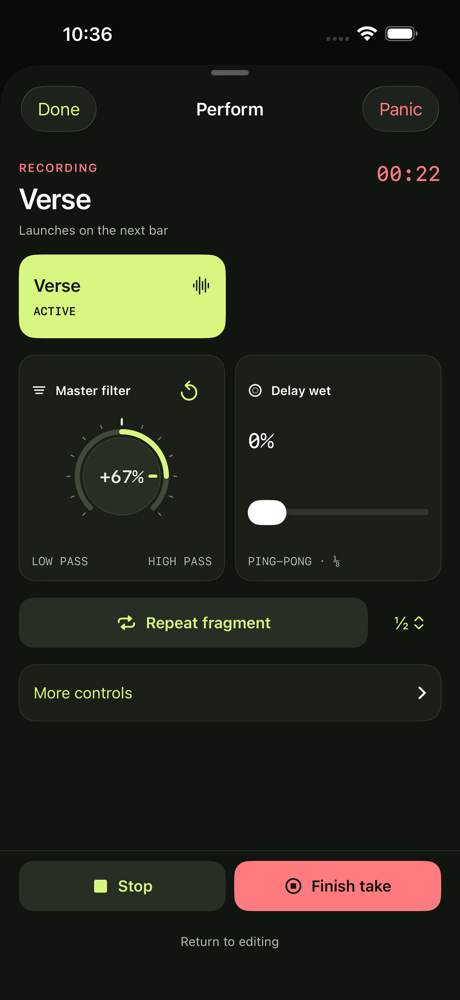
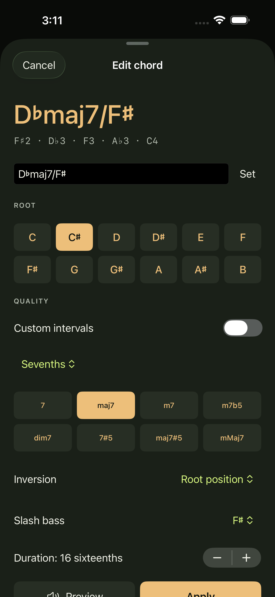
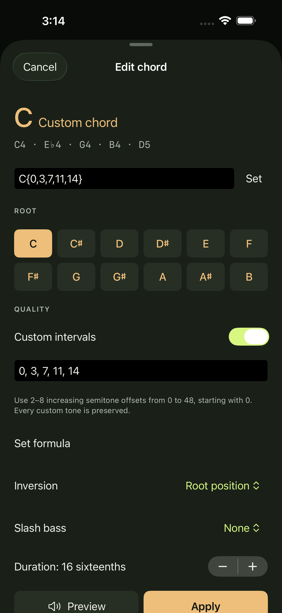

  

<h1 align="center">La Grilla</h1>

<strong>Идея → грув → трек.</strong> Карманная студия для iPhone: сочиняйте гармонию, играйте бит, собирайте аранжировку и продолжайте работу в своей DAW.

   
  iOS 18+ · SwiftUI · нативный звук · RU / EN · без аккаунта

<a href="#кандидат-20-в-работе">Экраны</a> · <a href="#возможности-кандидата-20">Возможности</a> · <a href="#попробовать-на-iphone">На iPhone</a> · <a href="docs/release/CURRENT.md">Текущий статус</a> · <a href="ROADMAP.md">Роадмап</a>

**Статус — функциональная альфа. Код этой ветки: 1.0.0 (22), schema 11.** Кандидат добавляет редактируемые локальные скетчи, нотацию, транспонирование и доработку первого музыкального результата. Полная программная и аппаратная приёмка остаётся открытой. Исходники и этапы связаны с [PR #21](https://github.com/alexgazin/la-grilla/pull/21); [точные результаты и ограничения](docs/release/CURRENT.md) сохраняются отдельно для каждого source.

## Контакт и звук · кандидат 22

Новые изменения по ручному сеансу: нативный multi-touch пэдов с коротким путём до звука, живая длина и перенос нот с рукояткой 44 pt, выбор настоящих Classic/Warm/Bright через «Звук» и опциональный наклон для фильтра или громкости. Код этой ветки — **1.0.0 (22), schema 11**; Xcode/native и проверка датчиков на iPhone ещё впереди. [Подробный технический отчёт и этапы](docs/review/2026-11-17/TOUCH21.md).

Тестовая IPA 20 ниже сохраняет собственный source и не содержит этих изменений. Новая IPA 22 будет отдельным файлом. Экспортируй важные проекты перед обновлением: приложение 22 читает старые схемы, а старые версии не читают сохранённую schema 11.

## Оригинальные экраны кандидата 20

Два оригинальных кадра работающей сборки 20: Harmony A/B и фильтр Perform. Эти экраны сняты с кандидата `deeb701` в iOS Simulator.

  
  

Методы-владельцы обоих кадров прошли; [весь запуск](https://github.com/alexgazin/la-grilla/actions/runs/43966102437) завершился с **2 PASS / 1 allowance / 1 interrupted**. Это предпросмотр интерфейса, не полная приёмка и не готовый проморолик. Исходные пиксели сохранены без изменений; [происхождение, имена вложений и SHA-256](Screenshots/Build20Preview/manifest.json).

### Предыдущие оригиналы сборки 19

Шесть оригинальных кадров сборки19 на работающем **iPhone 16 Pro Max Simulator**; сборка20 сохраняет этот интерфейс и исправляет импортированный диапазон воспроизведения. Нажмите на экран, чтобы открыть полный PNG.

<table>
  <tr>
    <td align="center" valign="top"><strong>Скетч перед применением</strong> Стиль, гармония и партии · A/B  </td>
    <td align="center" valign="top"><strong>Развить идею в сетке</strong> Редактируемая аранжировка на 8 тактов  </td>
    <td align="center" valign="top"><strong>Забрать MIDI</strong> Настоящее системное меню экспорта  </td>
  </tr>
  <tr>
    <td align="center" valign="top"><strong>Сохранить нотацию</strong> D♭maj7/F♯ после перезапуска  </td>
    <td align="center" valign="top"><strong>Свои формулы аккордов</strong> Все тоны остаются в редакторе  </td>
    <td align="center" valign="top"><strong>Идея своими словами</strong> Commands и понятная доступность AI  </td>
  </tr>
</table>

Кадры — **source `f005854`, сборка 19, schema 10**, [run 43890521487](https://github.com/alexgazin/la-grilla/actions/runs/43890521487): **13 PASS / 2 assertion FAIL / 0 timeout**. Все шесть выбранных PNG относятся к прошедшим методам; весь прогон не принят, два падения транспонирования сохранены в отчёте. Оригинальные пиксели не изменены. [Происхождение и пределы каждого кадра](Screenshots/AuditImprovements/README.md) · [Манифест и SHA-256](Screenshots/AuditImprovements/manifest.json).

## Возможности кандидата 20

| Часть студии | Текущая реализация |
| --- | --- |
| **Grid и редакторы** | До 8 дорожек, 8 секций и 64 тактов. Перенос, копирование, изменение длины, pinch-to-zoom, piano roll, Undo/Redo. |
| **Гармония** | 65 типов аккордов, свои интервальные формулы и voicing. A/B, стилизация, slash chords, буквенная запись, ступени и транспонирование. |
| **Локальный SketchComposer** | Скетч из аккордов, ударных, баса и мелодии по стилю и seed. Проверка, прослушивание, Apply одной операцией и дальнейшее редактирование. |
| **Jam и Perform** | Пэды 4×4, шаги, квантование, overdub; запуск секций, круговой фильтр, delay, repeat, запись и replay исполнения. |
| **Помощник и голос** | RU/EN Commands; необязательный адаптер FoundationModels для музыкальных запросов на совместимом устройстве. Диктовка отдельно от монофонического Voice-to-MIDI beta с сохранением исходника и ручной коррекцией. |
| **Микшер и MIDI** | Вертикальные фейдеры, pan, mute/solo, Master; CoreMIDI input/output, CC Learn, Panic и интерфейс BLE MIDI. |
| **Проекты и экспорт** | Автосохранение, восстановление и переносимый `.grillapack`; MIDI Type 1, WAV mixdown и выровненные stems, 44.1/48 kHz, 16/24 bit. |
| **Интерфейс** | RU/EN, Light/Dark/System, Dynamic Type и VoiceOver. Статичный Launch Screen и анимация реальной загрузки без искусственной задержки. |

Локальные Commands и SketchComposer работают без Apple Intelligence. Скетчи создаёт локальный музыкальный алгоритм; показанные кадры не демонстрируют генерацию реальной моделью. Доступность FoundationModels зависит от устройства, iOS 26+, готовности Apple Intelligence и языка запроса. Языки AI и диктовки выбираются независимо.

## Попробовать на iPhone

**[Скачать тестовую La Grilla 1.0.0 (20) · архив ZIP с IPA](https://github.com/alexgazin/la-grilla/actions/runs/43957824077/artifacts/14273365913)** — iPhone / iOS 18+, source `6bb06b5`. Войдите в GitHub, скачайте ZIP и извлеките `LaGrilla-unsigned.ipa` (3.4 MiB). Подпишите файл своим Apple ID через Sideloadly на Mac или Windows: бесплатная Personal Team подходит, подпись обычно действует 7 дней. Debug и Release archive прошли; полная нативная и аппаратная приёмка остаётся открытой. [Инструкция, SHA-256 и прежние IPA 19/17](Builds/Testing/README.md).

Для сборки **20** из исходников нужны Mac, iPhone с iOS 18+ и Xcode 26.3+:

1. Открыть ветку кандидата из [PR #21](https://github.com/alexgazin/la-grilla/pull/21) и [`LaGrilla.xcodeproj`](LaGrilla.xcodeproj).
2. Выбрать свою **Personal Team** в **Signing & Capabilities**, включив automatic signing.
3. Подключить iPhone, подтвердить Trust/Developer Mode и нажать **Run**.

Перед обновлением экспортируйте важные проекты в portable bundle. Проекты кандидата 20 используют **schema 10**: он читает 1…9, а старые приложения не откроют сохранённую schema 10. Тестовая IPA 20 доступна отдельно; её публикация для ручной проверки не означает завершённую программную приёмку. Код кандидата и его приёмка — в [CURRENT](docs/release/CURRENT.md). [Подробно про Xcode и установку](docs/DEVELOPMENT.md#run-on-your-own-iphone).

## Настоящее видео работы · сборка 15

**[▶ Смотреть запись — 2:12, Full HD, со звуком](https://github.com/alexgazin/la-grilla/raw/refs/heads/main/Media/WorkingDemo/la-grilla-working-demo.mp4)** · [Полная исходная запись](https://github.com/alexgazin/la-grilla/raw/refs/heads/main/Media/WorkingDemo/la-grilla-session-original.mp4)

Историческая запись **iOS Simulator, 1.0.0 (15)**: Play, аккорды, жесты, пэды, overdub, микшер, Harmony A/B, Commands, Perform и WAV share. Звук снят с выхода тех же сессий; три сессии смонтированы с сокращением ожиданий, действия идут в обычном темпе. Voice показан на подготовке записи. [Источники, монтаж и проверки](Media/WorkingDemo/README.md) сохраняют исходный результат capture-workflow и границы принятой записи.

Принятого видео работы 20 пока нет: последняя запись не завершила все четыре сценария и не сохранила воспроизводимый MP4. Историческое видео 15 сохраняет собственный source и результат.

## Готовность и дальнейшая работа

Ближайший рубеж — закрыть software gate кандидата 20 и повторить пользовательский сценарий на установленном iPhone: звук, разрешённая диктовка, повторная запись/Stop, сохранение, открытие и экспорт. Реальные аудиомаршруты, USB/BLE MIDI, 30-минутные сессии, человеческий напев, FoundationModels и импорт в две DAW остаются отдельной аппаратной приёмкой. Приложение пока не опубликовано в App Store; distribution signing, TestFlight и App Review впереди.

[Текущие доказательства и ограничения](docs/release/CURRENT.md) · [Роадмап](ROADMAP.md) · [34 замечания и план аудитов](docs/review/2026-11-16/PLAN.md) · [Отчёт по реализации](docs/review/2026-11-16/IMPLEMENTATION.md) · [Журнал разработки](docs/IMPLEMENTATION_LOG.md).

Исторические экраны, дизайн и промо

- [Предпросмотр и живое транспонирование сборки19](Screenshots/Transposition19) с собственным PASS-методом и раскрытым итогом всего запуска.
- [73 оригинальных экрана сборки 14](Screenshots/OriginalVision), [EN/RU Store-копии](Screenshots/AppStore).
- [Welcome и Settings сборки 15](Screenshots/ProfessionalShell), [дизайн и OpenArt-происхождение](Design/2026).
- [QA-превью splash сборки 17](Screenshots/LaunchPreview), [разрешённый input и Assistant 17](Screenshots/AuthorizedInput), [восстановление после ошибок сборки 16](Screenshots/DeviceRepair).
- [Историческое промо из скриншотов с отдельным offline-саундтреком](Media/Promo/README.md).

У каждой коллекции собственные source, run и хеши. Splash-превью показывает тот же компонент при явно удержанном QA-представлении и не измеряет время холодного запуска. Исторические медиа не переименовываются в доказательства кандидата 19.

