

  

<h1 align="center">La Grilla</h1>

<strong>Идея → грув → трек.</strong> Карманная студия для iPhone: сочиняйте гармонию, играйте бит, собирайте аранжировку и продолжайте работу в своей DAW.

   
  iOS 18+ · SwiftUI · нативный звук · RU / EN · без аккаунта

<a href="#экраны">Экраны</a> · <a href="#возможности">Возможности</a> · <a href="#попробовать-на-iphone">На iPhone</a> · <a href="docs/release/CURRENT.md">Текущий статус</a> · <a href="ROADMAP.md">Роадмап</a>

## Экраны

### Сборка 55: арпеджиатор, FM и аналоговые звуки, классические драм-машины, тайминг дублей

**Арпеджиатор.**
- «Разложить в арпеджио» в лаборатории гармонии, в клавиатуре и в поиске действий: аккорды или удержанные ноты дорожки становятся арпеджио. Порядок — вверх, вниз, вверх-вниз, как сыграно, случайно. Доли 1/4, 1/8, 1/8T, 1/16, 1/16T, 1/32 по темпу песни, 1–3 октавы, длина ноты 25–100 %.
- Сначала можно послушать, потом «Записать MIDI-нотами»: получается обычная дорожка, ноты правятся в пианоролле. Одна отмена.
- Живой арпеджиатор клавиатуры получил 1/4, 1/8T, порядок «Случайно» и длину ноты.

**Звуки.**
- FM в духе 80-х: электропиано с колокольной атакой, слэп-бас, плотный бас, трубчатые колокола, маримба, медные, стеклянный пэд.
- Аналоговая классика: моно-бас с суб-осциллятором, пульс-бас, сочный лид, тёплый хорус-пэд. Всё синтезируется на iPhone, без сэмплов.
- Наборы ударных в духе 808, 909, 707 и 606, у каждого по два готовых бита в битмашине.

**Как сыграно или по сетке.**
- При записи ударов поверх бита: «Как сыграно» (живой грув и микродинамика) или сетка 1/8…1/32 с триолями и силой притяжения.
- После записи у каждого дубля свой переключатель: удары возвращаются туда, где были сыграны, ничего не теряется. То же для фраз с клавиатуры.

**Исправлено.** «Послушать эскиз» в «Конструкторе трека» больше не теряет нажатие, если перед ним поменяли темп и клавиатура ещё была открыта.

### Сборка 54: трек за минуту, запись звука, ремиксы, курс гармонии, DAWproject и плагины

**Быстрый старт и соцсети.**
- «Трек за минуту»: выберите жанр в новом проекте — получите куплет и припев с битом жанра, 808, аккордами, басом и мелодией. «Другой вариант» заменяет его одной отменой.
- Видео для соцсетей: отрезок 15, 30 или 60 секунд с припева, картинка «Карта нот», «Пэды» или «Уровни», подпись «Made with La Grilla» можно выключить.
- Челлендж недели: одно задание для всех, правила отмечаются на открытой песне, «Выложить свою работу» готовит ролик на 30 секунд.

**Запись звука.**
- До четырёх аудиодорожек: голос или инструмент поверх песни, дубль до двух минут, запись начинается со следующего такта.
- Задержка входа учитывается по калибровке выхода, дубль можно сдвинуть на такт, долю или 10 мс, обрезать, сделать громче или тише, добавить фейды.
- Аудиодорожки видны в «Сетке», звучат в WAV, AAC, видео и рингтоне, у каждой свой стем.

**Ремиксы.**
- «Ссылка для ремикса»: песня (части, аккорды, бит, ноты, микс) прямо внутри ссылки `lagrilla://remix#…`, без серверов. Открывшему создаётся «… · моя версия» с указанием автора.
- Если мессенджер не сделал ссылку нажимаемой — «Вставить» в «Проектах». Делиться ремиксом можно только при лицензии «Ремикс с указанием автора» или «Не для продажи».

**Курс гармонии.**
- Десять уроков: ступени, функции T–S–D, песня на четырёх аккордах, минорная V, каденции, ii–V–I, заимствованная доминанта, краски из минора, обращения, квинтовый круг. Пример можно послушать в любой тональности, упражнение проверяется на вашей песне.
- Для учителя: задание из урока или из своих аккордов отправляется файлом; ученик отправляет песню обратно, учитель видит результат.

**Для DAW и плагины.**
- Экспорт DAWproject для Cubase 14, Studio One, Bitwig, а на iPad — Cubasis и n-Track: каждая партия и нотами, и аудио, с темпом, уровнями и маркерами. Файл проверяется по официальной схеме формата.
- Плагины AUv3: до двух эффектов после микса (звучат вживую и в экспорте), инструментальный плагин переводит дорожку в аудио с точностью до сэмпла. Ableton Link и `.als` ждут лицензий Ableton — [что нужно сделать](docs/ABLETON_RU.md).

### Сборка 53: удержание, нарезка и восстановление

**Слушать, не меняя.**
- Удержание = прослушивание везде: аккорд в «Сетке», нота в пианоролле, звук в списке инструментов, готовый бит, вариант, шаблон, грув, палитра. Звучит, пока держите, песня не меняется.
- Удержите картинку проекта в списке — услышите около 10 секунд припева.
- Эквалайзер «с / без» при одинаковой громкости (разница не больше 0,5 LU), чтобы «громче» не казалось «лучше».
- Один блок «Послушать → Применить → Отказаться» в «Помощнике» и правках фразой; «Отказаться» ничего не трогает в песне.

**Звук и работа.**
- Редактор нарезки лупа: волна, чувствительность и минимальный интервал, добавить, сдвинуть или удалить разрез, послушать срез, разложить на пэды 1–16.
- «Мой звук» в битмашине: одна нота из файла играет басовую партию 808 на всех нотах.
- Перетаскивание пэда на пэд в панели «Слои» меняет их местами одной отменой.
- MIDI learn для ручек синтезатора, низа и верха эквалайзера, посыла ревербера и драйва: кнопка «Назначить MIDI-ручку» в листах синтезатора и эквалайзера (или долгое нажатие на ручку); пока лист ждёт контроллер, он сам это показывает.
- Пэды загораются, пока их играет песня; уровни дорожек видны и в заголовках «Сетки».

**Надёжность и удобство.**
- Журнал правок между сохранениями: после сбоя — «Восстановить несохранённое?» с описанием разницы и одной отменой.
- При VoiceOver «Сетка» читается таблицей «такт → дорожки», ротор «Такты».
- Эко-режим в энергосбережении: метры реже, фон неподвижен, звук прежний.
- Подсказки под полем «Помощника» и названия для нового проекта; время запуска приложения видно в настройках.
- «Изменить голосом» и «Удалить аккорд» теперь в меню «⋯» редактора аккорда: долгое нажатие на аккорд только проигрывает его.

### Сборка 52: звук ядра, тур и удобство

**Звук.**
- Свой паттерн арпеджиатора: сетка 8 или 16 шагов, паузы, октавы, сохранённые паттерны и пресеты (клавиатура → раскладка → «Мой паттерн»).
- «Инструмент из звука»: запишите или загрузите одну ноту — приложение найдёт её высоту и разложит звук по всем клавишам (Звук → Банки звуков).
- Обработка голоса для записанных звуков: «Подкаст», «Вокал», «Тёплый» — EQ, компрессор, де-эссер и мягкая подстройка.
- Пространства реверберации: комната, зал, пластина и пружина (микшер → мастер).
- Слои на пэде: 2–4 звука по силе удара или по очереди (библиотека сэмплов → «Слои на этом пэде»).
- Автоматизация: кнопка записи в микшере пишет движения громкости и панорамы во время игры; точки правятся в «Автоматизации».
- MPE: отдельный изгиб и нажим каждой ноты — с MPE-контроллера и на экранных клавишах.

**Удобство.**
- «Покажи, как всё устроено»: тур из пяти действий на демо-песне; повторить можно в настройках.
- «Выбрать» в аранжировке: несколько клипов или целая секция — дублировать, сдвинуть, покрасить, заглушить, удалить одной отменой.
- Удержите шаблон, бит, грув или палитру — услышите четыре такта до выбора.
- Простой или полный режим, плотность «компактная / обычная / крупная», управление одной рукой.
- Поворот экрана не сбрасывает выбор, прокрутку и открытые листы.
- Карточка сохранения: когда сохранено, «Сохранить сейчас», «Вернуть как при открытии», копия и версии.
- Одинаковый порядок в меню «⋯»: слушать, переименовать, дублировать, цвет, удалить — всегда последним.
- «Почему так» и «Другой вариант» в «Помощнике», ползунок «осторожно ↔ смело».
- Скелетоны вместо спиннеров при загрузке; пианоролл и микшер готовятся заранее.

### Сборка 51: битмашина, 808 и пробовать без страха

**Битмашина (Джем → «Битмашина»).** Грувбокс прямо в песне:
- 46 готовых битов в 23 жанрах: трэп, дрилл, бум‑бэп, вест‑кост, лоу‑фай, фонк, R&B, поп, хаус, техно, UK гараж, драм‑н‑бейс, реггетон, афробит, амапиано, джерси‑клаб, фанк и диско, рок, синтвейв, электро, 8‑бит, джаз и босса, этника;
- 19 наборов ударных, из них 12 новых: Boom Bap, Lo‑fi, Drill, Phonk, Techno, Reggaeton, Afro, UK Garage, Jungle, Rock, Synthwave, 8‑bit;
- 808 и басы: 808 саб, 808 панч, 808 с перегрузом, лог‑драм, риз, эсид, бас пальцами, квадратный бас. Ноты 808 идут в тональности и ладу песни, у них своя дорожка «808»;
- 16 пэдов, которые загораются в такт; степ‑секвенсор с акцентами, тихими ударами и дробями; один или два такта, свинг, темп, кнопка «Вариация»;
- слушать вместе с аккордами песни до применения, потом поставить бит в секцию или во всю песню одним Undo;
- ещё 8 синтезаторов в списке инструментов: суперсо‑лид, синт‑пицц, колокольные и лоу‑фай клавиши, синт‑духовые, струнный и хоровой пэды, 8‑бит лид.

Все звуки синтезируются на iPhone по формулам: чужих сэмплов нет, вопросов с правами тоже.

**Части песни в «Помощнике» — словами или таблицей (замечание музыканта к сборке 47).**
- Аккорды понимаются без слова «аккорды» («Часть A — 8 тактов: Db Eb Cm Fm»), через запятые, пробелы, тире и стрелки.
- «по 2 такта», «2 bars each», «2 такта на аккорд» — длина считается от числа аккордов; две длины больше не спорят друг с другом.
- Нет длины или аккордов — вместо вопроса подставляется подсказка с пометкой «предложено».
- Работают русские буквы частей (А, Б, В) и названия: «Куплет», «Припев», «Бридж», Verse, Chorus — до четырёх частей.
- Флейта, струнные, саксофон, гитара, модуляция и прочее, чего локальный аранжировщик не играет, перечисляются как «пропущено», остальное описание используется.
- «Задать части таблицей» в конструкторе трека (и кнопка в «Помощнике», если текст не понят): такты, аккорды из тональности нажатием или текстом, название части, готовые порядки A B A, A B C B, добавить и убрать часть.

**«Послушать эскиз» в конструкторе трека (замечание к сборке 47).** Кнопка всегда отвечает: если описание поменялось, сначала перечитывает его, потом играет эскиз. На кнопке видно состояние («Готовлю…», «Играет», «Стоп»), по эскизу бежит курсор, а если сыграть нельзя, рядом написано почему.

**808 со слайдами.** В битмашине у ноты баса есть кнопка со стрелкой «Скольжение в следующую ноту»: нота плавно съезжает в следующую, как в трэпе и дрилле. Слайд слышен в песне и в экспорте.

**Инструменты музыканта.**
- Тюнер: хроматический и по струнам гитары, баса и укулеле, настройка ля от 430 до 450 Гц.
- Маркеры на таймлайне: «здесь вокал», переход к маркеру, маркеры держатся за свою секцию и попадают в MIDI.
- Шаг сетки ударных 1/8, 1/16, 1/32 и триоли 1/8T, 1/16T.
- Динамика песни: роли секций (вступление, куплет, припев, бридж, концовка), сравнение «было/стало» и применение одним Undo.
- Мастер словами: «сделай громче», «теплее», «ярче», «больше пространства», каждое — одна отменяемая правка.
- Поиск звуков по-русски и по-английски («тёплые клавиши», «808», «бас пальцами»), избранное и восемь последних звуков.
- Переименование секции и дорожки двойным касанием.
- «Начать с бита» в новом проекте: темп жанра и его бит сразу в битмашине.
- Звук из видео и голосовых заметок — на пэды и в библиотеку сэмплов.
- Задание из бита: ученик играет его в Джеме, приложение считает попадания.
- Геймпад: кнопки и курки работают как пэды и пишутся в дубль.
- Сообщения об ошибках говорят, что сделать, и часто сразу дают кнопку («Открыть микшер», «Отменить»).
- Карточка проекта показывает форму песни цветными секциями; AirDrop показывает название песни.
- Мастеринг сравнивает «до/после» с выровненной громкостью.
- Удобство: вибрация на долях, отсчёт голосом перед дублем, подписи «что звучит», контрастная сетка, однократные подсказки жестов.

**Исправлено при проверке сборки.**
- В лабораторию гармонии снова можно нажать «Создать предложение»: мини‑транспорт внизу листа больше не перекрывает кнопку (ошибка сборки 50; так же в листах баса, палитр и текста).
- Шаги битмашины включаются касанием.
- «Задать части таблицей» сразу показывает таблицу, а не прокручивает список наверх.
- Команда помощника «Song: темп; тональность; Intro 4 bars…» снова проверяется в помощнике.
- Секция переименовывается двойным касанием.
- В Джеме «Режим записи» снова под пэдами. В меню секции «Раньше», «Позже» и «Удалить» стоят сразу после «Дублировать».

**Ничего не теряется.**
- История правок: каждая правка сессии с понятной подписью; можно послушать песню на любой точке и вернуться к ней одним шагом.
- Версии песни: сохраняй версии с именами, сравнивай A/B с той же доли, восстанавливай одним Undo.
- Недавно удалённые: дорожки, дубли и клипы хранятся 30 дней и возвращаются на место.
- Всё открывается долгим нажатием на Undo.

**Поиск действий словами и голосом.** Лупа или ⌘K: «темп 92», «ля минор», «добавь припев», «удали последний дубль». Понимает опечатки и перепутанную раскладку, можно сказать голосом. Любимые действия закрепляются на панели над транспортом. Siri и Spotlight: новый бит с темпом и тональностью, открыть проект, записать идею.

**Слушай до применения.** Блок «Послушать» с кнопкой Играть/Стоп в напеве, вариантах, сборке дубля, аккордах из песни, идеях мелодии, настроениях и мастеринге.

**Бит.**
- «Инструменты бита»: варианты (призрачные удары, проще, плотнее, свинг, сбивка), автоматические сбивки, сборка лучшего дубля из нескольких.
- Стартовые грувы по жанрам, евклидовы ритмы, вероятность и рэтчеты на шагах.

**Гармония и мелодия.**
- Аккорды из файла песни или фото страницы песенника.
- Прогрессии по настроению с объяснением.
- Идеи мелодии и второй голос.
- «Почему так звучит» и аппликатуры гитары и укулеле в редакторе аккорда.
- Своя тональность у секции.

**Песня целиком.**
- Текст со слогами под нотами.
- Структура по шаблону или по таймингам референса.
- Концовка, «Продолжи за меня» и проверка песни.

**Экспорт.** Пакет для DAW (стемы, MIDI, README), лид-шит MusicXML, рингтон, метаданные в WAV, «Подготовить к выпуску» (−14/−16/−9 LUFS).

**Удобство.** Фокус на секции, компактный транспорт в шторках, подсказка следующего шага, режим практики, клавиатура и педаль, пэды для левши, визуальный метроном, до-ре-ми, цвета дорожек, заметки соавтору, идея дня.

Полный статус 140 пунктов — [docs/IDEAS_2026_STATUS_RU.md](docs/IDEAS_2026_STATUS_RU.md).

### Сборка 47: слои и дубли в «Карманном бите»

Под пэдами и дорожками в «Карманном бите» появилась панель «Слои»:
- у каждого инструмента своя строка с числом ударов и кнопками Mute и Solo;
- в меню строки можно очистить слой в текущем такте или целиком;
- меню «Очистить» стирает такт, весь бит или включает все заглушённые слои.

Каждая запись поверх бита теперь отдельный дубль. В разделе «Дубли» запрограммированные удары показаны отдельно от дублей. Каждый дубль можно заглушить, удалить или оставить в бите насовсем. Кнопка «Удалить последний дубль» убирает только новый дубль, нарисованный бит остаётся. Любое действие отменяется одним Undo. В горизонтальной ориентации те же действия собраны в меню «Слои».

### Сборка 46: новый дизайн, переходы и замечания музыканта

Весь интерфейс переведён на дизайн‑систему Luz:
- контент матовый, оболочка стеклянная, инструменты подсвечиваются изнутри;
- шторки вырастают из кнопок, которые их открыли;
- экраны сменяются наплывом, цифры перекатываются;
- списки появляются каскадом, у проектов живой фон.

При включённом «Уменьшении движения» все эффекты становятся короткими наплывами. [Каталог переходов и правила](docs/DESIGN_SYSTEM_RU.md)

<a href="Screenshots/Build46/jam-pads.png">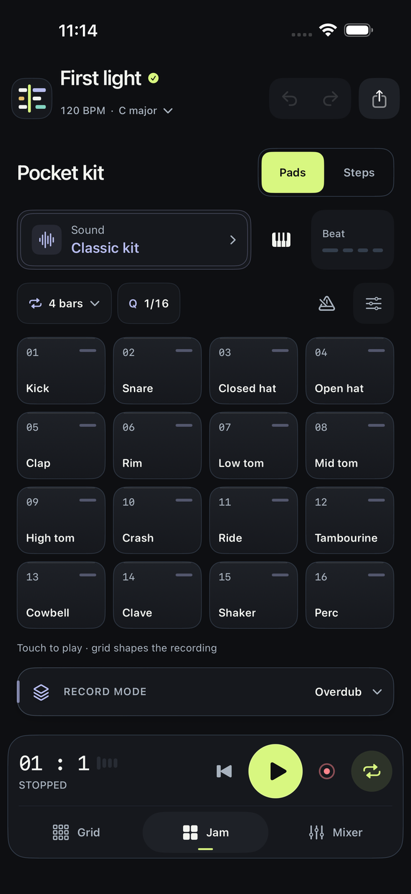</a> <a href="Screenshots/Build46/mixer.png">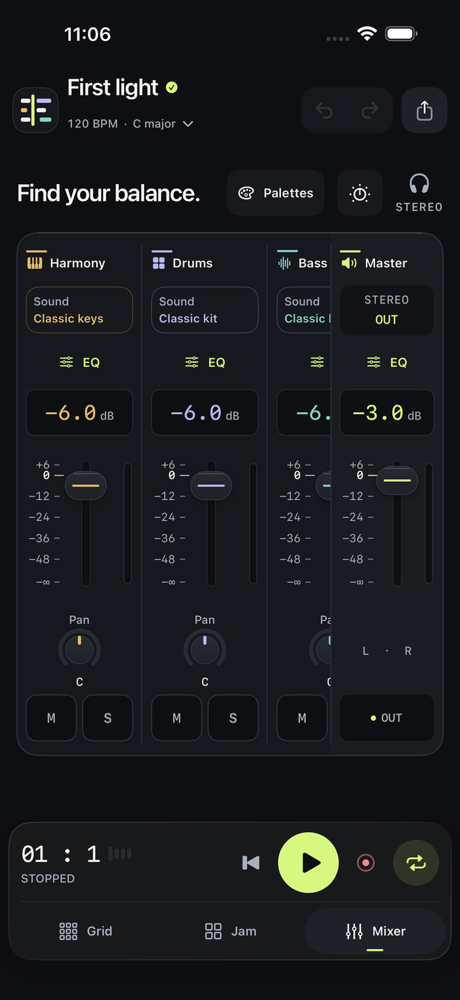</a> <a href="Screenshots/Build46/chord-editor.png">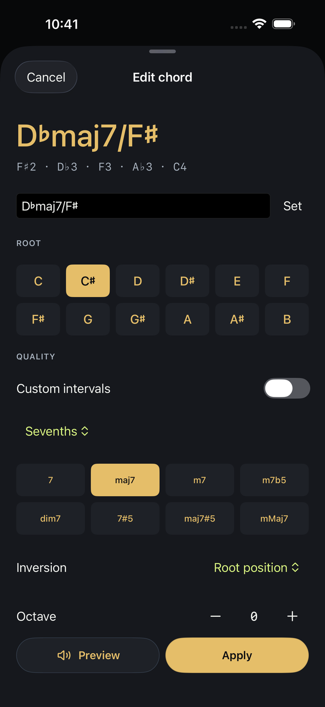</a> <a href="Screenshots/Build46/piano-roll.png">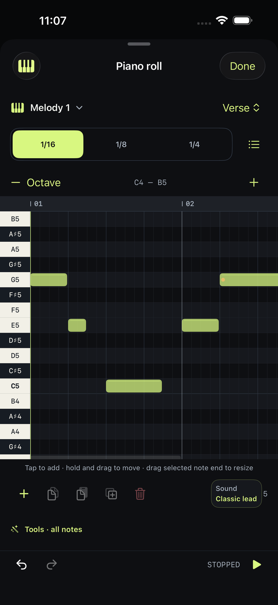</a> <a href="Screenshots/Build46/palettes.png">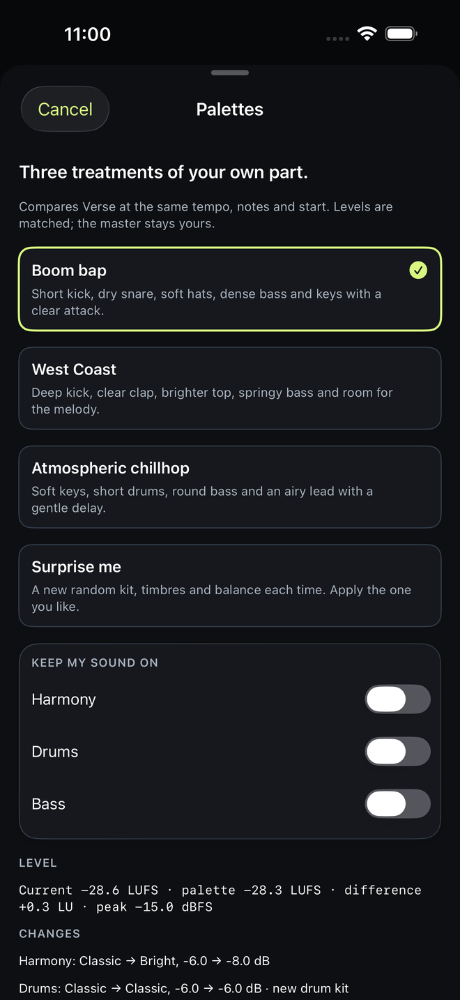</a> <a href="Screenshots/Build46/projects-aurora.png">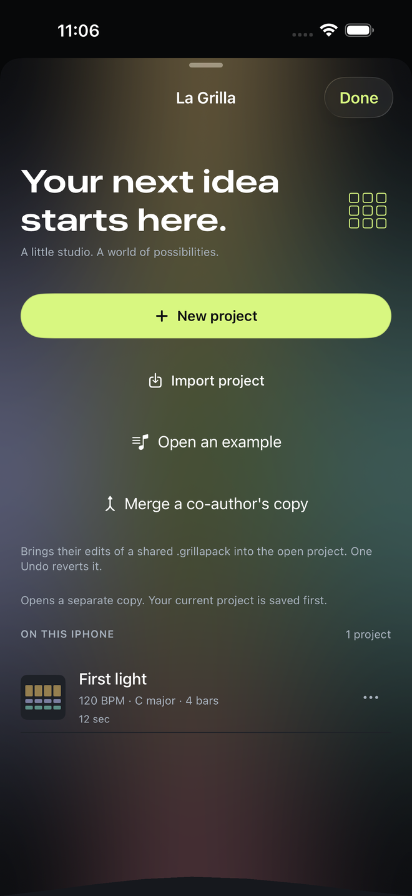</a>

По замечаниям Андрея:
- **Обращение аккорда** теперь слышно и видно. Бас играет нижний тон обращения, символ показывает его как C/E. Аккорд звучит сразу при выборе.
- **Октава аккорда** меняется кнопками −1/+1 в диапазоне −2…+2.
- **В библиотеке сэмплов** 112 встроенных ударных: 7 наборов × 16 пэдов, каждый можно прослушать.
- **Карманный бит** показывает бочку, малый и хэты дорожками одновременно. Переключатель возвращает режим одного пэда.
- **Зум двумя пальцами** на сетке больше не дёргает страницу по вертикали.

Кроме того, в Piano Roll выбранная нота всегда в кадре. Щипок больше не срабатывает как отмена двумя пальцами. На маленьких iPhone все 16 пэдов и кнопки микшера помещаются на экране.

### Барабанные наборы и редактор сэмпла

Откройте «Джем» → «Звук» → «Сэмплы пэдов». Сравните Pocket, Dusty и Coast на одном и том же бите, затем назначьте понравившийся набор всем 16 пэдам. Чтобы изменить отдельный удар, нажмите кнопку с волной в его строке. На волне можно подрезать начало и хвост, настроить атаку, затухание и уровень. Прослушайте правку перед применением. Исходник остаётся в проекте для следующей сессии, а применённый звук попадает в WAV и стемы.

При положительном усилении проверьте индикатор пика. Если появились обрезанные отсчёты, кнопка запаса по уровню рассчитает усиление для пика около −1 dBFS. В «Моих наборах» можно сохранить все 16 пэдов, затем восстановить их в другом проекте, сохранив его темп, рисунок и микс. Один Undo возвращает предыдущие назначения.

<a href="Screenshots/Producer43/factory-audition.png">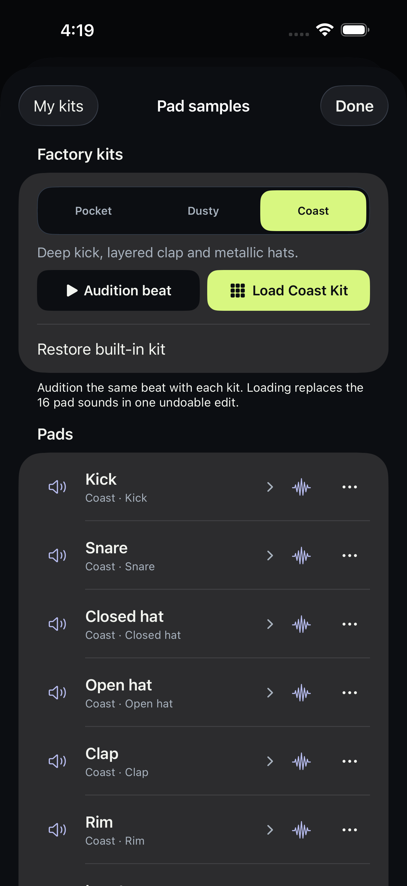</a> <a href="Screenshots/Producer43/pad-waveform.png">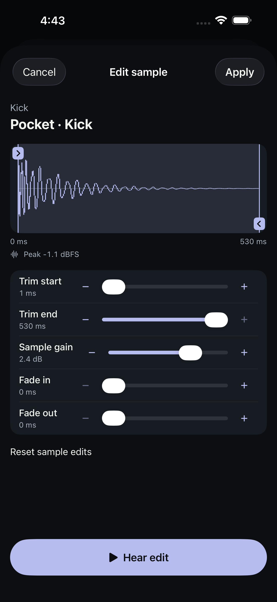</a> <a href="Screenshots/Producer43/personal-kits.png">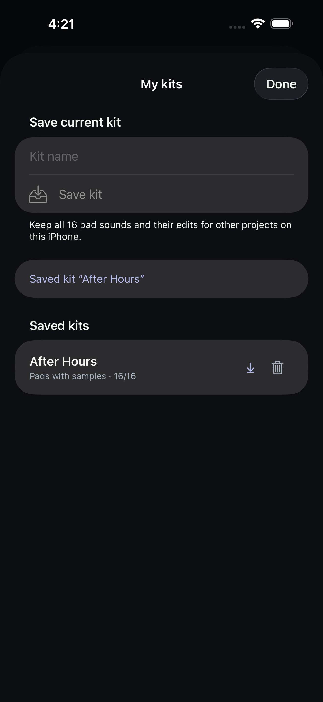</a>

[Послушать один ритм сначала на Dusty, затем на Coast](Media/Grooves/Producer43/dusty-then-coast.mp3)

### Интерактивная партитура и сравнение исполнений

В пустой сетке нажмите «Новый трек по описанию». Конструктор показывает всю песню сразу. Ширина каждой секции соответствует её длине, строки строятся из нот и ударов проекта. Коснитесь секции, чтобы услышать переход. Узкие части, включая однобарное вступление и гонг, можно выбрать по названию.

<a href="Screenshots/Score42/score-night-playing.png">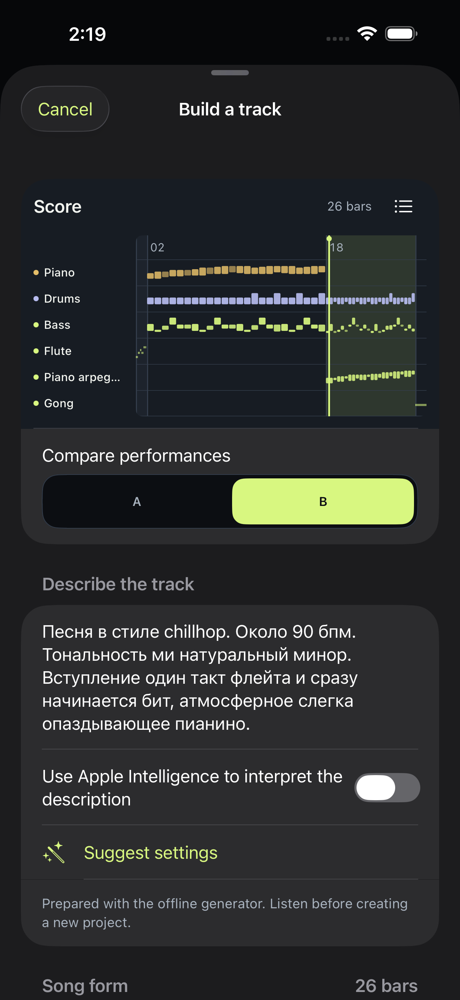</a> <a href="Screenshots/Score42/score-light.png">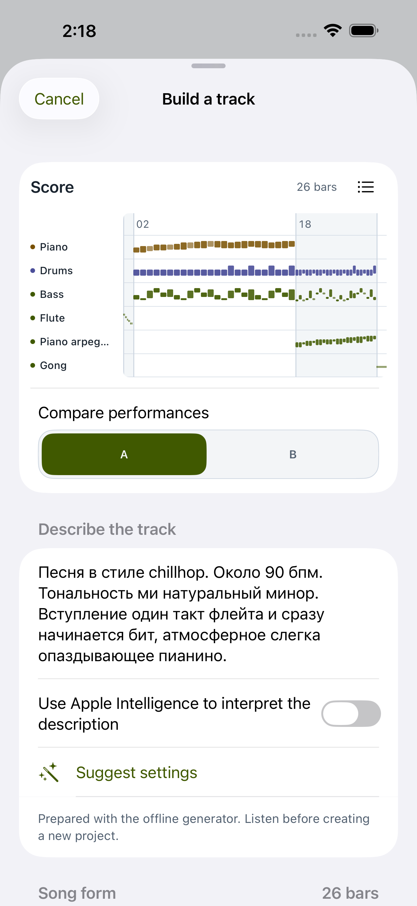</a>

Выберите A или B, чтобы сравнить два исполнения той же формы. Будущий проект использует выбранный вариант. В этих фрагментах звучат те же четыре такта chillhop при 90 BPM, с одним и тем же фортепиано и гармонией. [Послушать A](Media/Grooves/Score42/chillhop-A.mp3) · [Послушать B](Media/Grooves/Score42/chillhop-B.mp3)

### Форма песни

Откройте «Форму песни» над сеткой, чтобы увидеть пропорции куплетов, припевов и бриджей. Перемещайте карточки за ручку, добавляйте и дублируйте секции. «Помощник» показывает исходную и предложенную структуру перед применением.

<table><tr><td></td><td><a href="Screenshots/SongForm27/assistant-form.png">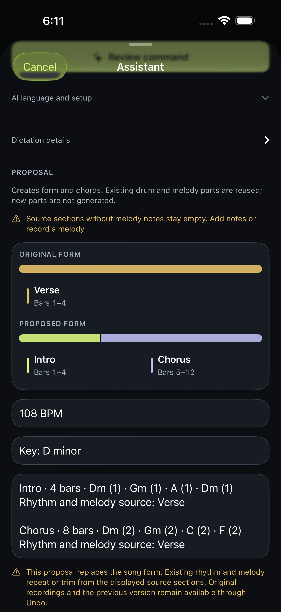</a></td></tr></table>

[Оригиналы и нативная проверка](Screenshots/SongForm27/README.md) · [Применение и этапы звука](docs/SONG_FORM_AND_SOUND_BANKS.md)

### Из описания в редактируемый трек

Откройте «Помощник» → «Примеры» и выберите тренировку, chillhop или медитацию. Можно также вставить свой вариант описания на русском или английском. Автоматический режим локально разбирает эти три формы, показывает план по тактам и предлагает значения, которых не задал автор. До сохранения можно поправить аккорды и длину, прослушать отдельную часть и отменить правку.

Тренировка возвращает точную первую партию после передышки. В chillhop флейта начинает одна, пианино чуть отстаёт от бита, арпеджио использует гармонию основной части и трек завершается гонгом. В медитации сначала слышен пэд, затем бансури с эхом, а в конце редкие клавиши и затухание. Для повторной работы откройте сохранённый план в «Помощнике»: новая версия создаётся отдельным проектом.

[Послушать все три результата, скачать проекты и MIDI](Media/Grooves/Arranger41/README.md) · [План и критерии приёмки](docs/OFFLINE_ARRANGER_RU.md) · [Музыкальный аудит и проверка интерфейса](docs/review/ANDREY_MUSICIAN_REVIEW_RU.md)

### Песня из исполнения

Запишите лайв и перенесите сыгранный порядок секций в отдельный проект. В новой песне можно менять секции, аккорды и партии. Сохранённый дубль доступен для повторного воспроизведения и экспорта.

[Оригинальный кадр и проверка](Screenshots/Release31/README.md)

### Игровая клавиатура

В «Джеме» откройте кнопку с клавишами или выберите «Клавиши» в нотном редакторе. Касание запускает ноту, удержание задаёт длительность, несколькими пальцами можно взять аккорд. В альбомной ориентации на широком экране помещаются две октавы. На мелодической дорожке кнопка записи сохраняет сыгранную фразу в открытый паттерн. Всю фразу можно отменить одним действием.

В галерее доступны записанные пианино и нейлоновая гитара, а также синтезированные электропианино, маримба, вибрафон, электроорган и четыре саксофона: сопрано, альт, тенор и баритон. У саксофонов различаются атака трости, призвук дыхания и вибрато. Выбор инструмента сохраняется на дорожке и слышен при воспроизведении и экспорте. В меню звуков доступны собственные банки SoundFont. [Послушать четыре саксофона по очереди, 9 секунд](Media/Audio/saxophone-voices.mp3)

### Эквалайзер в микшере

Нажмите **EQ** на дорожке или на мастере. За точку на графике можно потянуть пальцем, чтобы изменить частоту и усиление. Под графиком есть точные настройки четырёх полос, включая добротность Q и тип фильтра. Для сравнения на слух можно отключить отдельную полосу или весь EQ. В меню пресетов 27 готовых кривых для саксофона, ударных, баса, клавиш и мастера. Стереоэкспорт включает обработку мастера. При экспорте stems каждая дорожка сохраняет собственный EQ.

### Звуковые банки и Pocket Kit

Акустическое пианино и нейлоновая гитара доступны сразу. В звуковых банках можно найти и назначить инструмент из SoundFont. Тот же тембр используется в WAV и stems. В Джеме можно загрузить Pocket Kit из 16 сэмплов или выбрать свой звук из общей библиотеки.

<table><tr><td></td><td></td><td><a href="Screenshots/Sounds28/pocket-kit.png">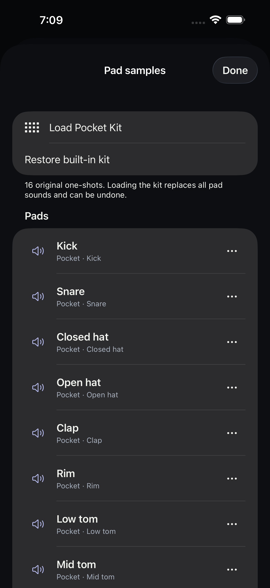</a></td></tr></table>

[Оригинальные экраны инструментов](Screenshots/InstrumentLibrary30/README.md) · [Pocket Kit](Screenshots/Sounds28/README.md) · [Настройки звука и исполнение](docs/SONG_FORM_AND_SOUND_BANKS.md)

### Ночная тема

<table><tr><td></td><td></td><td></td></tr><tr><td></td><td></td></tr></table>

[Оригинальные экраны и их версии](Screenshots/Design26/README.md)

История скриншотов сборки 23

## Экраны сборки 23

Ночная тема на iPhone 16 Pro Max Simulator. Perform показан с крупным системным текстом; нажмите на кадр, чтобы открыть оригинальный PNG.

<table><tr>
<td align="center"><strong>Фильтр и доступный Reset</strong>  </td>
<td align="center"><strong>Секции и транспорт</strong>  </td>
<td align="center"><strong>Review транспонирования</strong>  <a href="Screenshots/Build23Layout/transpose-preview.png">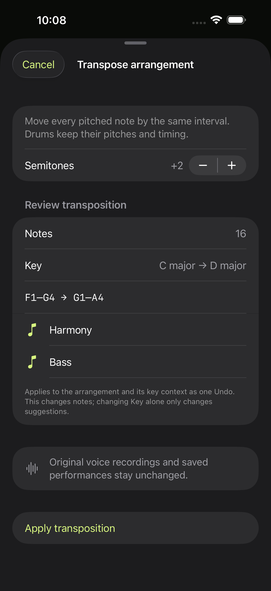</a></td>
</tr></table>

Эти три кадра сохраняют source `8f7cd0e`: методы-владельцы прошли, весь тот targeted-запуск — 4 PASS / 1 allowance. [Неизменённые оригиналы и происхождение](Screenshots/Build23Layout/README.md).

**Ступени и бемоли после перезапуска · прежний main 0cfd12e**

Оригинальный кадр `0cfd12e` принадлежит прошедшему Flats/scale-degrees методу. Весь main-run: 70 PASS / 2 FAIL / 1 allowance; один прошедший кадр не принимает весь релиз. [PNG, source/run и SHA-256](Screenshots/Build23Main/README.md).

**Помощник после исправлений · исходный кадр candidate 7564**

<a href="Screenshots/Build23Assistant/assistant-dictation-controls.png">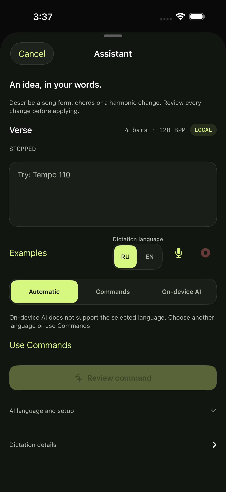</a>

Неизменённый оригинал `7564fe7`, owner AI setup PASS; весь focused4 — **4 PASS / 0 allowance**, не полный73 и не генерация реальной моделью. На кадре показаны реальные элементы управления и исходная языковая подсказка. [Source/run и provenance](Screenshots/Build23Assistant/README.md).

**Пэды после contact/hold · main `8bc7866`**

Неизменённый оригинал source `8bc7866`: Pad-owner **PASS13.483s**, предшествующий LiveEditing полностью **PASS83.255s**, включая Stop/hold/timing/counter. Весь full73 остаётся **71 PASS / 2 FAIL / общий timeout**, без полной приёмки. [PNG, owner и provenance](Screenshots/Build23Pads/README.md).

## Возможности

| Часть студии | Текущая реализация |
| --- | --- |
| **Grid и редакторы** | До 8 дорожек, 8 секций и 64 тактов. Карта всей песни, перетаскивание секций, изменение длины клипов, pinch-to-zoom, piano roll, Undo/Redo. |
| **Гармония** | 65 типов аккордов, свои интервальные формулы и voicing. A/B, стилизация, slash chords, буквенная запись, ступени и транспонирование. |
| **Локальный SketchComposer** | Скетч из аккордов, ударных, баса и мелодии по стилю и seed. Проверка, прослушивание, Apply одной операцией и дальнейшее редактирование. |
| **Jam и Perform** | Multi-touch пэды 4×4, шаги, квантование записи, overdub; запуск секций, фильтр/delay/repeat, запись, повтор и создание редактируемой песни из лайва. Наклон для фильтра или Master включается вручную. |
| **Помощник и голос** | RU/EN Commands; необязательный адаптер FoundationModels для музыкальных запросов на совместимом устройстве. Диктовка отдельно от монофонического Voice-to-MIDI beta с сохранением исходника и ручной коррекцией. |
| **Микшер и MIDI** | Вертикальные фейдеры, pan, mute/solo, Master, выбор встроенного тембра, назначение SoundFont и сэмплов пэдов. CoreMIDI input/output, CC Learn, Panic и интерфейс BLE MIDI. |
| **Проекты и экспорт** | Автосохранение, восстановление и переносимый `.grillapack`; MIDI Type 1, WAV mixdown и выровненные stems, 44.1/48 kHz, 16/24 bit. |
| **Интерфейс** | RU/EN, Light/Dark/System, Dynamic Type и VoiceOver. Статичный Launch Screen и анимация реальной загрузки без искусственной задержки. |

Локальные Commands и SketchComposer работают без Apple Intelligence. Скетчи создаёт локальный музыкальный алгоритм; показанные кадры не демонстрируют генерацию реальной моделью. Доступность FoundationModels зависит от устройства, iOS 26+, готовности Apple Intelligence и языка запроса. Языки ИИ и диктовки выбираются независимо.

**Конструктор трека** открывается из «Помощника» или при создании нового проекта. Для начала введите «Ночной хип-хоп, 88 BPM, ре минор, 8 тактов» и нажмите «Подобрать параметры». В меню «Готовый набор» доступны 18 музыкальных пресетов, по шесть для House, Hip-hop и Jazz. У каждого свои темп, гармония и вариант рисунка. Ритм, темп, тональность, лад, длину и аккорды можно менять по отдельности. «Послушать эскиз» проигрывает результат, а «Создать трек в сетке» сохраняет его отдельным проектом с четырьмя редактируемыми партиями.

В конструкторе сборки 37 используется автономный инструментальный генератор. Например, введите «Бум-бэп, 8 тактов, 88 BPM, ре минор. Первые четыре — только бас и барабаны. Перед повтором полтакта тишины». После «Подобрать параметры» можно задать длину вступления, выбрать бум-бэп или West Coast, изменить только бас или ударные и прослушать результат. В сохранённом проекте у баса и мелодии собственные MIDI-ноты, а секции можно редактировать на сетке. Системная модель подключается по желанию переключателем разбора описания. Ни для одного из режимов не требуется платный API.

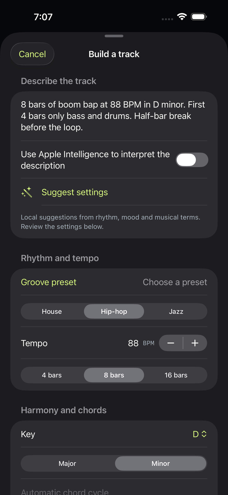 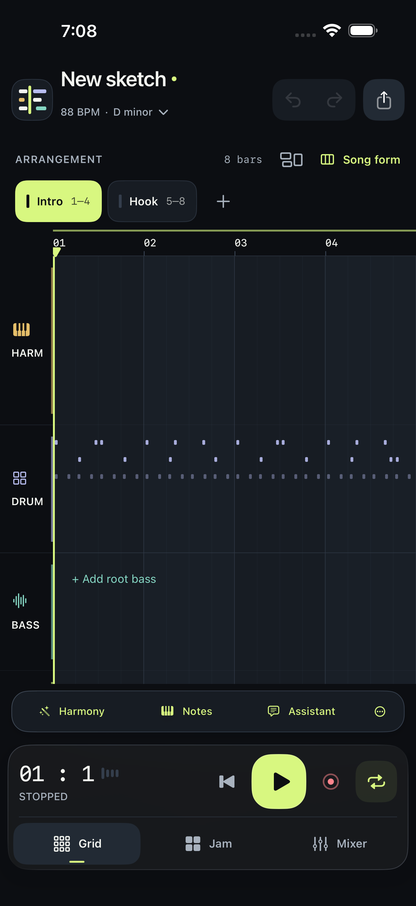

| Создано генератором 37 | Прослушать | Импортировать в сетку |
|---|---|---|
| Бум-бэп с четырёхтактовым вступлением, 88 BPM | [MP3](Media/Grooves/Pocket-at-88.mp3) | [Проект](Media/Grooves/Pocket-at-88.grillapack) |
| West Coast с коротким басом, 96 BPM | [MP3](Media/Grooves/Coast-at-96.mp3) | [Проект](Media/Grooves/Coast-at-96.grillapack) |

В сборке 38 режим Automatic в «Помощнике» поддерживает запрос «Create jazz hip hop old school», даже когда iOS сообщает о недоступности Apple Intelligence. «Проверить команду» откроет конструктор с готовыми параметрами. До «Создать трек в сетке» текущий проект остаётся открытым для возврата. [Послушать точный запрос](Media/Grooves/Old-school-jazz-hip-hop.mp3) · [Скачать редактируемый проект](Media/Grooves/Old-school-jazz-hip-hop.grillapack).

Если для языка описания доступна системная модель, Apple Intelligence предлагает параметры прямо на устройстве. В остальных случаях локальный подбор распознаёт знакомые слова о стиле и настроении и явные значения темпа, тональности и длины. Для точной последовательности можно вписать аккорды в поле конструктора или добавить в конец запроса «аккорды: Dm7 Bbmaj7 Gm7 A7». Состояние системной модели видно в основных настройках iPhone, в разделе «Apple Intelligence и Siri». [Требования Apple к устройству и языкам](https://support.apple.com/en-us/121115)

## Удобство работы руками

- **Пэды:** звук запускается при начале контакта; два пальца работают независимо. Квантование привязывает запись к сетке.
- **Нотный редактор.** Разведите или сведите два пальца, чтобы изменить масштаб времени, сохраняя высоту ряда на экране. Одним пальцем можно прокручивать сетку. При растягивании ноты линия показывает её конец, а Undo отменяет весь жест.
- **Звуки:** в микшере откройте «Звук» на мелодической дорожке, чтобы назначить инструмент из загруженного `.sf2`. В Джеме откройте «Звук → Сэмплы пэдов», чтобы сравнить три заводских набора, загрузить свой WAV/AIFF и сохранить настроенные пэды в «Мои наборы». [Инструкция](docs/SONG_FORM_AND_SOUND_BANKS.md)
- **Исполнение:** Replay и Reset доступны возле транспорта и фильтра, секции остаются под рукой при крупном тексте и в landscape. Наклоном можно управлять фильтром или громкостью микса проекта после ручного включения и калибровки.
- **Редактирование:** полные настройки открываются из меню проекта, Preview/Apply аккорда закреплены у нижней границы редактора.
- **Помощник:** у диктовки раздельные Start/Stop; поздний Stop после естественного окончания не начинает новую запись.

Эти изменения реализованы в приложении. Точную задержку и удобство на реальном iPhone ещё предстоит измерить.

## Попробовать на iPhone

**[Скачать La Grilla 1.0.0 (54)](https://raw.githubusercontent.com/alexgazin/la-grilla/7d1a6fb9b0fac206690615639d0db0a97269db32/Builds/Testing/LaGrilla-54-unsigned.ipa)**. Подпишите скачанный IPA своим Apple ID через Sideloadly. Бесплатная Personal Team подходит. [Установка и проверка пакета](Builds/Testing/README.md).

Перед обновлением экспортируйте важные проекты в `.grillapack`. Сборка 55 читает проекты схем 1…16 (16 — песни с аудиодорожками; их не откроют сборки до 54), проекты сборок 43–47 открываются без миграции. После сохранения в схеме 15 проект хранит исходники отредактированных пэдов. Чтобы снова открыть такую копию, требуется сборка 43 или новее.

## Подготовка к выпуску

У сборки 42 прошли 91 из 91 сценария iPhone Simulator, 237 тестов музыкальной логики и 17 наборов аудиоядра. Проверены офлайн-аранжировки, сохранение и повторное открытие проектов, живое исполнение и экспорт. Для TestFlight и App Store ещё предстоят прослушивание на реальном iPhone, проверка MIDI-контроллера и релизная подпись. [Результаты и открытые проверки](docs/release/CURRENT.md)

[Текущая сборка и результаты](docs/release/CURRENT.md) · [Протокол устройства](docs/release/DEVICE_ACCEPTANCE.md) · [Роадмап](ROADMAP.md) · [Дизайн](DESIGN.md)

Исходные экраны доработок 22: пэды, ноты и звук

## Исходные доработки сборки 22

Оригинальные кадры работающего **iPhone 16 Pro Max Simulator**, ночная тема. Нажмите, чтобы открыть полный PNG.

<table>
  <tr>
    <td align="center" valign="top"><strong>Пэды и доступный выбор звука</strong>  </td>
    <td align="center" valign="top"><strong>Изменённая длина ноты</strong>  </td>
    <td align="center" valign="top"><strong>Прослушивание тембра</strong>  </td>
  </tr>
</table>

Все выбранные PNG принадлежат прошедшим методам. Четыре кадра имеют source `60c24ce` (9 PASS / 1 ошибка ожидания форматирования), нотный кадр — `aded2ff` (1 PASS, resize и оба Undo). Product-код между этими исходниками и исходным `main` 22 совпадает. Это раздельные focused-проверки, не новый полный прогон 10 или 73 сценариев. [Пять оригиналов, source/run и контрольные суммы](Screenshots/Build22Touch/README.md).

Историческое видео работы · сборка 15

## Настоящее видео работы · сборка 15

**[▶ Смотреть запись — 2:12, Full HD, со звуком](https://github.com/alexgazin/la-grilla/raw/refs/heads/main/Media/WorkingDemo/la-grilla-working-demo.mp4)** · [Полная исходная запись](https://github.com/alexgazin/la-grilla/raw/refs/heads/main/Media/WorkingDemo/la-grilla-session-original.mp4)

Историческая запись **iOS Simulator, 1.0.0 (15)**: Play, аккорды, жесты, пэды, overdub, микшер, Harmony A/B, Commands, Perform и WAV share. Звук снят с выхода тех же сессий; три сессии смонтированы с сокращением ожиданий, действия идут в обычном темпе. Voice показан на подготовке записи. [Источники, монтаж и проверки](Media/WorkingDemo/README.md) сохраняют исходный результат capture-workflow и границы принятой записи.

По просьбе владельца новое видео отменено. Историческое видео 15 сохранено со своим source и результатом; оно не представляет сборку 23.

Исторические оригиналы сборок 19 и 20

## Оригинальные экраны кандидата 20

Два оригинальных кадра работающей сборки 20: Harmony A/B и фильтр Perform. Эти экраны сняты с кандидата `deeb701` в iOS Simulator.

  
  

Методы-владельцы обоих кадров прошли; [весь запуск](https://github.com/alexgazin/la-grilla/actions/runs/43966102437) завершился с **2 PASS / 1 allowance / 1 interrupted**. Это предпросмотр интерфейса, не полная приёмка и не готовый проморолик. Исходные пиксели сохранены без изменений; [происхождение, имена вложений и SHA-256](Screenshots/Build20Preview/manifest.json).

### Предыдущие оригиналы сборки 19

Шесть оригинальных кадров сборки19 на работающем **iPhone 16 Pro Max Simulator**; сборка20 сохраняет этот интерфейс и исправляет импортированный диапазон воспроизведения. Нажмите на экран, чтобы открыть полный PNG.

<table>
  <tr>
    <td align="center" valign="top"><strong>Скетч перед применением</strong> Стиль, гармония и партии · A/B  </td>
    <td align="center" valign="top"><strong>Развить идею в сетке</strong> Редактируемая аранжировка на 8 тактов  </td>
    <td align="center" valign="top"><strong>Забрать MIDI</strong> Настоящее системное меню экспорта  </td>
  </tr>
  <tr>
    <td align="center" valign="top"><strong>Сохранить нотацию</strong> D♭maj7/F♯ после перезапуска  </td>
    <td align="center" valign="top"><strong>Свои формулы аккордов</strong> Все тоны остаются в редакторе  </td>
    <td align="center" valign="top"><strong>Идея своими словами</strong> Commands и понятная доступность AI  </td>
  </tr>
</table>

Кадры — **source `f005854`, сборка 19, schema 10**, [run 43890521487](https://github.com/alexgazin/la-grilla/actions/runs/43890521487): **13 PASS / 2 assertion FAIL / 0 timeout**. Все шесть выбранных PNG относятся к прошедшим методам; весь прогон не принят, два падения транспонирования сохранены в отчёте. Оригинальные пиксели не изменены. [Происхождение и пределы каждого кадра](Screenshots/AuditImprovements/README.md) · [Манифест и SHA-256](Screenshots/AuditImprovements/manifest.json).

Исторические экраны, дизайн и промо

- [Предпросмотр и живое транспонирование сборки19](Screenshots/Transposition19) с собственным PASS-методом и раскрытым итогом всего запуска.
- [73 оригинальных экрана сборки 14](Screenshots/OriginalVision), [EN/RU Store-копии](Screenshots/AppStore).
- [Welcome и Settings сборки 15](Screenshots/ProfessionalShell), [дизайн и OpenArt-происхождение](Design/2026).
- [QA-превью splash сборки 17](Screenshots/LaunchPreview), [разрешённый input и Assistant 17](Screenshots/AuthorizedInput), [восстановление после ошибок сборки 16](Screenshots/DeviceRepair).
- [Историческое промо из скриншотов с отдельным offline-саундтреком](Media/Promo/README.md).

У каждой коллекции собственные source, run и хеши. Splash-превью показывает тот же компонент при явно удержанном QA-представлении и не измеряет время холодного запуска. Исторические медиа не переименовываются в доказательства текущей сборки 23.

