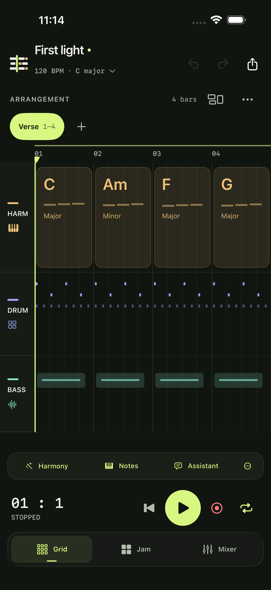
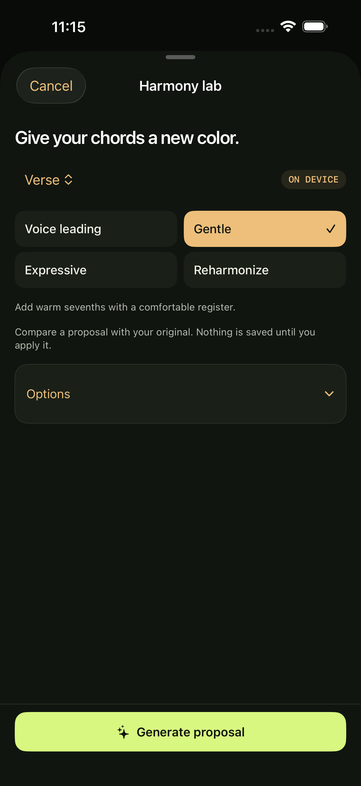
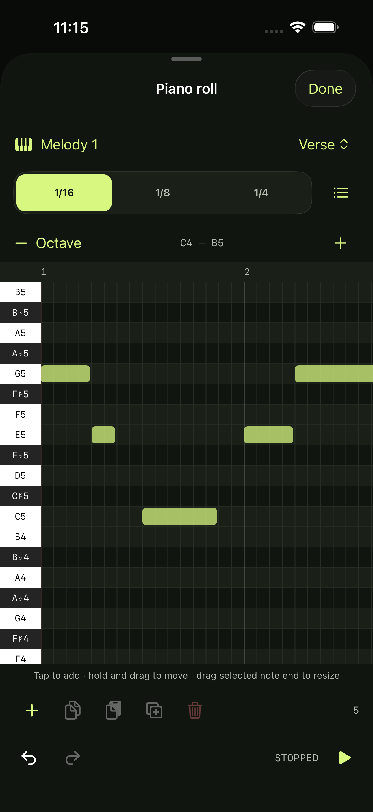
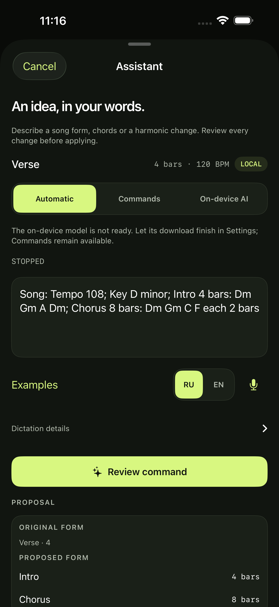
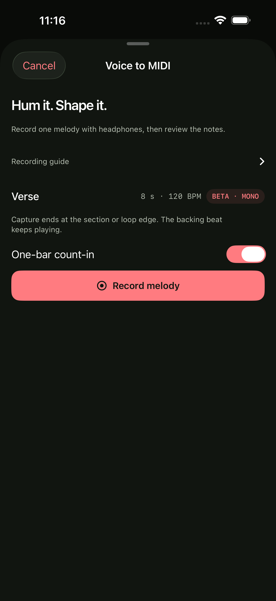
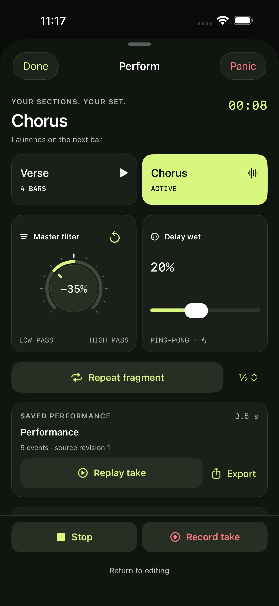
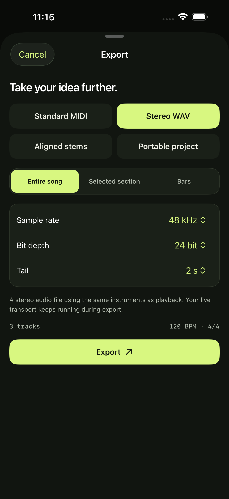

  

<h1 align="center">La Grilla</h1>

<strong>Идея → грув → трек.</strong> Карманная студия для iPhone: сочиняйте гармонию, играйте бит, собирайте аранжировку и забирайте музыку в свою DAW.

   
  iOS 18+ · SwiftUI · нативный звук · RU / EN · без аккаунта

<a href="#что-уже-работает">Возможности</a> · <a href="#установить-на-свой-iphone">На свой iPhone</a> · <a href="ROADMAP.md">Роадмап</a> · <a href="docs/IMPLEMENTATION_LOG.md">Журнал разработки</a>

## Студия в девяти экранах

Настоящие экраны **1.0.0 (14)** из работающего приложения в iOS Simulator. Нажмите на изображение, чтобы открыть оригинал.

<table>
  <tr>
    <td align="center" valign="top" width="33%">
      <strong>Grid · форма трека</strong> Аккорды, дорожки, такты и секции  
      
    </td>
    <td align="center" valign="top" width="33%">
      <strong>Jam · сыграть грув</strong> 16 пэдов, квантование и overdub  
      
    </td>
    <td align="center" valign="top" width="33%">
      <strong>Mixer · найти баланс</strong> Вертикальные фейдеры, pan, mute / solo  
      
    </td>
  </tr>
  <tr>
    <td align="center" valign="top" width="33%">
      <strong>Harmony · новый цвет</strong> Voicing, стилизация и сравнение A/B  
      
    </td>
    <td align="center" valign="top" width="33%">
      <strong>Notes · своя мелодия</strong> Piano roll, перенос и длина нот  
      
    </td>
    <td align="center" valign="top" width="33%">
      <strong>Assistant · идея словами</strong> Локальные Commands и review формы  
      
    </td>
  </tr>
  <tr>
    <td align="center" valign="top" width="33%">
      <strong>Voice · напеть идею</strong> Монофонический Voice-to-MIDI · beta  
      
    </td>
    <td align="center" valign="top" width="33%">
      <strong>Perform · сыграть трек</strong> Секции, круговой фильтр, FX и live take  
      
    </td>
    <td align="center" valign="top" width="33%">
      <strong>Export · продолжить в DAW</strong> MIDI, WAV, stems и переносимый проект  
      
    </td>
  </tr>
</table>

[Все 73 оригинальных скриншота](Screenshots/OriginalVision) · [Русский интерфейс](Screenshots/OriginalVision/grid-ru.png) · [Светлая тема](Screenshots/OriginalVision/grid-light.png) · [Компактный iPhone](Screenshots/OriginalVision/compact-grid.png) · [12 кадров для App Store EN/RU](Screenshots/AppStore)

PNG сохранены без изменений; [манифест](Screenshots/OriginalVision/manifest.json) содержит источник, запуск тестов, размеры и SHA-256 каждого кадра. У Assistant на показанном экране работает локальный режим Commands; это не демонстрация генерации реальной моделью.

## Что уже работает

| Часть студии | Возможности текущей сборки |
| --- | --- |
| **Аранжировка** | До 8 дорожек, 8 секций и 64 тактов; 4/4, 40–240 BPM. Перенос, копирование и изменение длины клипов, перестановка секций, pinch-to-zoom с сохранением точки под пальцами. |
| **Гармония** | 65 типов аккордов, свои интервальные формулы, обращения и slash chords. Voice leading, усложнение и reharmonize с A/B, Apply и Undo. |
| **Бит и мелодия** | Пэды 4×4, step editor, count-in, квантование, overdub / replace; бас и независимые мелодические дорожки с piano roll. |
| **Живой звук** | Общий транспорт между экранами, циклы и правки во время воспроизведения. Ноты, структура, тембры, микшер и FX принимаются согласованно на музыкальной границе. |
| **Assistant** | Текстовые RU/EN Commands для темпа, тональности, секций, аккордов и формы целой песни. Предложения можно проверить, прослушать, применить или отменить одной операцией. Диктовка использует Apple Speech при наличии локальной языковой модели. |
| **Voice-to-MIDI · beta** | Запись одной мелодической линии поверх бита, сохранение исходного аудио, определение высоты, прослушивание, ручная коррекция нот и ритма, Apply / Undo. Нужны наушники и проверка результата. |
| **DJ Performance** | Квантованный запуск секций, beat jumps, repeat, круговой Low/High Pass и delay. Запись, воспроизведение и экспорт live take. |
| **Микшер и MIDI** | Вертикальные фейдеры, pan, mute / solo, Master и индикаторы. CoreMIDI input / output, выбор каналов, CC Learn, Panic и интерфейс подключения BLE MIDI. |
| **Экспорт и проекты** | MIDI Type 1, WAV mixdown и выровненные stems: 44.1 / 48 kHz, 16 / 24 bit. Переносимый `.grillapack` сохраняет исходные записи. Автосохранение, восстановление, Undo / Redo. |
| **Интерфейс** | Русский и английский, светлая и тёмная темы, Dynamic Type, VoiceOver и Reduce Motion; компактные и горизонтальные экраны. [Дизайн и OpenArt-источники](Design/2026). |

**On-device AI:** адаптер Apple FoundationModels включается на совместимом устройстве с iOS 26+, Apple Intelligence, готовой моделью и поддерживаемым языком. Локальные RU/EN Commands доступны отдельно. Качество и задержка генерации реальной моделью ещё требуют проверки на устройстве.

Основная студия работает локально, без аккаунта и облачного API. Все инструментальные звуки синтезируются приложением.

## Установить на свой iPhone

Нужны Mac с Xcode **26.3 или новее** и iPhone с **iOS 18+**.

1. Склонируйте репозиторий или подтяните свежий `main`; откройте [`LaGrilla.xcodeproj`](LaGrilla.xcodeproj).
2. В Xcode добавьте свой Apple ID: **Settings → Accounts**. В app target → **Signing & Capabilities** включите **Automatically manage signing** и выберите свою **Team**.
3. Подключите iPhone по USB, подтвердите **Trust / Доверять** и включите **Developer Mode / Режим разработчика**, если Xcode попросит.
4. Выберите схему **LaGrilla**, свой iPhone и нажмите **Run**.

Бесплатная Personal Team подходит для локального запуска; такую подпись обычно нужно обновлять раз в семь дней через Xcode. Если bundle identifier занят, задайте уникальный для своей локальной сборки. [Подробная инструкция и команды сборки](docs/DEVELOPMENT.md#run-on-your-own-iphone).

Приложение пока не опубликовано в App Store. CI-архив собран без distribution-подписи и не является устанавливаемым IPA.

## Проверки и готовность

Текущий программный кандидат — **1.0.0 (14), schema 8**. Этапы C1–C7 приняты; интеграция — [PR #13](https://github.com/alexgazin/la-grilla/pull/13).

| Подтверждение | Результат и источник |
| --- | --- |
| Полная программная приёмка | [Run 43771988471](https://github.com/alexgazin/la-grilla/actions/runs/43771988471), исходники `77fb72ab82cd800eb8131136628c416ad83c9046`: **118 Swift tests / 19 suites**, **15 C++ suites**, **44/44 функциональных native-сценария** и **3/3 метода захвата**. Один отдельный opt-in diagnostic пропущен намеренно. |
| Интеграция в `main` | [Run 43777618996](https://github.com/alexgazin/la-grilla/actions/runs/43777618996) для merge commit `8e5b1f7`: все три CI jobs и **44/44 функциональных native-сценария** прошли; повторный массовый захват кадров не запускался. Актуальные проверки ветки — в badge наверху. |
| Дополнительная совместимость | [Run 43777646531](https://github.com/alexgazin/la-grilla/actions/runs/43777646531): неизменные исходники приложения `77fb72a`, **iOS 18.5 Simulator**, **3/3 сценария** — whole-song Commands Apply / Undo, custom chord save / Undo, переходы между экранами при воспроизведении. Это отдельная ограниченная проверка, не полный прогон и не физический iPhone. |
| Визуальная приёмка | 73 индивидуально просмотренных оригинала; 12 Store-копий EN/RU и четыре корневых превью сохраняют исходные байты. 603 локализованных ключа EN/RU. [Сводка и ограничения C7](docs/release/C7_ACCEPTANCE.md). |

**До App Store остаётся C8:** установка и приёмка на физических iPhone, включая минимальную ОС; 30-минутные проверки задержки, нагрева и непрерывности звука; speaker / wired / USB / Bluetooth-маршруты; настоящие USB/BLE MIDI-контроллеры и импорт в две DAW; живой напев и реальная FoundationModels; distribution signing, TestFlight и App Review. [Чек-лист устройства](docs/release/DEVICE_ACCEPTANCE.md) и [процедура выпуска](docs/release/RELEASE.md).

Voice-to-MIDI остаётся монофонической beta с ручной проверкой. В аудио-QA зафиксированы разрывы временных меток рендера; отсутствие слышимых выпадений на телефоне ещё не измерено. Границы подтверждённых результатов подробно сохранены в [приёмке C7](docs/release/C7_ACCEPTANCE.md).

## Документация и дальнейшая работа

README описывает текущую сборку и обновляется вместе с проверенными этапами. Первоначальные формулировки «после MVP» сохранены отдельно, чтобы история требований не смешивалась с фактическими возможностями.

- [ROADMAP](ROADMAP.md) — выполненные этапы и оставшаяся работа до App Store.
- [План C0–C8](docs/ORIGINAL_VISION_COMPLETION.md) — подробные задачи, технические контракты и критерии приёмки.
- [Журнал реализации](docs/IMPLEMENTATION_LOG.md) — исправления, проверки и ссылки на результаты.
- [Development](docs/DEVELOPMENT.md) — архитектура, структура репозитория, сборка и установка.
- [Принятая QA](docs/release/C7_ACCEPTANCE.md) · [Release QA](docs/RELEASE_QA.md) · [Физическая приёмка](docs/release/DEVICE_ACCEPTANCE.md).
- [Исходная продуктовая спецификация](docs/PRODUCT_SPECIFICATION.md) — все 25 первоначальных разделов, backlog и источники.
- [Дизайн-бриф](DESIGN_PROMPT.txt) · [Текущий дизайн](Design/2026/README.md) · [Privacy RU](docs/privacy/ru.md) / [EN](docs/privacy/en.md) · [Support](docs/release/SUPPORT.md).
