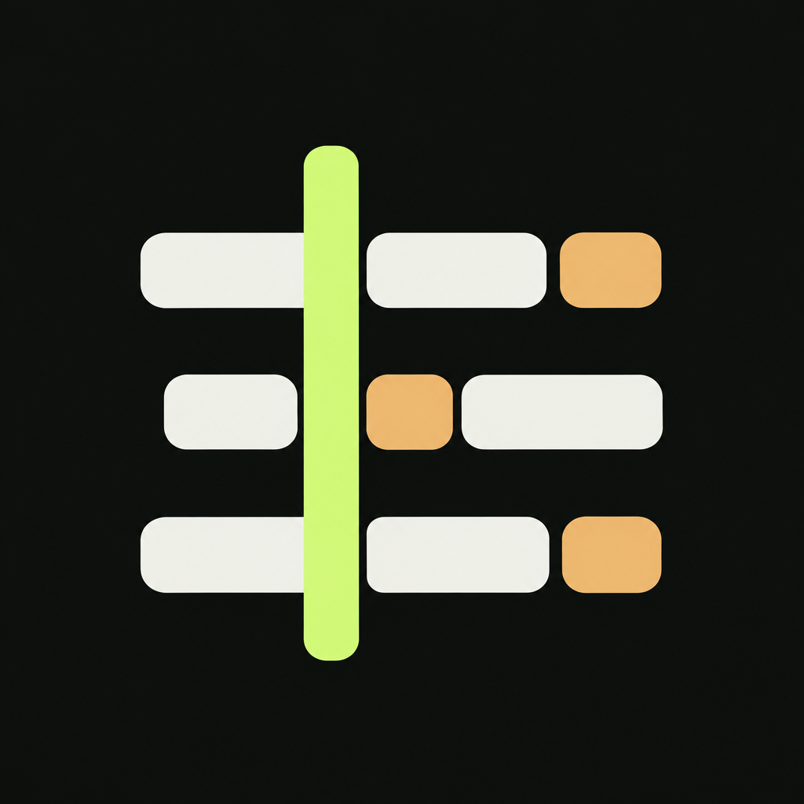
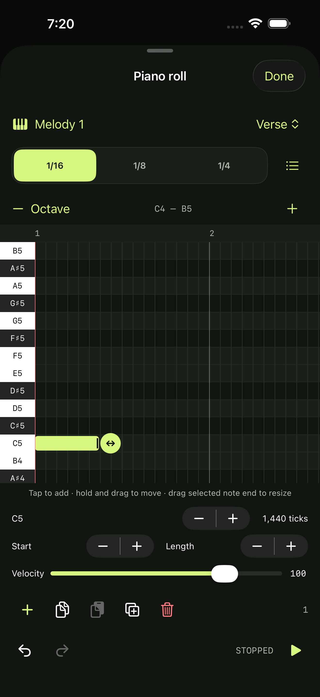
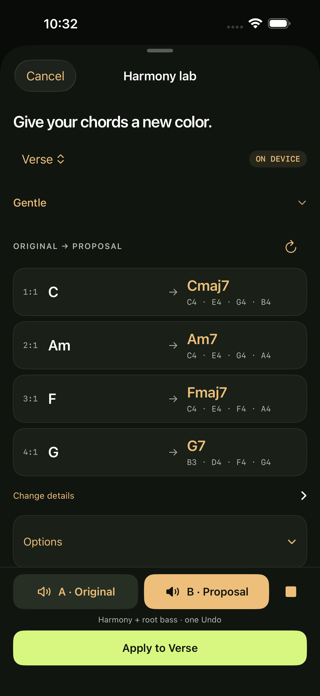

  

<h1 align="center">La Grilla</h1>

<strong>Идея → грув → трек.</strong> Карманная студия для iPhone: сочиняйте гармонию, играйте бит, собирайте аранжировку и продолжайте работу в своей DAW.

   
  iOS 18+ · SwiftUI · нативный звук · RU / EN · без аккаунта

<a href="#экраны-сборки-22">Экраны</a> · <a href="#возможности-сборки-22">Возможности</a> · <a href="#попробовать-на-iphone">На iPhone</a> · <a href="docs/release/CURRENT.md">Текущий статус</a> · <a href="ROADMAP.md">Роадмап</a>

**В `main` — La Grilla 1.0.0 (22), schema 11. Статус — функциональная альфа.** Ночная тема сохранена; доработаны касания, нотный редактор, выбор тембров и управление наклоном. [Скачать тестовую IPA 22 из `main`](https://github.com/alexgazin/la-grilla/actions/runs/44038751086/artifacts/14307869946) · [Установка и SHA-256](Builds/Testing/README.md).

## Что изменилось в 22

- **Пэды:** звук запускается при начале контакта. Пальцы независимы; удержание и скольжение не добавляют случайных ударов. Квантование меняет записанный ритм, а не откладывает живой удар.
- **Ноты:** длина и положение видны во время движения; конец отмечен линией и подсказкой выше пальца. Рукоятка 44×44 pt, привязка к сетке и одно Undo на завершённый жест.
- **Звуки:** кнопка «Звук» в Jam и Mixer открывает встроенные Classic/Warm/Bright с прослушиванием. Apply сохраняет выбранный тембр одной операцией Undo.
- **Наклон:** в Perform можно вручную включить управление фильтром или общей громкостью проекта и запомнить нейтральное положение. Настоящие датчики и удобство на iPhone ещё требуют проверки.

## Экраны сборки 22

Оригинальные кадры работающего **iPhone 16 Pro Max Simulator**, ночная тема. Нажмите, чтобы открыть полный PNG.

<table>
  <tr>
    <td align="center" valign="top"><strong>Пэды и доступный выбор звука</strong>  </td>
    <td align="center" valign="top"><strong>Изменённая длина ноты</strong>  </td>
    <td align="center" valign="top"><strong>Прослушивание тембра</strong>  </td>
  </tr>
</table>

Все выбранные PNG принадлежат прошедшим методам. Четыре кадра имеют source `60c24ce` (9 PASS / 1 ошибка ожидания форматирования), нотный кадр — `aded2ff` (1 PASS, resize и оба Undo). Product-код между этими исходниками и исходным `main` 22 совпадает. Это раздельные focused-проверки, не новый полный прогон 10 или 73 сценариев. [Пять оригиналов, source/run и контрольные суммы](Screenshots/Build22Touch/README.md).

## Возможности сборки 22

| Часть студии | Текущая реализация |
| --- | --- |
| **Grid и редакторы** | До 8 дорожек, 8 секций и 64 тактов. Перенос, копирование, изменение длины, pinch-to-zoom, piano roll, Undo/Redo. |
| **Гармония** | 65 типов аккордов, свои интервальные формулы и voicing. A/B, стилизация, slash chords, буквенная запись, ступени и транспонирование. |
| **Локальный SketchComposer** | Скетч из аккордов, ударных, баса и мелодии по стилю и seed. Проверка, прослушивание, Apply одной операцией и дальнейшее редактирование. |
| **Jam и Perform** | Multi-touch пэды 4×4, шаги, квантование записи, overdub; запуск секций, фильтр/delay/repeat, запись и replay. Наклон для фильтра или Master включается вручную. |
| **Помощник и голос** | RU/EN Commands; необязательный адаптер FoundationModels для музыкальных запросов на совместимом устройстве. Диктовка отдельно от монофонического Voice-to-MIDI beta с сохранением исходника и ручной коррекцией. |
| **Микшер и MIDI** | Вертикальные фейдеры, pan, mute/solo, Master и выбор встроенного тембра; CoreMIDI input/output, CC Learn, Panic и интерфейс BLE MIDI. |
| **Проекты и экспорт** | Автосохранение, восстановление и переносимый `.grillapack`; MIDI Type 1, WAV mixdown и выровненные stems, 44.1/48 kHz, 16/24 bit. |
| **Интерфейс** | RU/EN, Light/Dark/System, Dynamic Type и VoiceOver. Статичный Launch Screen и анимация реальной загрузки без искусственной задержки. |

Локальные Commands и SketchComposer работают без Apple Intelligence. Скетчи создаёт локальный музыкальный алгоритм; показанные кадры не демонстрируют генерацию реальной моделью. Доступность FoundationModels зависит от устройства, iOS 26+, готовности Apple Intelligence и языка запроса. Языки AI и диктовки выбираются независимо.

## Попробовать на iPhone

**[Скачать La Grilla 1.0.0 (22) · ZIP с IPA из `main`](https://github.com/alexgazin/la-grilla/actions/runs/44038751086/artifacts/14307869946)** — iPhone / iOS 18+, source [`b478021`](https://github.com/alexgazin/la-grilla/commit/b478021ca4281527b0b1cbfbcae38eb80ba51392). Войдите в GitHub, скачайте архив и извлеките `LaGrilla-unsigned.ipa` (3.5 MiB). Подпишите её своим Apple ID через Sideloadly на Mac или Windows. Бесплатная Personal Team подходит; подпись обычно действует 7 дней. [Инструкция, точный SHA-256 и предыдущие IPA](Builds/Testing/README.md).

Для сборки **22** из исходников нужны Mac, iPhone с iOS 18+ и Xcode 26.3+:

1. Обновить `main` и открыть [`LaGrilla.xcodeproj`](LaGrilla.xcodeproj).
2. Выбрать свою **Personal Team** в **Signing & Capabilities**, включив automatic signing.
3. Подключить iPhone, подтвердить Trust/Developer Mode и нажать **Run**.

Перед обновлением экспортируйте важные проекты в portable bundle. Сборка 22 читает схемы 1…10 и сохраняет **schema 11**; старые приложения не открывают сохранённую schema 11. Debug и Release archive точного `main` прошли, compatibility Xcode 16.4 / 26.0.1 тоже прошла. Полный набор 73 и аппаратная приёмка пока не приняты. [Результаты и ограничения](docs/release/CURRENT.md).

## Настоящее видео работы · сборка 15

**[▶ Смотреть запись — 2:12, Full HD, со звуком](https://github.com/alexgazin/la-grilla/raw/refs/heads/main/Media/WorkingDemo/la-grilla-working-demo.mp4)** · [Полная исходная запись](https://github.com/alexgazin/la-grilla/raw/refs/heads/main/Media/WorkingDemo/la-grilla-session-original.mp4)

Историческая запись **iOS Simulator, 1.0.0 (15)**: Play, аккорды, жесты, пэды, overdub, микшер, Harmony A/B, Commands, Perform и WAV share. Звук снят с выхода тех же сессий; три сессии смонтированы с сокращением ожиданий, действия идут в обычном темпе. Voice показан на подготовке записи. [Источники, монтаж и проверки](Media/WorkingDemo/README.md) сохраняют исходный результат capture-workflow и границы принятой записи.

Нового принятого ролика сборки 22 пока нет. Историческая попытка записи 20 не завершила четыре сценария и не сохранила воспроизводимый MP4; видео 15 сохраняет собственные source и результат.

## Готовность и дальнейшая работа

Проверки касаний прошли как 9 сценариев на `60c24ce` и отдельный resize с двумя Undo на `aded2ff`, при одинаковом product-коде. Полная exact-main регрессия 73 ещё не принята: первый запуск остановился на служебной подготовке Simulator до functional-тестов. Частичные результаты не заменяют этот прогон.

Следующие шаги — завершить полный CI и повторить на установленной 22 плотный ритм, два пальца, изменение нот возле краёв и наклон. Физическая задержка, speaker/wired/USB/Bluetooth, голос/Apple Intelligence, USB/BLE MIDI, две DAW и 30-минутные сессии остаются открытыми. Приложение пока не опубликовано в App Store; signing для distribution, TestFlight и App Review впереди.

[Текущие доказательства](docs/release/CURRENT.md) · [Изменения контакта и звука](docs/review/2026-11-17/TOUCH21.md) · [Роадмап](ROADMAP.md) · [34 замечания аудита](docs/review/2026-11-16/PLAN.md) · [Журнал разработки](docs/IMPLEMENTATION_LOG.md).

Исторические оригиналы сборок 19 и 20

## Оригинальные экраны кандидата 20

Два оригинальных кадра работающей сборки 20: Harmony A/B и фильтр Perform. Эти экраны сняты с кандидата `deeb701` в iOS Simulator.

  
  

Методы-владельцы обоих кадров прошли; [весь запуск](https://github.com/alexgazin/la-grilla/actions/runs/43966102437) завершился с **2 PASS / 1 allowance / 1 interrupted**. Это предпросмотр интерфейса, не полная приёмка и не готовый проморолик. Исходные пиксели сохранены без изменений; [происхождение, имена вложений и SHA-256](Screenshots/Build20Preview/manifest.json).

### Предыдущие оригиналы сборки 19

Шесть оригинальных кадров сборки19 на работающем **iPhone 16 Pro Max Simulator**; сборка20 сохраняет этот интерфейс и исправляет импортированный диапазон воспроизведения. Нажмите на экран, чтобы открыть полный PNG.

<table>
  <tr>
    <td align="center" valign="top"><strong>Скетч перед применением</strong> Стиль, гармония и партии · A/B  </td>
    <td align="center" valign="top"><strong>Развить идею в сетке</strong> Редактируемая аранжировка на 8 тактов  </td>
    <td align="center" valign="top"><strong>Забрать MIDI</strong> Настоящее системное меню экспорта  </td>
  </tr>
  <tr>
    <td align="center" valign="top"><strong>Сохранить нотацию</strong> D♭maj7/F♯ после перезапуска  </td>
    <td align="center" valign="top"><strong>Свои формулы аккордов</strong> Все тоны остаются в редакторе  </td>
    <td align="center" valign="top"><strong>Идея своими словами</strong> Commands и понятная доступность AI  </td>
  </tr>
</table>

Кадры — **source `f005854`, сборка 19, schema 10**, [run 43890521487](https://github.com/alexgazin/la-grilla/actions/runs/43890521487): **13 PASS / 2 assertion FAIL / 0 timeout**. Все шесть выбранных PNG относятся к прошедшим методам; весь прогон не принят, два падения транспонирования сохранены в отчёте. Оригинальные пиксели не изменены. [Происхождение и пределы каждого кадра](Screenshots/AuditImprovements/README.md) · [Манифест и SHA-256](Screenshots/AuditImprovements/manifest.json).

Исторические экраны, дизайн и промо

- [Предпросмотр и живое транспонирование сборки19](Screenshots/Transposition19) с собственным PASS-методом и раскрытым итогом всего запуска.
- [73 оригинальных экрана сборки 14](Screenshots/OriginalVision), [EN/RU Store-копии](Screenshots/AppStore).
- [Welcome и Settings сборки 15](Screenshots/ProfessionalShell), [дизайн и OpenArt-происхождение](Design/2026).
- [QA-превью splash сборки 17](Screenshots/LaunchPreview), [разрешённый input и Assistant 17](Screenshots/AuthorizedInput), [восстановление после ошибок сборки 16](Screenshots/DeviceRepair).
- [Историческое промо из скриншотов с отдельным offline-саундтреком](Media/Promo/README.md).

У каждой коллекции собственные source, run и хеши. Splash-превью показывает тот же компонент при явно удержанном QA-представлении и не измеряет время холодного запуска. Исторические медиа не переименовываются в доказательства текущей сборки 22.

