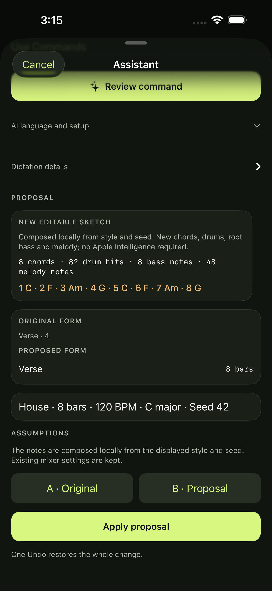
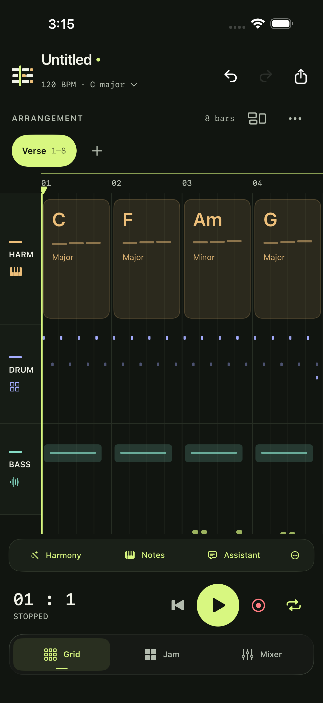
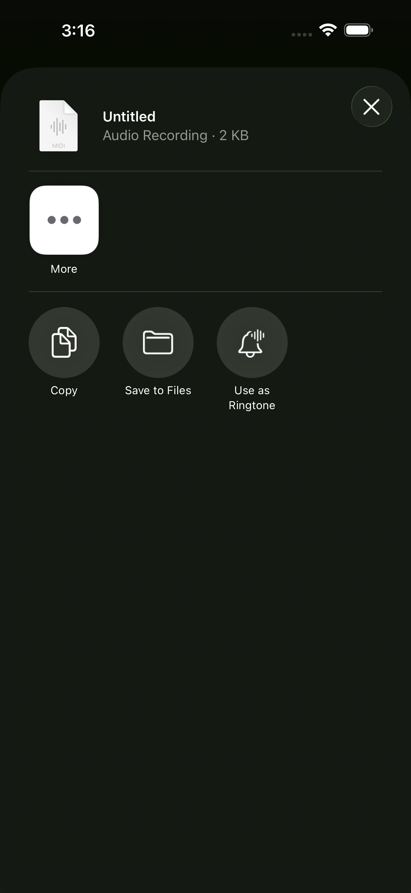
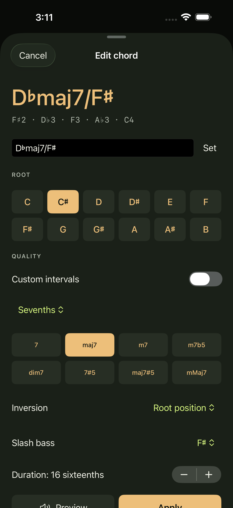
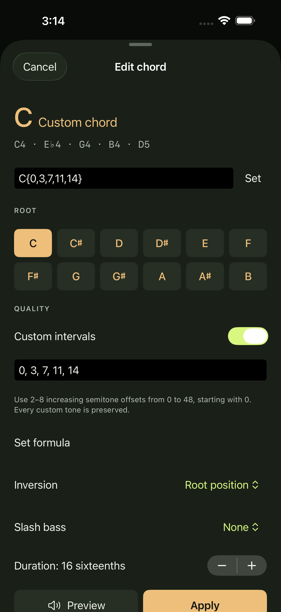
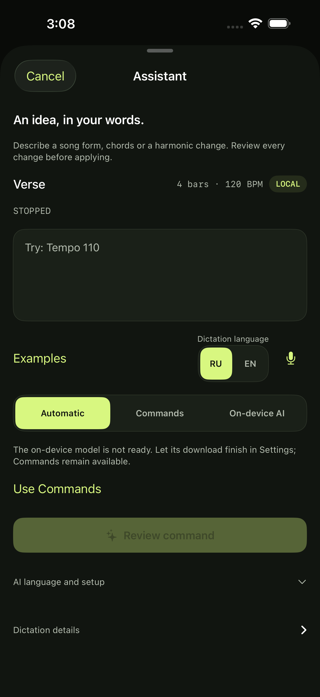

# Audit improvements — build 19

Six original XCTest screenshots from [run 43890521487, attempt 1](https://github.com/alexgazin/la-grilla/actions/runs/43890521487/attempts/1), source [`f00585461b4ba3453d6f90a7bf479b349d85698f`](https://github.com/alexgazin/la-grilla/commit/f00585461b4ba3453d6f90a7bf479b349d85698f), build **19**, project schema **10**. Each image belongs to a **passing test method** on the iPhone 16 Pro Max Simulator, iOS 26.2, arm64, Xcode 26.3.

**The complete focused run did not pass: 13 methods passed, 2 failed assertions, 0 execution-allowance timeouts.** `xcodebuild` exited 65 and finalized its result bundle. Both failures belong to `TranspositionUITests`; no image from either failed method is included here. These six accepted frames do not change that run result.

<table>
  <tr>
    <td align="center" valign="top"><strong>Review a new local sketch</strong> Style, seed, real parts, A/B and Apply  </td>
    <td align="center" valign="top"><strong>Apply to the arrangement</strong> Editable 8-bar harmony, drums, bass and melody  </td>
    <td align="center" valign="top"><strong>Share the generated MIDI</strong> Actual iOS share sheet after store reopen  </td>
  </tr>
  <tr>
    <td align="center" valign="top"><strong>Preserve chord writing</strong> D♭maj7/F♯ after Undo/Redo and relaunch  </td>
    <td align="center" valign="top"><strong>Keep every custom tone</strong> C, E♭, G, B and D from the saved formula  </td>
    <td align="center" valign="top"><strong>Explain model availability</strong> Commands fallback and separate dictation language  </td>
  </tr>
</table>

| Frames | What their passing native method established |
| --- | --- |
| [Sketch review](01-local-sketch-review.png) and [applied Grid](02-local-sketch-applied.png) | `SketchGenerationTests/testEmptyProjectLocalSketchABApplyUndo` passed in **48.199 s**. An actual empty project produced a deterministic House sketch: 8 bars, 120 BPM, C major, seed 42. The original remained unchanged during A/B; actual output was silent for the empty original and nonzero for the proposal. Apply populated all four musical roles; one Undo restored the empty 4-bar project and Redo restored the 8-bar sketch. |
| [MIDI share](03-generated-sketch-midi-share.png) | `SketchGenerationTests/testGeneratedSketchReopensWithRealAudioAndMIDIShare` passed in **73.248 s**. The generated project was saved, reopened in a fresh app process, played with real nonzero output and an advancing clock into bars 5–8, and exported through the actual MIDI share sheet without an export error. The system calls the 2 KB item “Audio Recording” while its icon says MIDI. No external DAW import or completed Save to Files action is claimed. |
| [Chord writing after reopen](04-chord-writing-after-reopen.png) | `ChordWritingUITests/testTypedRootAndSlashWritingSurviveUndoRedoAndStoreReopen` passed in **48.918 s**. Typed `Dbmaj7/F#` retained `D♭maj7/F♯` through Apply, Undo/Redo, save and process relaunch. The pitch-class selector still marks C♯; the stored chord writing and displayed chord tones use D♭/F♯. |
| [Custom harmony](05-custom-harmony-notes.png) | `HarmonyCatalogTests/testCustomFormulaPersistsEveryToneAndIsUndoable` passed in **31.728 s**. The real editor applied and reopened `C{0,3,7,11,14}` with all five tones, then Undo returned to C. This frame is an editor reopen within that method, not a fresh-process storage check. |
| [Assistant composer](06-assistant-composer.png) | `AIAvailabilityTests/testActualUnavailableModelRecheckPreservesIndependentLanguagesInputAndProject` passed in **64.317 s**. Actual model unavailability remains visible; Commands is offered, dictation language remains independent, and input/project preservation is checked. Empty input disables Review. No successful model inference or transcription is claimed. |

All six frames were viewed individually, then copied **without resizing, cropping, annotation or other pixel edits**. Native scrolling and toolbar overlap remain visible in the review frame; the partly offscreen controls in the chord editors were also left untouched. HTML display widths only affect this page's presentation. Original dimensions are **1320 × 2868**.

[manifest.json](manifest.json) records each original attachment name, owning PASS method, duration, timestamp, dimensions, byte count, SHA-256, source/run identity and visual-review note. [SHA256SUMS](SHA256SUMS) checks the local files. The five `source-*.json` files preserve the original attachment export, complete derived provenance, complete focused outcomes and artifact metadata/verification; their references to omitted attachments do not promote those images.

The [downloaded artifact 14238218198](https://github.com/alexgazin/la-grilla/actions/runs/43890521487/artifacts/14238218198) was independently checked here: **133,294,064 bytes**, SHA-256 **`165b39d46698885361466a4d680f51a4fb4c952bc939b9ab3af1e034b8d2f768`**. Each selected PNG and the native attachment manifest match their ZIP members byte for byte. The artifact is currently scheduled to expire on **2027-02-14**; the selected original images and receipts are retained in this directory.

These are **Simulator regression results for this source revision**. The local composer generates editable notes from style and seed; it does not use Apple Intelligence to generate music or audio. Physical iPhone routing, microphone indicator behavior, latency/dropouts, human singing accuracy, actual on-device model inference and export interoperability in two external DAWs remain separate acceptance gates. Screenshots alone establish neither sound quality nor release readiness.
