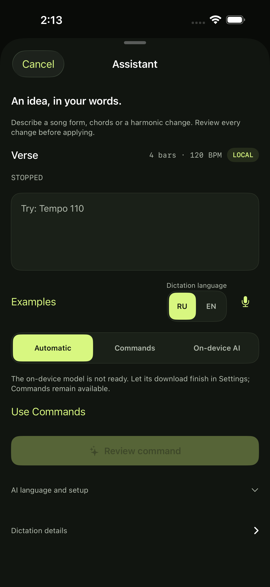
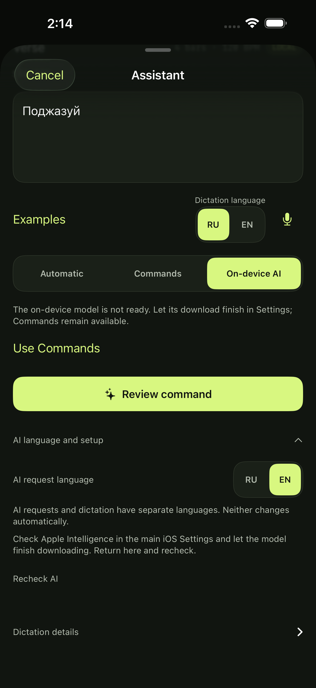
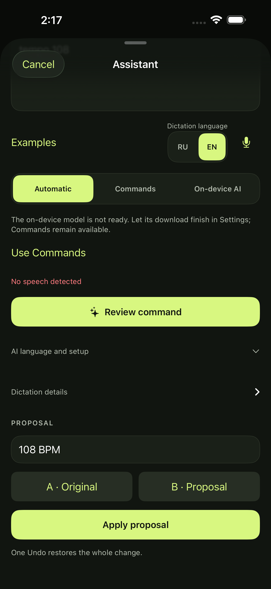

# Помощник · нативные сценарии build 17

Оригинальные кадры **1.0.0 (17), schema 8**, source `5adbadb37c39911c4acc2c2ef511198867098040`, iPhone 16 Pro Max Simulator. [Запуск 43876565702, attempt 2](https://github.com/alexgazin/la-grilla/actions/runs/43876565702/attempts/2) завершился **7 PASS, 0 FAIL, 0 SKIP** за 379.622 s. Каждый PNG просмотрен отдельно и скопирован без изменения пикселей.

| Основной ввод | Раскрытые настройки ИИ | Проверка команды после диктовки |
| --- | --- | --- |
|  |  |  |

Это реальные экраны приложения, без принудительного визуального preview. Первый кадр показывает основной ввод и свёрнутые настройки ИИ. Второй — раскрытые настройки, отдельные языки AI EN / диктовка RU, сохранённую команду «Поджазуй» и настоящую причину `modelNotReady`. Метод затем проверил локальный diff C → Cmaj9, Apply и Undo; генерация языковой моделью здесь не заявляется.

В третьем сценарии приняты настоящие системные разрешения микрофона и Speech. Контроллер получил **521237 реальных PCM frames**; музыкальная петля дала честное `No speech detected` (1110). После этого в том же Assistant проверены набранная команда `tempo 108`, реальное предложение 108 BPM, Apply и Undo. На кадре виден review; поле ввода находится выше текущей позиции прокрутки. Успешное распознавание человеческой речи не заявляется.

Отдельный тест записал настоящий CAF через host HAL и проверил завершение input-графа: прежний I/O engine остановлен, новый граф не содержит input node, работает один граф, DSP kernel / sample rate / MIDI сохранены, clock продолжил движение. Измеренные паузы I/O сохранены в receipt; отсутствие слышимых разрывов и системный индикатор на физическом телефоне отдельно не подтверждены.

[Манифест](manifest.json) содержит источник, исходные native attachment names, методы, timestamps, размеры и SHA-256. [Проверка и исходные факты](verification.json), [Speech receipt](speech-observation.txt), [CAF / retirement receipt](retirement-caf-observation.txt), [transport после Speech](post-speech-transport.txt) и [локальная гармония / recheck](ai-recheck-scope.txt) сохраняют происхождение. Нативные text receipts также скопированы без изменений.
