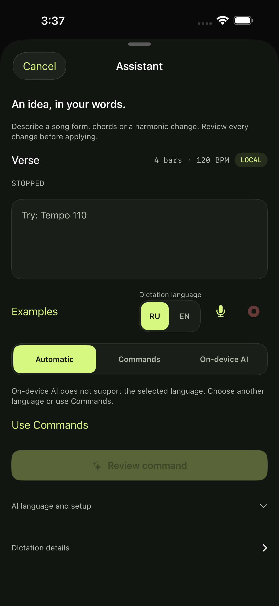

# Помощник23 — отдельные Start и Stop

Неизменённый оригинальный PNG работающего приложения: [`7564fe7`](https://github.com/alexgazin/la-grilla/commit/7564fe7eff86cf6fbec1caab02d152fb1741c7d2), [run44112860068, attempt1](https://github.com/alexgazin/la-grilla/actions/runs/44112860068/attempts/1), [исходный artifact14344395820](https://github.com/alexgazin/la-grilla/actions/runs/44112860068/artifacts/14344395820). Кнопка микрофона начинает диктовку, отдельный квадрат Stop останавливает её и не запускает новую запись после автоокончания.

Метод-владелец `AIAvailabilityTests/testActualUnavailableModelRecheckPreservesIndependentLanguagesInputAndProject` — **PASS, 43.305s**. Все четыре обязательных Assistant-сценария этого focused-запуска прошли: exit0, без allowance и общего timeout. Scope — `input-diagnostic`, fullAcceptance=false; это не полный native73 и не приёмка телефона.

На кадре видны исходный RU язык диктовки и фактическая подсказка о неподдерживаемом языке запроса ИИ. Весь сценарий отдельно выбирает EN для AI и подтверждает настоящий `available`, не меняя язык диктовки, запрос или музыку. Генерация реальной моделью здесь не выполнялась; глобальная недоступность модели не заявляется.

Размер1320×2868, **226902байта**, SHA-256 `74d4f125a594d12beb74c3c4e79993234e4b65d5de41d5d4885da7abb48853e8`. [Происхождение, исходное имя attachment и контрольная сумма](provenance.json). Новая запись видео не создавалась.
