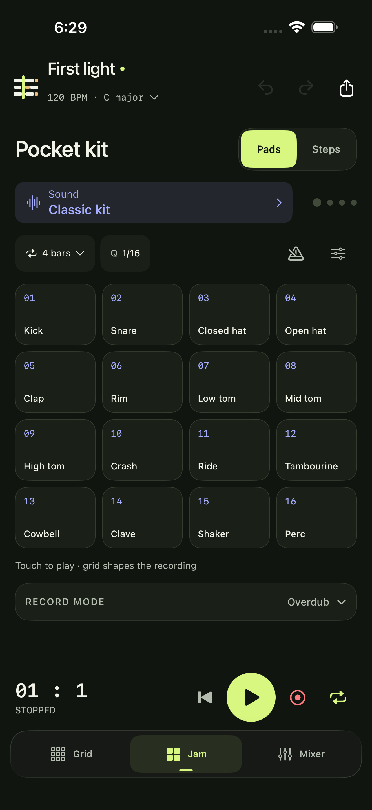

# Пэды23 — прошедший настоящий контакт

Неизменённый оригинальный PNG работающей сборки source `8bc7866`, [run44140208148](https://github.com/alexgazin/la-grilla/actions/runs/44140208148),attempt1, [bundle14360221600](https://github.com/alexgazin/la-grilla/actions/runs/44140208148/artifacts/14360221600). Здесь видны пэды, кнопка Sound/Classic kit и квантование записи.

Владелец `PadTouchUITests/testContactEnqueuesBeforeReleaseAndHoldDoesNotRetrigger` — **PASS13.483s**: выполнены реальный1.2s контакт, accepted1/held0/timing>0.8, следующий tapaccepted2 и завершение приложения. Сразу предшествующий полный сценарий перестановки/удаления секций завершился настоящим Stop и PASS83.255s.

Весь native run остаётся **71 PASS / 2 FAIL из73**, с общим timeout; это не полный PASS и не измерение задержки пальца/акустики на iPhone. Сбои наблюдения grid проверяются отдельно. Стандартный exporter не завершился из-за прерванного xcresult; payload извлечён напрямую из оригинальных Data по точной цепочке passed ActionTestSummary→public.png attachment→payloadRef. [Исходные member IDs, hashes и владение](provenance.json).

Размер1320×2868,261097bytes,SHA-256 `708bdb8a4d1687c4746872254afedd5023801ba3f7eb930c10002fdb2750e3f9`. Байты не редактировались. Новая запись видео не создавалась.
