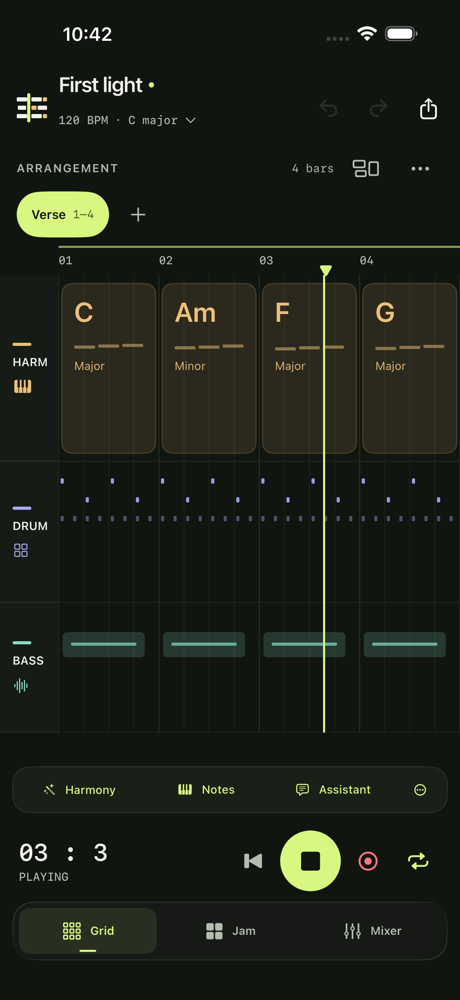
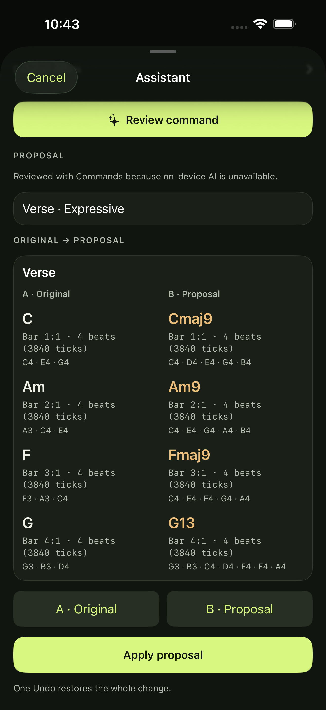
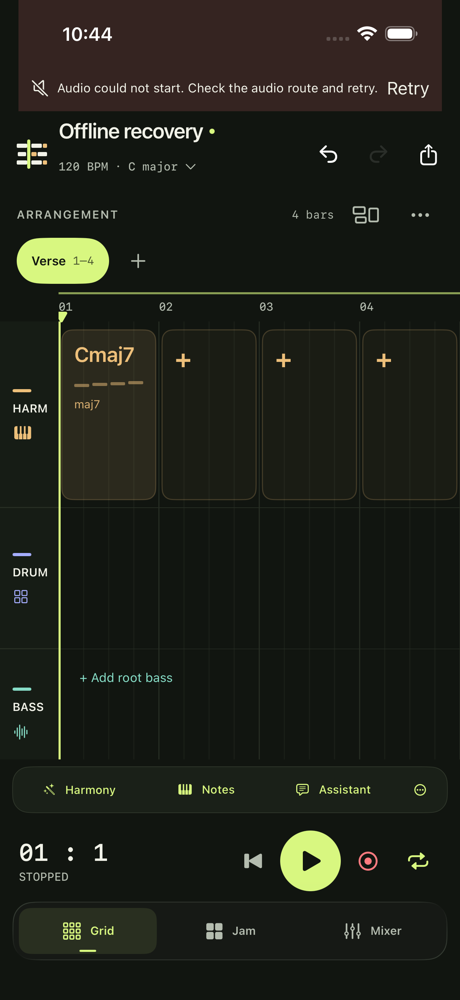

# Device repair verification — build 16

Five original XCTest screenshots from [run 43845748716, attempt 2](https://github.com/alexgazin/la-grilla/actions/runs/43845748716/attempts/2), source `27cbf09a0d6266d728df9fef889d2caa94ee0c8b`. The complete native job passed **8 tests, 0 failures, 0 skips** on the iPhone 16 Pro Max Simulator, iOS 26.2, with Xcode 26.3.

Each image was reviewed individually and copied without pixel changes. [manifest.json](manifest.json) records the original attachment, owning passing test, source, run, artifact, timestamp, dimensions, byte count and SHA-256. All five native attachments have `isAssociatedWithFailure: false`. The downloaded [artifact](https://github.com/alexgazin/la-grilla/actions/runs/43845748716/artifacts/14217069719) was verified against its published byte count and SHA-256.

<table>
  <tr>
    <td align="center" valign="top"><strong>Output-only playback</strong> Actual Simulator graph  </td>
    <td align="center" valign="top"><strong>Local harmony review</strong> Model unavailable; Commands works  </td>
    <td align="center" valign="top"><strong>Project remains editable</strong> Explicit QA audio-failure injection  </td>
  </tr>
</table>

| Screenshot | What the native test established |
| --- | --- |
| [Dictation denial and typed tempo review](01-dictation-denied-typed-tempo-review.png) | The actual Apple Speech Recognition permission prompt was denied. The process stayed alive, explained the denial, and successfully reviewed, applied and undid a typed `tempo 108` command. This does not establish transcription quality. |
| [Output-only playback](02-output-only-grid-playing.png) | An actual output-only graph kept the same kernel and an advancing callback clock while navigating Grid, Jam and Mixer. Its trace reports `inputPriming=outputOnly`, `inputPrimed=false`, `actualPlaying=1` and `error=none`. No PCM was injected into this graph. |
| [Unavailable AI: Commands preserves input](03-unavailable-ai-commands-preserve-input.png) | A genuine unavailable-model explanation led to Commands mode without losing the original free-form text. The unsupported free-form request was not applied. |
| [Local harmony review](04-unavailable-ai-local-harmony-review.png) | A supported command used the real local parser with a visible fallback notice: C → Cmaj9, Am → Am9, F → Fmaj9, G → G13. Apply and Undo passed. This is local command processing, without model inference. |
| [Project editing during injected audio failure](05-injected-audio-failure-project-edit.png) | Explicit `--audio-unavailable` QA fault injection left editing usable behind a nonmodal banner. A new blank project was created, Cmaj7 was saved, and a fresh Session reopened the real stored project and chord. |

The fault-injection test also passed its actual system MIDI-share UI assertions. Its separately captured share frame only showed a dimmed Grid during presentation, so that frame is **excluded from this gallery**. Its original artifact member and hash remain in `rejectedAttachments` in the manifest; none of these images claims to show the MIDI share sheet.

The three existing strict native audio tests also passed with actual host HAL/input PCM required. Their receipts preserve measured callback gaps; the result does not establish dropout-free physical audio. All images use English UI; the AI example fields contain Russian text.

These are Simulator regression results. The reported physical iPhone audio failure, device routing, microphone indicator behavior, latency, human singing and on-device AI still require separate device acceptance. This set must not be relabelled as evidence from a later source revision.
