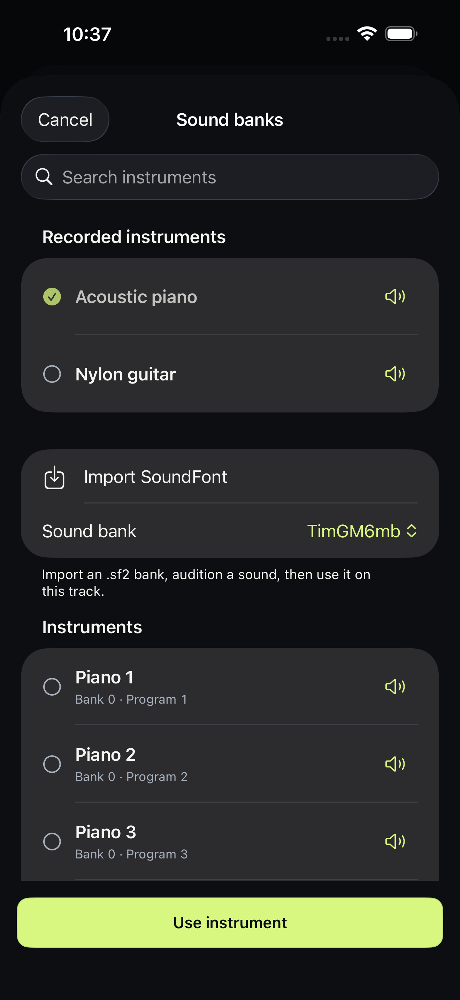
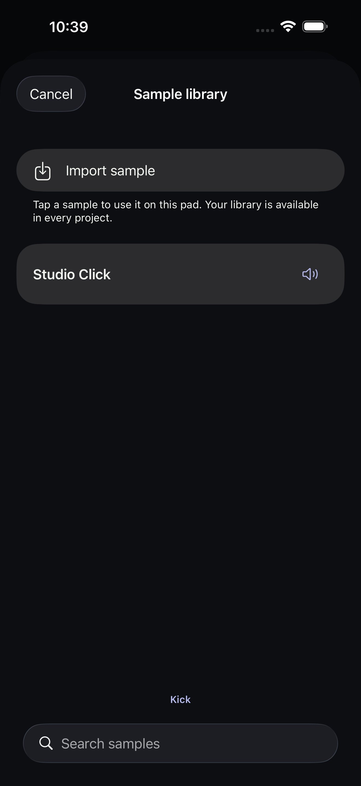
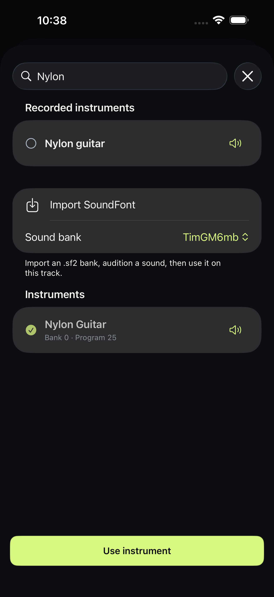

# Живые инструменты и общая библиотека

Неизменённые PNG с iPhone 16 Pro Max Simulator, Night, 1320 × 2868. Экраны сняты в сборке 30. Исходник этих экранов и ресурсов вошёл в сборку 31. Все пять сценариев прошли в [проверке сборки 30](https://github.com/alexgazin/la-grilla/actions/runs/44285511183/attempts/1).

| Записанные инструменты | Библиотека пэда | Поиск SoundFont |
| --- | --- | --- |
|  |  |  |

[Контрольные суммы и тесты-владельцы](provenance.json) · [Руководство по звуку](../../docs/SONG_FORM_AND_SOUND_BANKS.md)
