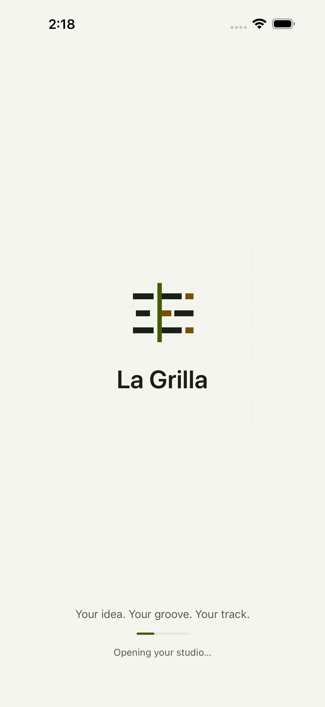
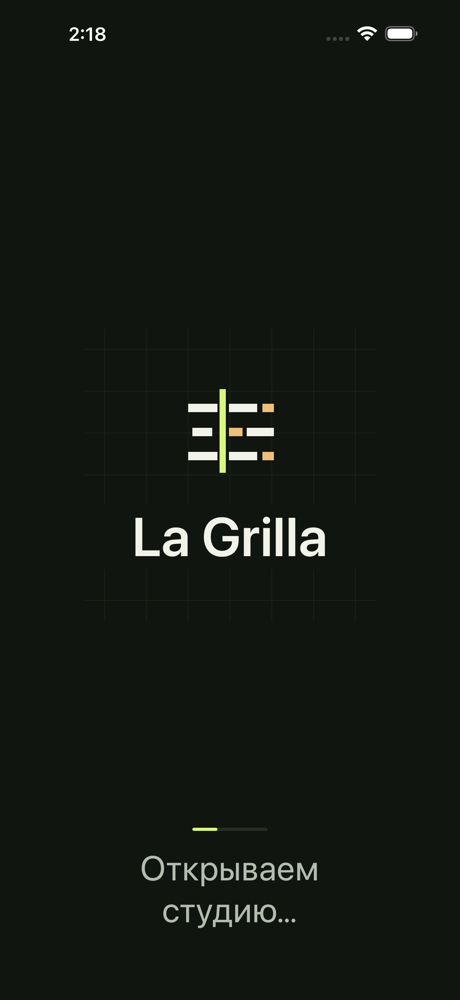

# Сплеш La Grilla · нативное QA-превью

Три оригинальных PNG **1.0.0 (17), schema 8**, source `5adbadb37c39911c4acc2c2ef511198867098040`, iPhone 16 Pro Max Simulator, 1320 × 2868. Байты сохранены без ресайза, ретуши и генерации.

| Тёмная тема · EN | Светлая тема · EN | Крупный текст · RU / Reduce Motion |
| --- | --- | --- |
|  |  |  |

Это тот же SwiftUI `AppStartView`, удержанный параметром `--uitesting --splash-preview` после настоящего bootstrap. Кадры показывают компонент загрузки, **не** системный статический launch screen и **не** длительность холодного запуска. В обычном приложении искусственного минимального ожидания нет. У RU-кадра Reduce Motion задан явным QA override; системное значение записано отдельно.

[Нативный запуск 43876565702, attempt 2](https://github.com/alexgazin/la-grilla/actions/runs/43876565702/attempts/2): **7 PASS, 0 FAIL, 0 SKIP**, 379.622 s. Метод `SplashScreenTests/testBrandedLoadingPreviewAndRealStartupPreserveOnboarding()` — **PASS, 45.749 s**; он также прошёл настоящий обычный запуск, Welcome → Skip и повторный запуск. Это проверка Simulator; физический iPhone и производительность холодного запуска отдельно не подтверждены.

Каждый кадр просмотрен: композиция помещается, текст не перекрывается; крупный русский статус переносится на две строки, слоган скрыт для размещения. [Манифест с SHA-256, исходными именами и связью с методом](manifest.json) и [неизменённый нативный receipt](native-observations.txt) сохраняют происхождение.
