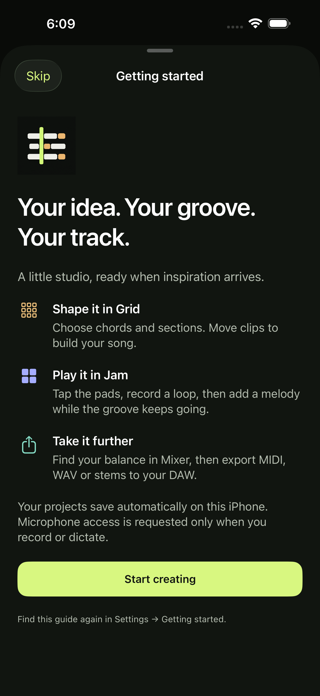
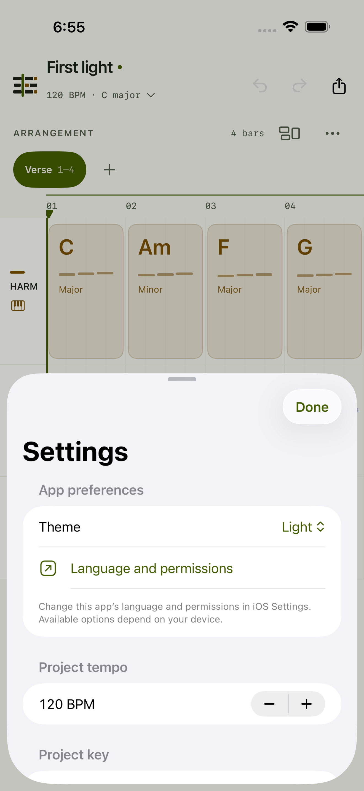
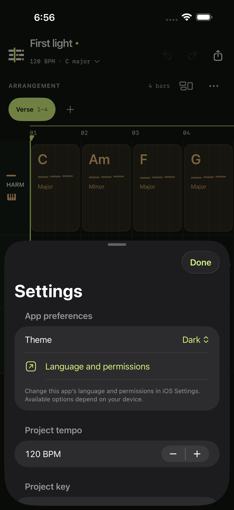

# Professional shell — accepted native screenshots

<table>
  <tr>
    <td align="center" valign="top"><strong>Getting started</strong> 838b4847 · English  </td>
    <td align="center" valign="top"><strong>Settings · Light</strong> 014a00b9 · English  </td>
    <td align="center" valign="top"><strong>Settings · Dark</strong> 014a00b9 · English  </td>
  </tr>
</table>

**Three unchanged original PNGs**, candidate **1.0.0 (15), schema 8**,
iPhone 16 Pro Max **Simulator**, English. Each is 1320×2868, opaque RGB8,
individually viewed and accepted. Click a screen to open its full original.
[manifest.json](manifest.json) records each file's own source SHA, run, artifact,
native attachment/test, timestamp, dimensions, byte count and SHA-256.
No pixels were rewritten, resized, retouched or replaced.

## Historical welcome / complete software verification

`welcome.png` remains source `838b4847c63d97f1ee57fd9a423e6489746603a4`,
[run 43812214574](https://github.com/alexgazin/la-grilla/actions/runs/43812214574).
It is byte-identical to original attachment
`NativeAttachments/main/ADF91E11-2C11-41C3-922B-BAB50D60468A.png`:
322708 bytes, SHA-256
`a5b5518a0c1ccc2060009a0a418dea5e0176ebc233a2b0f6fe5c536db2fffa52`.
The actual welcome method passed in **30.697 seconds**.

That source's three jobs succeeded: 118 Swift tests / 19 suites, 15 C++ suites,
623 EN/RU keys, 46 functional native tests passed, one opt-in diagnostic skipped.
Three bulk capture methods were intentionally not run under `[ui-only]`;
the welcome image is an ordinary functional-test attachment.
The complete verified [ios-verification ZIP](https://github.com/alexgazin/la-grilla/actions/runs/43812214574/artifacts/14202191969)
is 200085353 bytes, SHA-256
`be149878cbb87b48cccf19174ab79a71e314d419bd110263a8124548c2595ac6`.

## Correct light/dark Settings / focused verification

`settings-light.png` and `settings-dark.png` are source
`014a00b9d6069e55150ae1f794810216cea63be3`,
[run 43819149979](https://github.com/alexgazin/la-grilla/actions/runs/43819149979).
The `verify-shell` job passed **two focused native methods, zero failures**:

- `StudioTests/testAppThemePersistsAndSystemSettingsEntryIsReachable()` —
  **86.895 seconds**. Light selection, persisted Light after relaunch and Dark
  selection are checked against the actual presented Form's pixels. Each guard
  requires two consecutive matching background samples before preserving a frame.
- `StudioTests/testWelcomeCanBeSkippedAndReopenedWithoutRepeatingOnLaunch()` —
  **49.722 seconds**. Its newer welcome capture is not promoted here; the original
  accepted welcome above keeps its own source.

The selected Light/Dark value now matches the corresponding light/dark Form.
Both raw PNGs match their `ProfessionalShellAttachments` entries in the complete
verified [professional-shell-visual ZIP](https://github.com/alexgazin/la-grilla/actions/runs/43819149979/artifacts/14203764427):
64293458 bytes, SHA-256
`1a463005a6987e8d7259019a068a34cbdf594d54452e116c7a94b0b9dbaf9bf0`.
This is focused theme/guide verification; it is not a repeated full 46-test run.

Two earlier theme PNGs from `838b4847` were **rejected** for stale inverse Form
appearance and remain unpromoted. Original raw exports retain their
issue-description attachments. Each promoted PNG has
`isAssociatedWithFailure=false`; final method results come from the matching
verified logs. No issue-free or retry-free history is claimed.

New Russian, compact and large-type guide captures are still pending;
[OriginalVision](../OriginalVision) preserves its historical sources.
The separate [working-app recording](../../Media/WorkingDemo/README.md) is now
accepted media evidence: actual Simulator UI and same-session audio, 132.2 seconds,
15 sections and 36 disclosed intervals. Its original capture workflow
[43813957218](https://github.com/alexgazin/la-grilla/actions/runs/43813957218)
retains **FAILURE** for the post-roll guard; its **three native UI methods passed**,
and actual media coverage/alignment is verified separately. These PNG files do
not themselves establish video acceptance. The earlier
[motion promo](../../Media/Promo/README.md) remains a screenshot presentation
with a separate offline soundtrack.
Physical iPhone routes, real AI/human voice, signing, TestFlight and App Review
remain [open](../../docs/release/DEVICE_ACCEPTANCE.md).
