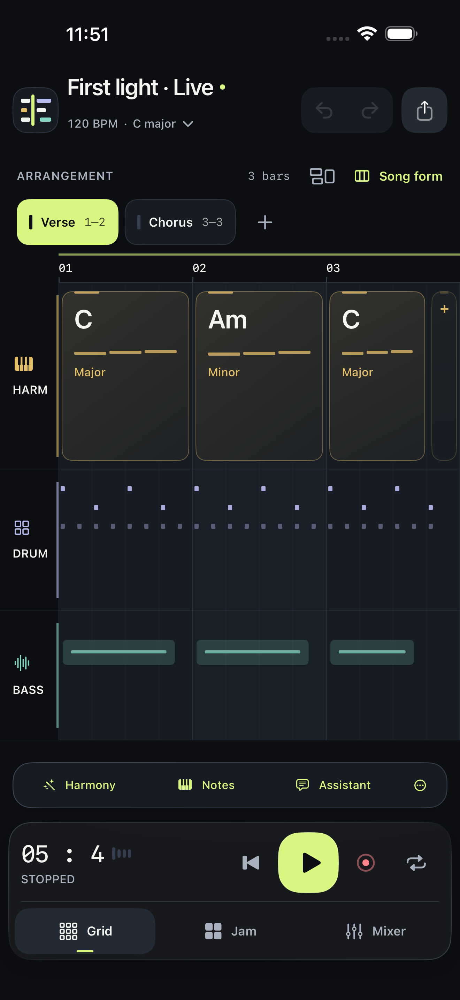

# Редактируемая песня из лайва

Оригинальный PNG сборки 31 на iPhone 16 Pro Max Simulator в ночной теме. В только что созданном проекте «First light · Live» видны записанные секции, аккорды и ритм. Исходный дубль остаётся в библиотеке проектов.

Кадр сделан сразу после открытия нового проекта. На индикаторе транспорта в этот момент видна позиция завершённого исполнения.

[Происхождение и контрольная сумма](provenance.json) · [Полный прогон 80 сценариев](https://github.com/alexgazin/la-grilla/actions/runs/44289170060/attempts/1)
