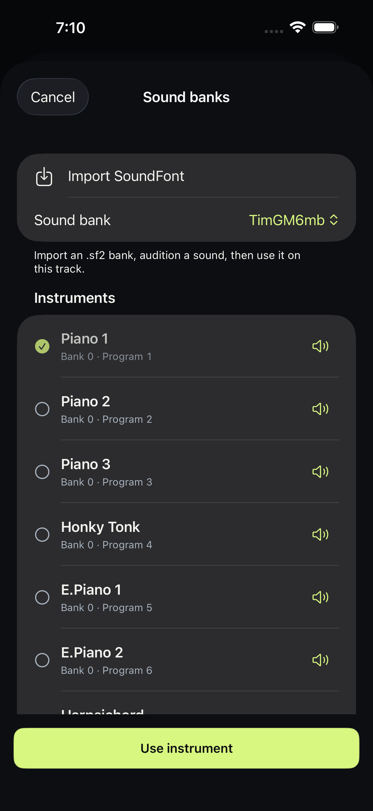
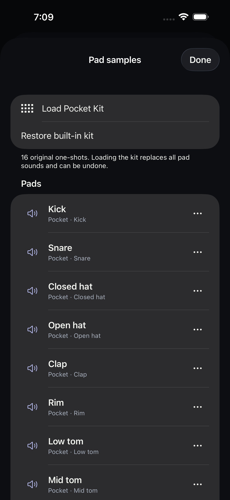

# Звуки La Grilla 28

Оригинальные PNG из работающего La Grilla на iPhone 16 Pro Max Simulator. Ночная тема, 1320 × 2868. [Нативный прогон](https://github.com/alexgazin/la-grilla/actions/runs/44255310891/attempts/1)

| Выбор инструмента | Сэмплы пэдов |
| --- | --- |
|  |  |

Прошли установка набора, Undo/Redo, перезапуск проекта, назначение Piano 1 и подтверждение нового состояния аудиоядра. Отдельный сценарий подтвердил, что предпрослушивание сохраняет идущий луп. Идентификаторы тестов, размеры и SHA-256 оригиналов есть в [provenance.json](provenance.json).

[Звуковые настройки и форматы](../../docs/SONG_FORM_AND_SOUND_BANKS.md) · [Тестовая IPA](../../Builds/Testing/README.md)
