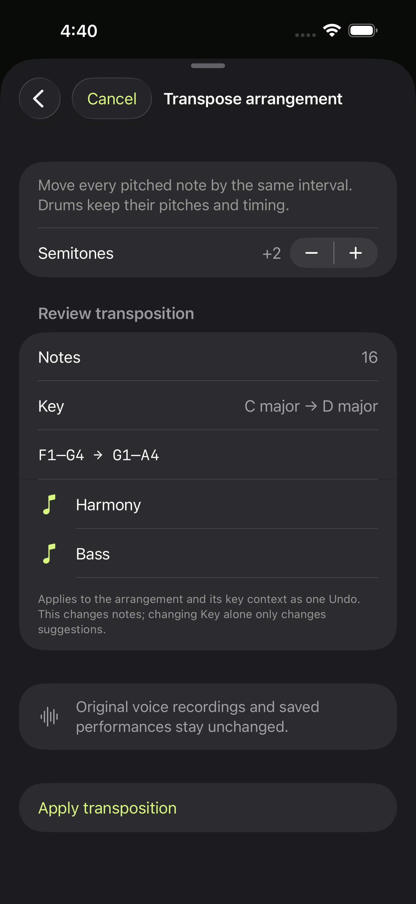
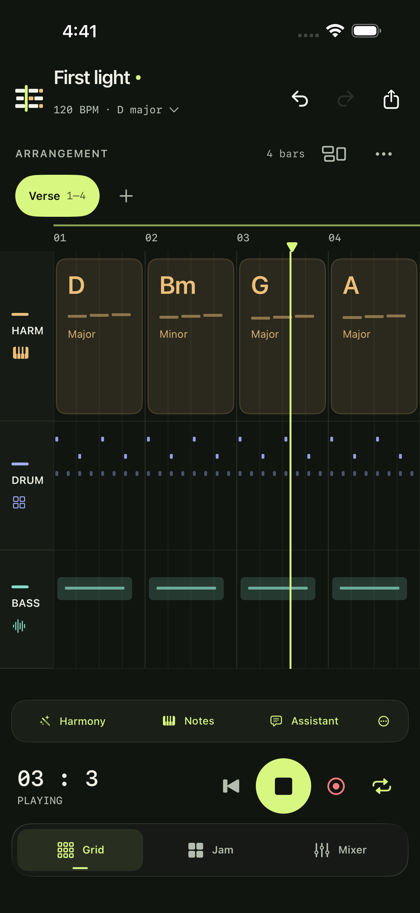

# Транспонирование — оригинальные кадры сборки19

Два неизменённых PNG из работающего iPhone16ProMax Simulator, iOS26.2/Xcode26.3. Source `4e85930acf006376f3861d4209bf07ea8bcdcaf0`, [run43906210190](https://github.com/alexgazin/la-grilla/actions/runs/43906210190), attempt1.

Оба принадлежат **PASS** методу `TranspositionUITests/testTransposePreviewCancelApplyLiveUndoRedoAndReopen` —66.046s. Весь focused run не принят: **14PASS/1assertionFAIL/1execution-allowance timeout**. Это отдельный source19, не приёмка20.

| Предпросмотр +2 полутона | Применено во время воспроизведения |
| --- | --- |
|  |  |

Метод проверил Cancel, применение, принятый DSP generation/clock/output meter, Undo/Redo и повторное открытие того же реального проекта. Акустическая частота и физический iPhone этим не измерены. [Манифест](manifest.json) сохраняет исходные имена вложений, владельца, timestamps, размеры и SHA-256. Пиксели не редактировались; оба кадра просмотрены отдельно.
